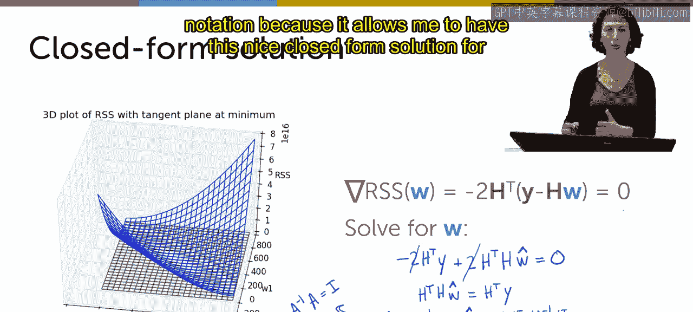

# 机器学习：回归：2.3：方法一：闭式解 📐

在本节中，我们将学习求解多元线性回归模型参数的第一种方法——闭式解。我们将通过矩阵运算，直接推导出最优参数 **W** 的计算公式。

上一节我们介绍了用矩阵形式表示残差平方和。本节中，我们来看看如何通过求导并令其为零，来找到使残差平方和最小的参数 **W**。

## 推导闭式解

我们的目标是找到参数 **W**，使得残差平方和（RSS）的梯度为零。梯度公式如下：

\[
\nabla RSS(\mathbf{W}) = -2\mathbf{H}^T\mathbf{y} + 2\mathbf{H}^T\mathbf{H}\mathbf{W}
\]

为了找到最小值点，我们将梯度设为零并求解 **W**：

\[
-2\mathbf{H}^T\mathbf{y} + 2\mathbf{H}^T\mathbf{H}\mathbf{W} = 0
\]

首先，两边同时除以 2，简化方程：

\[
-\mathbf{H}^T\mathbf{y} + \mathbf{H}^T\mathbf{H}\mathbf{W} = 0
\]

接着，将 \(-\mathbf{H}^T\mathbf{y}\) 项移到等式右边：

\[
\mathbf{H}^T\mathbf{H}\mathbf{W} = \mathbf{H}^T\mathbf{y}
\]

现在，为了解出 **W**，我们需要在等式两边同时左乘矩阵 \(\mathbf{H}^T\mathbf{H}\) 的逆矩阵 \((\mathbf{H}^T\mathbf{H})^{-1}\)：

\[
(\mathbf{H}^T\mathbf{H})^{-1} (\mathbf{H}^T\mathbf{H}) \mathbf{W} = (\mathbf{H}^T\mathbf{H})^{-1} \mathbf{H}^T\mathbf{y}
\]

根据矩阵逆的定义，一个矩阵与其逆矩阵相乘得到单位矩阵 **I**。同时，单位矩阵乘以任何向量都得到该向量本身。因此，等式左边简化为 **W**。

于是，我们得到了参数 **W** 的估计值 \(\hat{\mathbf{W}}\) 的闭式解：

\[
\hat{\mathbf{W}} = (\mathbf{H}^T\mathbf{H})^{-1} \mathbf{H}^T \mathbf{y}
\]

这个公式非常强大，它通过一次矩阵运算，同时求出了从 \(w_0\) 到 \(w_D\) 的所有回归系数。

## 公式的意义与优势

以下是这个闭式解公式的几个关键点：

*   **简洁性**：它将求解多个参数的问题，压缩成了一个简洁的矩阵方程。
*   **高效性**：对于中小型数据集，可以直接通过数值计算库（如 `numpy.linalg.inv`）快速计算出结果。
*   **理论保障**：在矩阵 \(\mathbf{H}^T\mathbf{H}\) 可逆（即满秩）的条件下，该解是使得残差平方和全局最小的唯一解。

这也解释了为什么我们要不厌其烦地将问题转化为矩阵形式——它使得推导和计算都变得异常清晰和紧凑。

## 总结

本节课中我们一起学习了求解多元线性回归参数的**闭式解法**。我们通过设置梯度为零，推导出了核心公式 \(\hat{\mathbf{W}} = (\mathbf{H}^T\mathbf{H})^{-1} \mathbf{H}^T \mathbf{y}\)。这个方法在数学上非常优雅，并能一次性计算出所有参数的最优估计值。