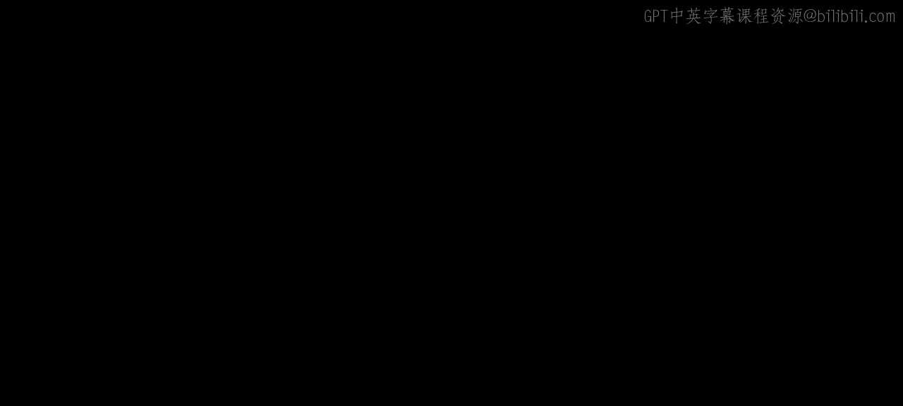
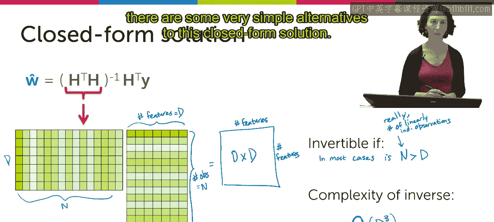

# 华盛顿大学《机器学习（回归，第2课⧸共4课）｜Machine Learning》中英字幕 p44 44_讨论闭式解.zh_en -BV11b421H7XL_p44-

。

Okay， so let's think a little bit about this form of this closed form solution and what we see is we have this H transpose H inverse and let's talk about that a little bit more。

 remember H was that big green matrix。 It's the matrix of all the features for each one of our observations。

So each row is a different observation， and we have that matrix。

 and we're pre multiultplying by the transpose where we take it and set it on its side。

So this inner part here is this green matrix on its side times the regular green matrix。

And what's the result of that multiplication， Well remember？How many rows are there？To this matrix。

Well， they're。However， many observations we have in our data， which is n， capital N。

 that's how many rows there are and how many columns。Well， it's however many features we're using。

And what's our notation for that， that's just capital D。Okay， so if we multiply these two matrices。

 so in contrast when I take the transpose。I have n columns and D rows。

And the result of multiplying a D by n matrix by an N by D matrix is just a D by D matrix。

So it's a square matrix that's。D rose by D columns。So。Let me be a little bit more explicit。

 number of features by number of features。And then we need to take the inverse of this matrix。

So that's going to be invertible。 This resulting matrix is going to be invertible in general。

So I'll say in most cases。If the number of observations we have is larger than the number of features。

that means that this matrix is full rank and then we can take its inverse。嗯。

If you don't know what full rank is that's perfectly fine for this course。

 but if you do that's what we're referring to here and what I say in most cases is because there's a little caveat where。

Really， it's just。What we need is we need to make sure it's not just the number of observations that we have that are greater than the number of features。

We need to make sure that the number。Of linearly independent。Observations。So I should say really。

 instead of capital N， it's the number of linearly independent observations that needs to be greater than。

The number of features。 and again， if that didn't make sense to you， that's actually fine。

 just think about the fact and we'll talk about it a lot in this course in later modules that this matrix might not be invertible。

Okay。What's the complexity of the inverse， though， Let's assume that we can actually invert this matrix。

 Well， the complexity it' often noted with this big O notations。

 I'm writing a big O just the letter O number of features cubed。

And what that means is that the number of operations we have to do to invert this matrix scales cubically with the number of features in our model。

Okay， so if you have lots and lots and lots and lots of features， this can be really， really。

 really computationally intensive to do， so computationally intensive that it might actually be computationally impossible to do。

So especially if we're looking at applications with lots and lots of features。And again。

 assuming we have more observations still than these number of features。

 we're going to want to use some other solution than forming this big matrix and taking its inverse。

 even though there are actually some really fancy ways of doing this matrix inverse and so know that those fancy ways exist but still there are some very simple alternatives to this closed form solution。

。