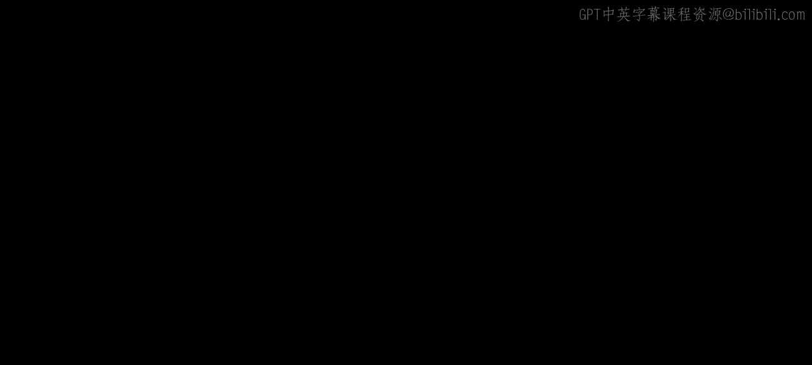
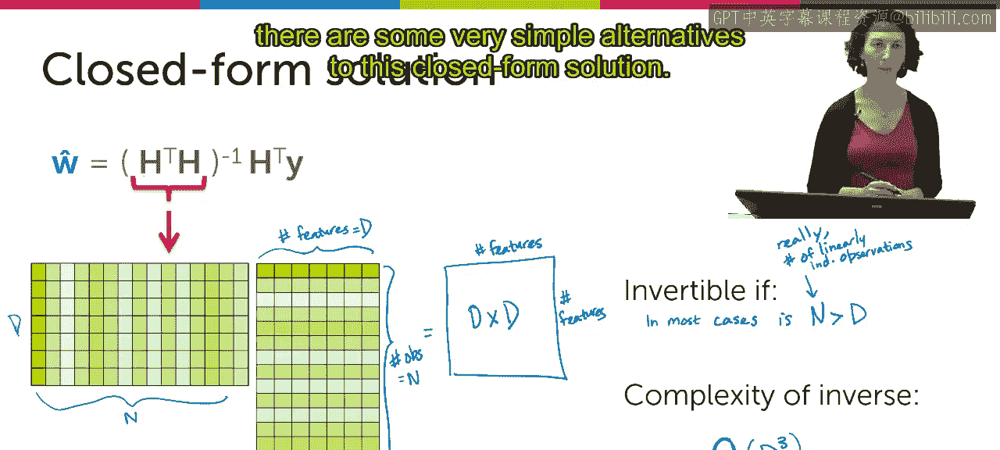

# 机器学习：第2课：讨论闭式解

在本节课中，我们将深入探讨线性回归的闭式解公式，分析其构成、计算复杂性以及在实际应用中的一些注意事项。我们将重点关注公式中的核心矩阵运算及其含义。

---

## 闭式解公式回顾

上一节我们介绍了线性回归的闭式解公式。其核心形式如下：

**公式：** `w = (H^T * H)^(-1) * H^T * y`

其中：
*   `w` 是我们要求解的权重向量。
*   `H` 是设计矩阵，包含了所有观测数据的所有特征。
*   `y` 是目标值向量。

## 深入分析 (H^T * H)^(-1)

现在，让我们仔细看看公式中的 `(H^T * H)^(-1)` 部分。

### 矩阵 H 的维度

首先，回顾一下设计矩阵 `H` 的构成。它是一个大型矩阵，每一行代表一个独立的观测数据，每一列代表一个特征。

*   假设我们有 `N` 个观测数据（样本数）。
*   假设我们有 `D` 个特征。

那么，矩阵 `H` 的维度就是 **N 行 × D 列**。

### 矩阵乘法的结果

当我们计算 `H^T * H` 时：
*   `H^T`（H的转置）的维度是 **D 行 × N 列**。
*   `H` 的维度是 **N 行 × D 列**。

根据矩阵乘法规则，一个 D×N 的矩阵乘以一个 N×D 的矩阵，结果是一个 **D × D** 的方阵。也就是说，结果矩阵的行数和列数都等于特征的数量 `D`。

### 矩阵的可逆性

接下来，我们需要对这个 D×D 的方阵求逆，即计算 `(H^T * H)^(-1)`。

这个矩阵在**大多数情况下**是可逆的。一个关键条件是：**线性独立的观测数据数量必须大于特征的数量 `D`**。

*   **简单理解**：通常，只要我们的样本数量 `N` 显著大于特征数量 `D`，这个条件就能满足，矩阵就是可逆的。
*   **深入说明**：严格来说，需要的不是简单的 `N > D`，而是“线性独立的观测数据”数量大于 `D`。如果某些观测数据是其他数据的线性组合，它们可能不增加新的信息。不过在本课程中，我们通常假设数据满足可逆条件。如果矩阵不可逆，我们会后续讨论其他处理方法。

## 计算复杂度分析

假设 `(H^T * H)` 矩阵是可逆的，我们来分析计算其逆矩阵的计算成本。

计算一个 D×D 矩阵的逆，其时间复杂度通常用大O符号表示为 **O(D^3)**。

**这意味着：**
计算所需的基本操作次数，与特征数量 `D` 的三次方成正比。例如，如果特征数量翻倍，计算量大约增加到原来的 8 倍。

### 对实际应用的影响

这种立方级的复杂度增长，在特征数量非常多（例如成千上万甚至更多）时，会带来严峻的挑战：

1.  **计算强度极高**：求逆运算会变得非常缓慢，消耗大量的计算资源（CPU时间和内存）。
2.  **可能无法计算**：在极端情况下，由于计算资源或时间的限制，直接求逆在实际上可能是“不可能”完成的任务。

因此，虽然闭式解在数学上非常优雅和精确，但在处理大规模、高维度的数据（即特征数 `D` 很大）时，直接使用这个公式可能并不可行。

## 替代方案简介

正是由于直接计算闭式解可能面临计算复杂度的挑战，在实际的机器学习应用中，我们通常会采用其他优化算法来求解权重 `w`，例如：

*   **梯度下降法**：一种迭代优化算法，通过逐步调整参数来最小化损失函数，特别适合大规模数据集。
*   **随机梯度下降法**：梯度下降的高效变体，每次迭代只使用一个或一小批样本，速度更快。

这些迭代方法避免了直接计算大型矩阵的逆，从而能够高效地处理海量特征和样本的数据。尽管闭式解存在快速计算逆矩阵的优化算法，但这些简单的迭代替代方案在实践中更为常用和灵活。

---

## 本节课总结

在本节课中，我们一起学习了：

1.  深入剖析了线性回归闭式解 `w = (H^T * H)^(-1) * H^T * y` 的核心部分。
2.  明确了设计矩阵 `H` 的维度（N×D），以及 `H^T * H` 运算后得到一个 D×D 的方阵。
3.  讨论了 `(H^T * H)` 矩阵可逆的条件：线性独立的观测数需大于特征数 `D`。
4.  重点分析了闭式解的主要计算瓶颈：求逆运算的时间复杂度为 **O(D^3)**。这意味着当特征数量很大时，计算会变得异常昂贵甚至不可行。
5.  引出了在实际应用中，面对高维数据时，我们需要使用如梯度下降等迭代算法作为闭式解的替代方案。

理解闭式解的优点和局限性，能帮助我们在不同场景下选择合适的模型训练方法。