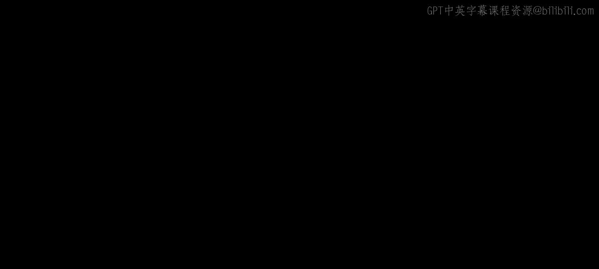
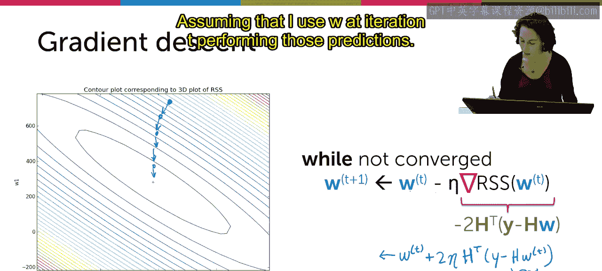
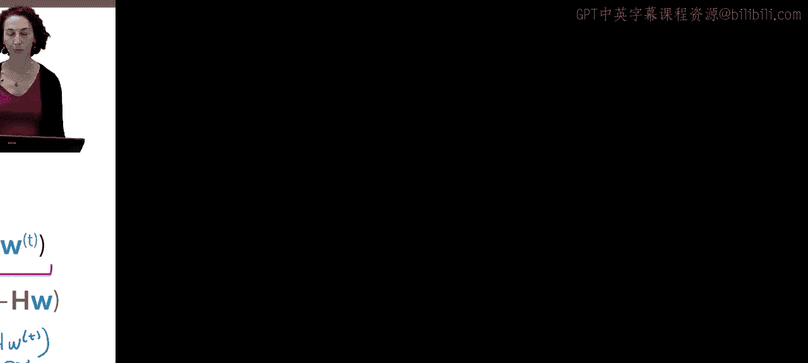
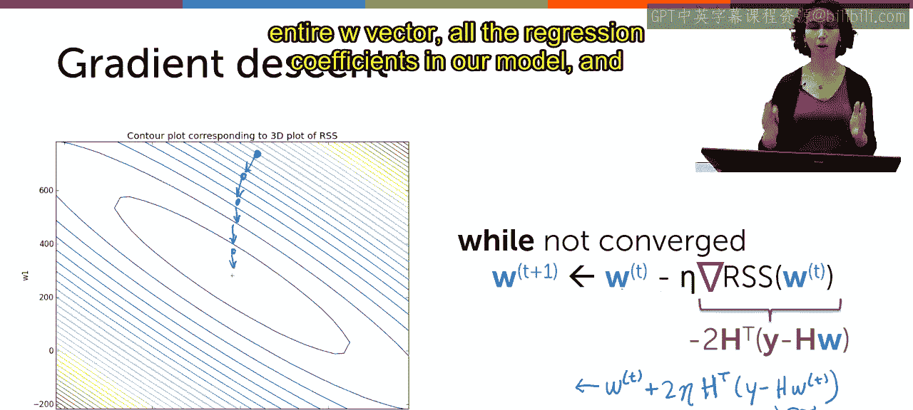

# 华盛顿大学《机器学习（回归，第2课⧸共4课）｜Machine Learning》中英字幕 p45 45_方法2：梯度下降.zh_en -BV11b421H7XL_p45-

。

So this simple alternative approach is gradient descent。

Where remember that the gradient descent algorithm。

 we just initialize our vector of parameters somewhere。And take these steps， these gradient steps。

And eventually。We will converge to the optimum of this problem。

Okay so what does this algorithm look like for multiple regression Well it looks very similar to our simple linear regression where we say while not converge。

 we're going to take our W parameters and we're going to update them by subtracting some step size eta times the gradient of our residual sum of squares at our previous set of parameters Wt so what is our residual sum of squares or sorry the gradient of the residual sum of squares I'm writing right here。

 so this update is W at iteration T。There the minus sign and this minus sign will turn into a plus sign。

2 ada。Times this H matrix H。Transpose y minus HW at iteration T。And what is this here？Well。

 H times W it iteration T is my predicted set of observations， the whole vector of them。

Assuming that I use W Ed iteration T for forming those predictions。

Okay， so what this version of the algorithm is doing is it's taking our entire W vector。

 all the regression coefficients in our model and updating them all at once using this matrix notation shown here。

