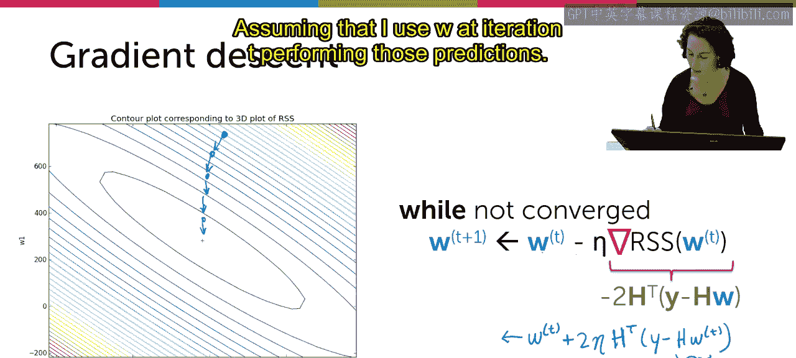
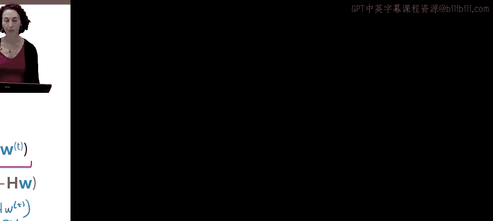
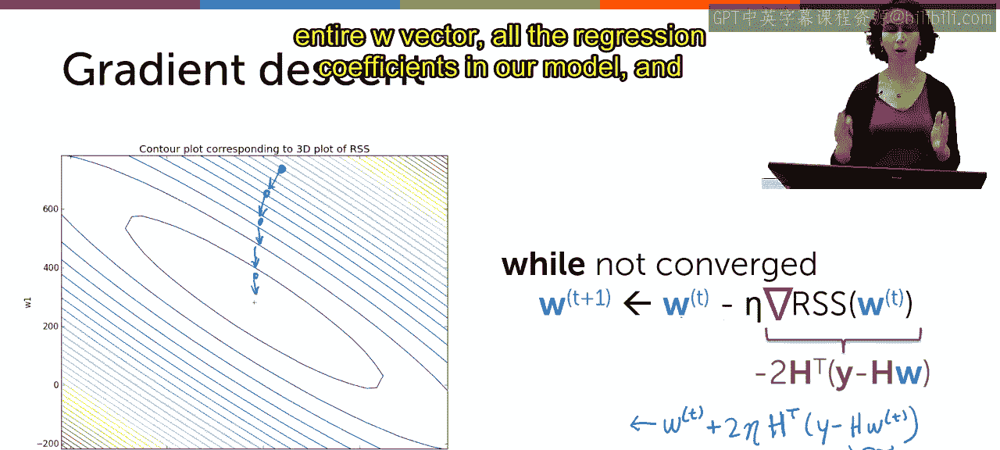

# 机器学习：回归：第2课：方法2：梯度下降


在本节课中，我们将学习用于求解多元线性回归问题的第二种核心方法：梯度下降法。我们将了解其基本思想、更新公式，并理解它如何通过迭代的方式找到最优参数。

## 概述

上一节我们介绍了通过解析解（正规方程）来求解多元线性回归问题。本节中，我们来看看另一种强大的迭代优化方法——梯度下降法。这种方法通过不断沿着目标函数（残差平方和）梯度的反方向更新参数，逐步逼近最优解。

## 梯度下降算法原理

梯度下降是一种通用的优化算法。其核心思想是：首先随机初始化参数向量，然后反复沿着目标函数下降最快的方向（即负梯度方向）迈出一步，最终收敛到问题的最优解。

对于多元线性回归，我们的目标是最小化残差平方和（RSS）。梯度下降算法会迭代地更新参数向量 **W**。

以下是梯度下降算法的通用更新步骤：

```python
while not converged:
    W_new = W_old - eta * gradient(RSS(W_old))
```

其中，`eta` 是学习率（步长），`gradient(RSS(W_old))` 是在当前参数 `W_old` 处计算的 RSS 梯度。

## 多元线性回归的梯度下降

对于多元线性回归，梯度下降的更新公式具有特定的矩阵形式。

具体更新规则如下：

**W_t+1 = W_t - 2η * H^T (y - H W_t)**

让我们来解析这个公式：
*   **W_t**：第 `t` 次迭代时的参数向量。
*   **η**：学习率，控制每次更新的步长。
*   **H**：设计矩阵，包含所有观测的特征数据。
*   **y**：观测值的真实向量。
*   **H W_t**：使用当前参数 `W_t` 对所有观测值做出的预测向量。
*   **(y - H W_t)**：当前预测的残差向量。



这个公式的意义在于，它同时更新模型中的所有回归系数（即整个 **W** 向量）。更新方向由设计矩阵 **H** 的转置与当前残差向量的乘积决定。



## 算法步骤总结

本节课中我们一起学习了梯度下降法在多元线性回归中的应用。

1.  **初始化**：随机选择一组初始参数 **W**。
2.  **迭代更新**：重复应用更新公式 **W = W - 2η * H^T (y - H W)**，直到参数收敛（即变化非常小）或达到预设的迭代次数。
3.  **输出**：最终得到的 **W** 即为模型学到的回归系数。



这种方法通过迭代避免了直接求解大型矩阵的逆，在处理特征维度非常高或数据量极大时可能更具计算优势。