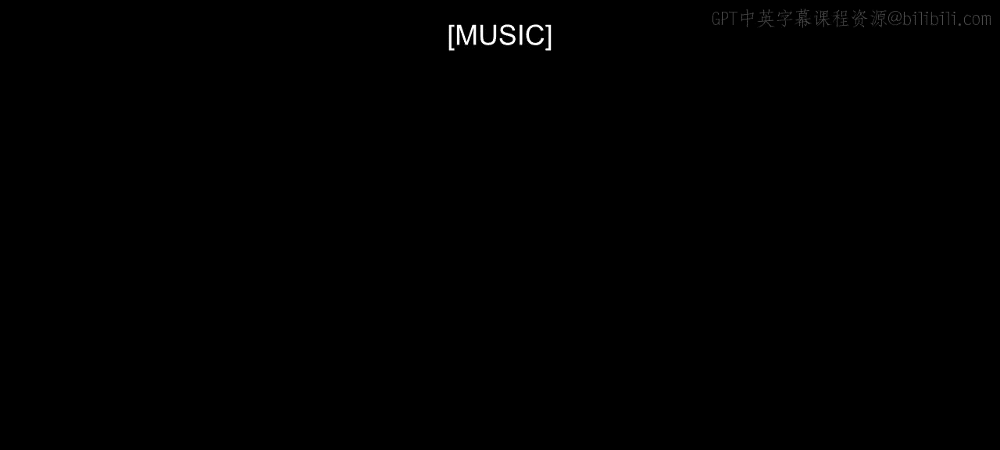
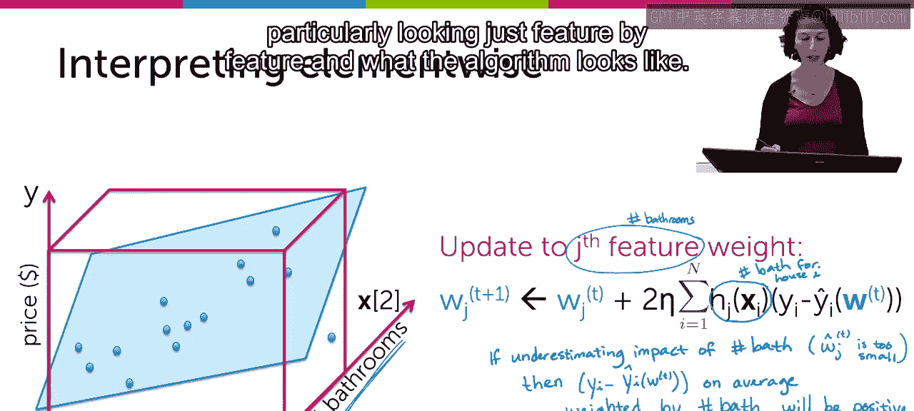
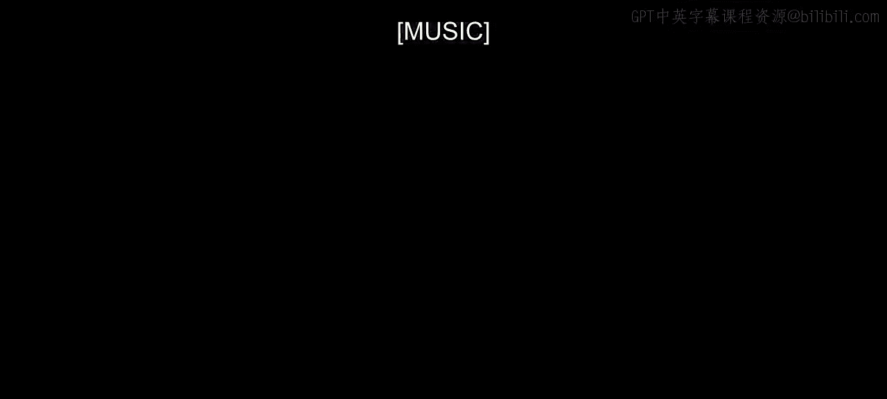

# 华盛顿大学《机器学习（回归，第2课⧸共4课）｜Machine Learning》中英字幕 p46 46_逐特征更新.zh_en -BV11b421H7XL_p46-

。

But instead， let's think about the update just to a single feature and think about what that looks like and give some intuition for why the update has this form。

 so let's go through and derive what the update is just for a single feature。

 of course we could go to this matrix notation and figure out what is the update for that J row but。

Let's go through。 it's a little bit simpler to go back to this form of our residual sum squares and drive it directly。

 So I'm just going to rewrite this more explicitly so that when we start taking derivatives it's easier to see what's going on so we have。

The sum。Over I equals12 n。 and we have Y I minus。 Now let's write out what this vector inner product is and what is it。

 Well， it's simply our fit。 So we have w0 times h0 of X I。Minus W1， H1 of X。Minus all the way to。

Sorry， our last feature。W capital D， H capital D of X I。Squared。Okay。

 so remember when we're taking a gradient， well， what's the gradient it's just a vector of a bunch of partial。

Partials with respect to W0 then W1 all the way up to W capital D， so let's just look at one element。

 which is the partial of this residual sum squares with respect to WJ and that will give us our update for this J entry。

So。The partial derivative of this function with respect to W J。

 If you go through and remember what we did in this simple linear regression model。

 we keep this sum on the outside。 then we take the derivative of this function。With respect to WJ。

So the two is going to come down， we're going to get this function repeated again。So Y I minus w 0。

 H0， X I minus W1， H1， X I。Dot dot， dot， minus W D， H D。X， I。Squared， and then we have to multiply。

 what's the coefficient。 Sorry， it's no longer squared。 It's the to the one power。Well。

 let's go back to what I was asking， what's the coefficient associated with。WJ。Well。

 it's minus HJ so it's negative of our Jth feature。Sorry， my pen stopped writing for a second there。

Minus Hj of X I。Okay， so let's write this more compactly， we can write this as。I equals 1 to n。Of。嗯。

Sorry， I'll bring out the minus2 to the outside here。Minus2 times this sum。

Where the sum we're going to have hj of Xi。Inside the sum， that's this term。

 and then we're going to multiply by this function， which I'm going to return to vector notation。

 just H X I transpose W。But in this case， there's no square。Okay， so I'm going to plug this in。

To the update for the Jth feature where I take the previous weight of that feature。

And subtract off a step size times the partial， which is minus to some。I equals 1 to n。

H J X I times Y I minus。H transpose of Xi。This being this vector times W， also a vector。

Where specifically we're looking at W from this teeth iteration。Okay，Again。

 we can add a little bit of interpretation here where this part here， this is。

I'm taking the features， all the features for my I observation， multiplying by the entire W vector。

 so this is my predicted value of my Ith observation。Using WOT。Okay， so let's rewrite this。

 so here I've just written exactly what I had on the previous slide and now let's think about interpreting this update here。

In particular。Let's assume that WJ corresponds to the coefficient associated with number of baths。

 so let's say the J feature。Let's just assume is。Number of bathrooms。And what happens if。In general。

 I'm overestimating， sorry， not overestimating if I'm underestimating the impact of the number of baths on my predicted value of the house。

 so what that means is if I look along this bathroom's direction and I look at the slope of this hyperplane。

 I'm saying that it's not steep enough， so increasing bathrooms actually has more impact on the value of the house than my currently estimated model thinks it does。

Okay， so what's going to happen so if？Under。Estimating。The impact of。Number of bathrooms。

So what this corresponds to is W hat J。At iteration T。Is too small。Then what I'm going to have is。

That my observations in general are larger than my predicted observations。So this term here。

On average。Will be。Will be positive。 Okay， but we're taking this average。Multiplying by the feature。

That's number bathrooms， so on average。Waited。By number of bathrooms。Were this here。

Is number of bathrooms？4。Hows I。That's what we're multiplying that by。嗯。So， this。Sorry。

 that should say then will be positive。And what's the impact of that？

The impact of that is this whole term here， what we're adding to WJ will be positive。

 so we're going to increase。WJ hat。So。I'll just say W J。Sorry。

 I don't know how to annotate this to make it clear what I'm saying， I'll say。W J。

T plus 1 will be greater than WJT。We're increasing the value。

And let's talk very quickly about this weight by the number of baths here。

Why are we waiting this residual by the number of baths？Well， of course。

 the observations that have more of the feature， more numbers of us should weight more heavily in our assessment of the fit。

 so that's why whenever we look at the residual we wait by the value of the feature that we're considering。

Okay， so this gives us a little bit of intuition behind this gradient descent algorithm。

 particularly looking just feature by feature and what the algorithm looks like。

