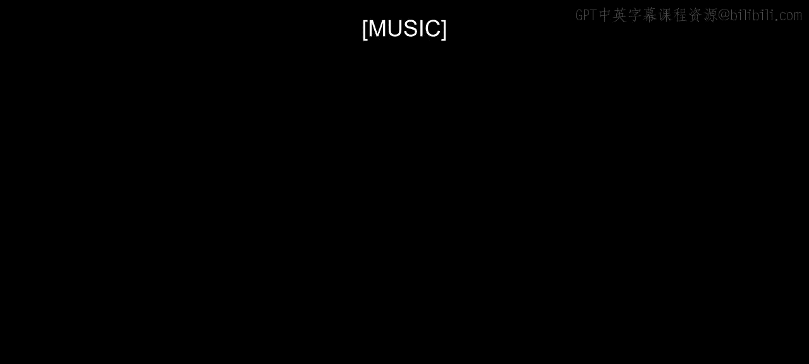
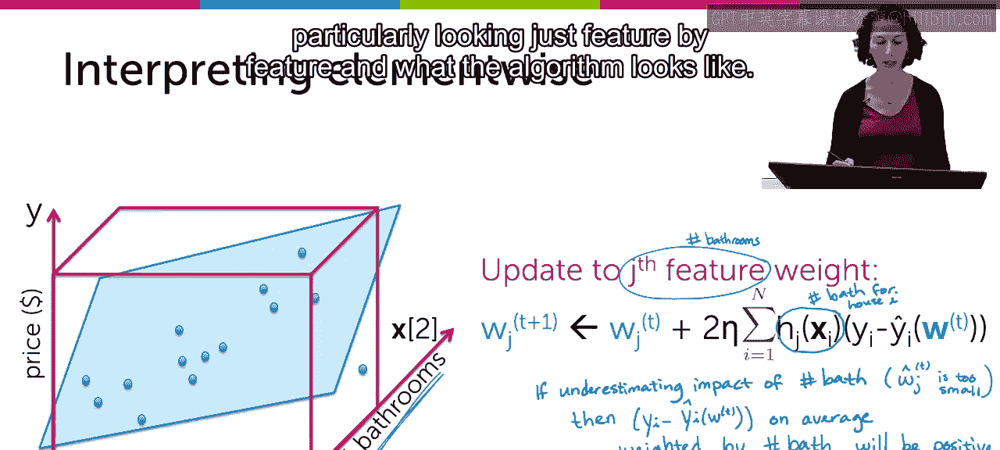
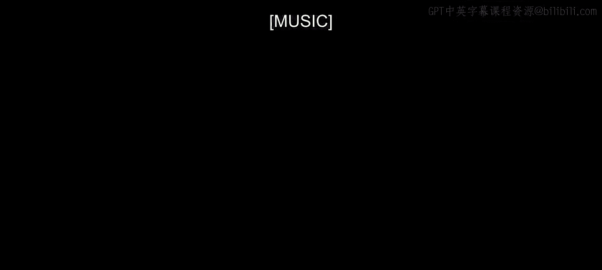

# 机器学习：第2课：逐特征更新梯度下降



在本节课中，我们将深入探讨梯度下降算法，并聚焦于**单个特征**的权重更新过程。我们将推导其数学公式，并解释其背后的直观含义，帮助你理解为什么更新规则会呈现为当前的形式。

上一节我们介绍了梯度下降的整体框架，本节中我们来看看如何将其应用到单个特征的权重更新上。

## 单特征更新公式推导

与其直接使用矩阵形式，我们回到**残差平方和**的原始定义来推导，这样更简单明了。

残差平方和公式如下：

```
RSS(w) = Σ_{i=1}^{n} [ y_i - (w_0 * h_0(x_i) + w_1 * h_1(x_i) + ... + w_D * h_D(x_i) ) ]^2
```

梯度是一个向量，包含了对每个权重 `w_j` 的偏导数。我们只需关注其中一个元素，即 `RSS` 对 `w_j` 的偏导数，这就能给出第 `j` 个权重的更新规则。

对 `w_j` 求偏导的过程如下：

```
∂RSS/∂w_j = Σ_{i=1}^{n} [ -2 * h_j(x_i) * ( y_i - H(x_i)^T w ) ]
```

其中，`H(x_i)^T w` 是使用当前权重向量 `w` 对第 `i` 个观测值的预测值。

因此，第 `j` 个特征在梯度下降中的更新规则为：

```
w_j^{t+1} = w_j^{t} - η * ( ∂RSS/∂w_j )
```

代入偏导数公式，得到：

```
w_j^{t+1} = w_j^{t} + η * [ 2 * Σ_{i=1}^{n} h_j(x_i) * ( y_i - H(x_i)^T w^t ) ]
```

在实际算法中，常数因子2通常被吸收到学习率 `η` 中，因此核心更新项为：

```
w_j^{t+1} = w_j^{t} + η * Σ_{i=1}^{n} h_j(x_i) * ( y_i - ŷ_i^t )
```

其中 `ŷ_i^t` 是第 `t` 次迭代时的预测值。

## 更新规则的直观解释

现在，让我们通过一个例子来直观理解这个更新规则。假设 `w_j` 对应“卫生间数量”这个特征的系数。

以下是更新过程如何工作的逻辑：

*   **情况：低估特征影响**
    *   如果当前模型**低估**了卫生间数量对房价的影响，意味着权重 `w_j^t` **太小**。
    *   那么，对于许多观测值，真实房价 `y_i` 将大于模型预测值 `ŷ_i^t`，导致残差 `(y_i - ŷ_i^t)` 在**整体上为正**。
    *   在更新公式中，我们将这些正的残差乘以对应的特征值 `h_j(x_i)`（即卫生间数量）并求和。
    *   最终，更新项 `η * Σ [...]` 会是一个**正值**，加到当前的 `w_j^t` 上。
    *   结果：`w_j^{t+1} > w_j^t`，我们**增加**了卫生间数量的权重，修正了之前的低估。

*   **为何用特征值加权残差？**
    *   在求和项 `Σ h_j(x_i) * (y_i - ŷ_i^t)` 中，每个观测值的残差都被其对应的特征值 `h_j(x_i)` 加权。
    *   这是因为，拥有更多该特征（例如更多卫生间）的观测值，在评估该特征对误差的“责任”时应具有**更大的发言权**。一个卫生间很多的房子，其预测误差在调整卫生间权重时理应比一个卫生间很少的房子贡献更多的信息。





本节课中我们一起学习了梯度下降算法中针对单个特征的权重更新过程。我们推导了其数学公式，并通过“卫生间数量”的例子，解释了更新规则如何根据预测误差（残差）和特征值本身来动态调整权重，使模型逐步逼近最优解。这种逐特征审视的方式，为理解梯度下降的工作原理提供了清晰的直觉。