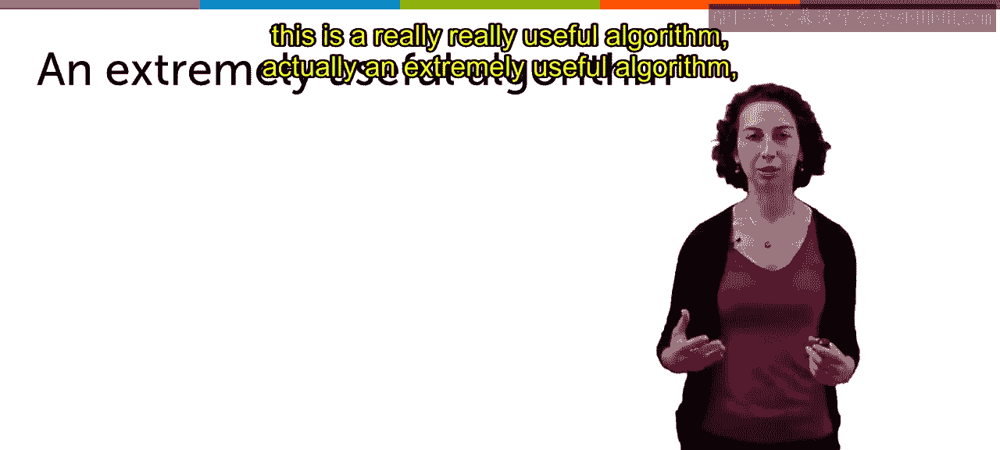

# 华盛顿大学《机器学习（回归，第2课⧸共4课）｜Machine Learning》中英字幕 p47 47_梯度下降方法的算法总结.zh_en -BV11b421H7XL_p47-

。

Now let's actually summarize the entire gradient descent algorithm for multiple regression。

 stepping through very carefully every step of this algorithm。So in particular， at first。

 what we're going to do is we're just going to initialize。

All of our different parameters to be zero at the first iteration。

 or you could initialize them randomly or you could do something a bit smarter。

 but let's just assume that they're all initialized to zero。

 and we're going to start our iteration counter at  zero。 I mean， at one。And then。

What we're doing is we're saying wall， we're not converged。

 And what was the condition we talked about before in our simple regression module for not being converged。

 We said wall， the gradient of our residual sum squares。

 the magnitude of that gradient was sufficiently large， larger than some tolerance。Epsilon。

Then we were going to keep going。s。So。What is the magnitude of residual summit squares？Here。

 this thing， just to be very explicit， is the square root。Of。The square。

 So what what are the elements of the gradient of residual summa squares。 Well。

 it's a vector where every element is the partial derivative with respect to some parameter。

 I'm going to refer to that as partial of J。Okay， so。When I take the magnitude of the vector。

 I multiply the vector times its's transpose， take the square root that's equivalent to saying I'm going to sum up。

The partial derivative with respect to the first feature squared。Plus。

All the way up to the partial derivative。Of。The capital D feature。

 sorry I guess I should start the indexing really starts with zero。Squared。

 and then I take the square root。 So if the result of this is greater than epsilon。

 then I'm going to continue my gradient descent iterates。

 if it's less than epsilon then I'm going to stop。 But let's talk about what the actual iterates are。

 Well， for every feature in my multiple regression model。

First thing I'm going to do is I'm going to calculate this partial derivative with respect to the Jth feature。

And I'm going to store that because that's going to be useful in both taking the gradient step as well as monitoring convergence like I wrote here。

m so。This J partial， we derived it on the previous slide。 it has this form。

 and then my gradient step takes that。Jith。Coeient at time T and subtracts my step size times that partial derivative and then once I cycle through all the features in my model。

 then I'm going to increment this T counter， I'm going to check whether I've achieved convergence or not。

 if not I'm going to loop through and I'm going to do this until this condition。

This magnitude of my gradient is less than epsilon。Okay。

 so I want to take a few moments to talk about this gradient descent algorithm because we presented it specifically in the context of multiple regression and also for the simple regression case。

 but this algorithm is really， really important， it's probably the most widely used machine learning algorithm out there and we're going to see it when we talk about classification all the way to talking about deep learning。

So even though we've presented this in the context of multiple regression， this is a really。

 really useful algorithm， actually an extremely useful algorithm as the title of this slide shows。😊。

