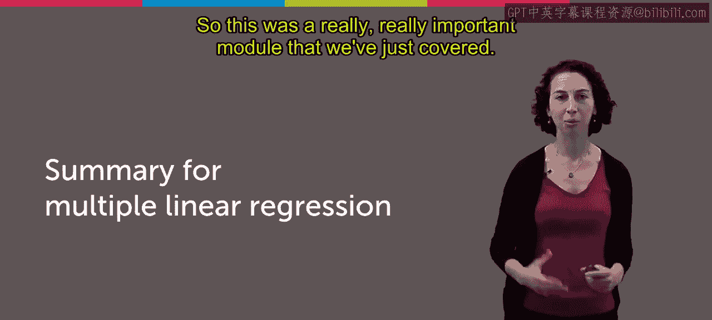
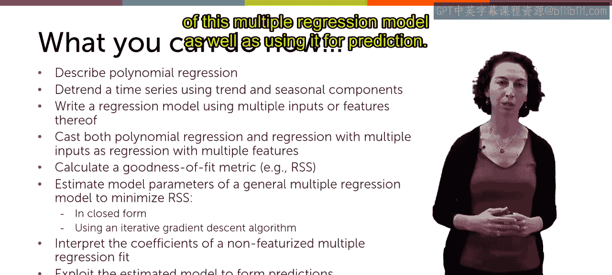

# 华盛顿大学《机器学习（回归，第2课⧸共4课）｜Machine Learning》中英字幕 p48 48_简要回顾.zh_en -BV11b421H7XL_p48-

。

So that's multiple regression and as you've seen we've talked about what we said was the most widely used machine learning tool out there。

 along with the most widely used algorithmic tool， this gradient descent algorithm So this was a really。

 really important module that we've just covered and now that you've worked through this module what you're able to do is describe linear regression when you have multiple features of just a single input like when we're talking about polynomial regression or things like modeling seasonality and time series but we also talked about how to handle multiple different inputs and features of these different inputs and all of these models fall in the context of multiple regression and for this multiple linear regression model。

 we talked about how to fit the model using both a closedform solution as well as gradient descent and we also talked about how we can interpret the coefficients of some cases of this multiple regression model as well as using。

For prediction。

。