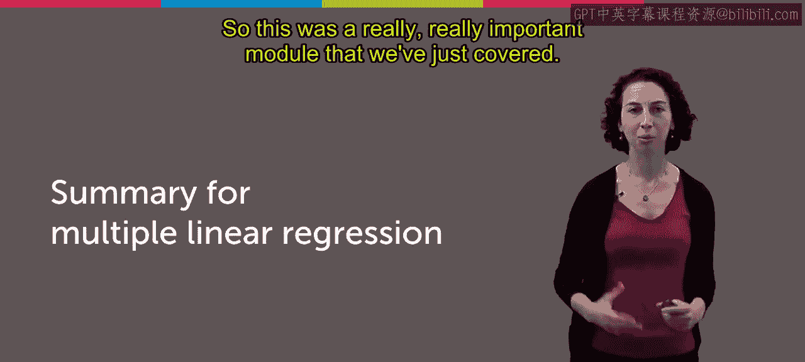
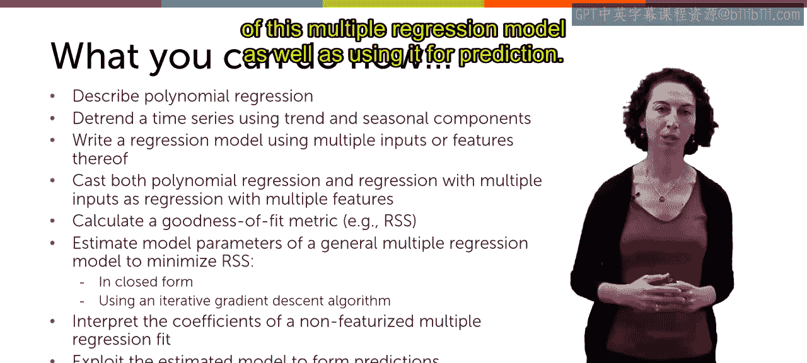

# 机器学习：第2课：多元回归核心回顾 🧠

在本节课中，我们将系统回顾多元回归的核心概念。多元回归是应用最广泛的机器学习工具之一，与之配套的梯度下降算法也是最常用的优化算法。本节将总结多元回归模型的定义、拟合方法、系数解释及其预测应用。


---

## 多元回归模型概述 📊

上一节我们介绍了多元回归的基本思想。多元线性回归模型用于描述一个目标变量与多个特征变量之间的线性关系。其核心公式如下：

**公式：**
\[
y = w_0 + w_1 x_1 + w_2 x_2 + \dots + w_d x_d + \epsilon
\]

其中：
- \( y \) 是目标变量。
- \( x_1, x_2, \dots, x_d \) 是特征变量。
- \( w_0, w_1, \dots, w_d \) 是模型系数（参数）。
- \( \epsilon \) 是误差项。

该模型不仅适用于处理多个不同输入特征的情况，也能通过特征变换（如多项式项）来建模单输入的非线性关系，例如多项式回归或时间序列中的季节性建模。

---

## 模型拟合方法 ⚙️

本节中我们来看看两种主要的模型拟合方法：解析解和梯度下降。

### 1. 解析解（闭式解）

对于多元线性回归，存在一个直接的解析解，可通过最小二乘法求得。其核心是通过求解正规方程来得到最优系数。

**公式：**
\[
\mathbf{w} = (\mathbf{X}^T \mathbf{X})^{-1} \mathbf{X}^T \mathbf{y}
\]

其中：
- \( \mathbf{X} \) 是特征矩阵（包含一列1以对应截距 \( w_0 \)）。
- \( \mathbf{y} \) 是目标变量向量。
- \( \mathbf{w} \) 是系数向量。

### 2. 梯度下降算法

当特征维度很高或数据量很大时，计算解析解可能计算量过大。梯度下降是一种迭代优化算法，通过不断沿成本函数梯度反方向更新参数来寻找最优解。

以下是梯度下降的参数更新规则：

**代码（更新规则）：**
```python
# 重复直到收敛
for j in range(num_iterations):
    # 计算预测值
    predictions = X.dot(w)
    # 计算误差
    errors = predictions - y
    # 计算梯度（对每个系数w_j）
    gradient = (1/m) * X.T.dot(errors)
    # 更新系数
    w = w - learning_rate * gradient
```

---

## 模型系数的解释 🔍

理解模型系数的含义对于解释模型至关重要。在多元回归中，系数 \( w_j \) 表示在保持其他所有特征不变的情况下，特征 \( x_j \) 每增加一个单位，目标变量 \( y \) 的预期变化量。

例如，在一个预测房价的模型中，如果 \( w_1 = 150 \)，且 \( x_1 \) 代表房屋面积（平方米），则意味着在房屋其他条件不变的情况下，面积每增加一平方米，房价预计上涨150单位。

---

## 模型预测与应用 🎯

拟合模型后，核心应用是进行预测。使用学习到的系数 \( \mathbf{w} \)，对于新的输入特征向量 \( \mathbf{x}_{\text{new}} \)，预测值计算如下：

**公式：**
\[
\hat{y} = w_0 + w_1 x_{\text{new},1} + w_2 x_{\text{new},2} + \dots + w_d x_{\text{new},d}
\]



---



## 总结 📝

本节课中我们一起学习了多元回归的核心内容。我们回顾了多元线性回归模型的定义，它能够处理多特征输入及通过变换处理复杂模式。我们探讨了两种模型拟合方法：高效的解析解和适用于大规模数据的梯度下降算法。我们还学习了如何解释模型系数，并了解了如何使用拟合好的模型进行预测。多元回归是机器学习中强大而基础的工具，为理解更复杂的模型奠定了坚实的基础。