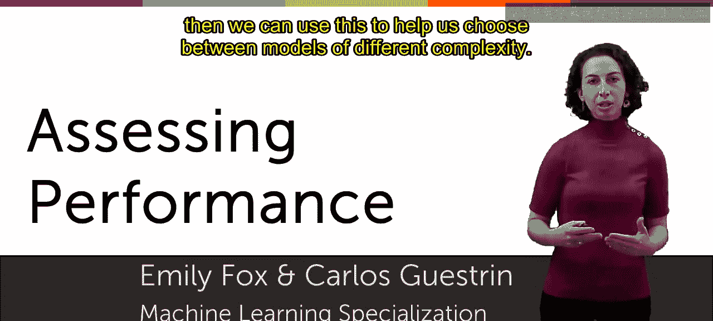

# 华盛顿大学《机器学习（回归，第2课⧸共4课）｜Machine Learning》中英字幕 p49 49_评估性能简介.zh_en -BV11b421H7XL_p49-

。

Up until this point in this course， we talked at great length about different models and algorithms for fitting these models。

 but we have no idea how to assess the performance of our estimated model。

 and of course that's really critical to analyzing the performance of the method that we have at hand。

 and if we can think of how to assess the performance of our procedure。

 then we can use this to help us choose between models of different complexity。

