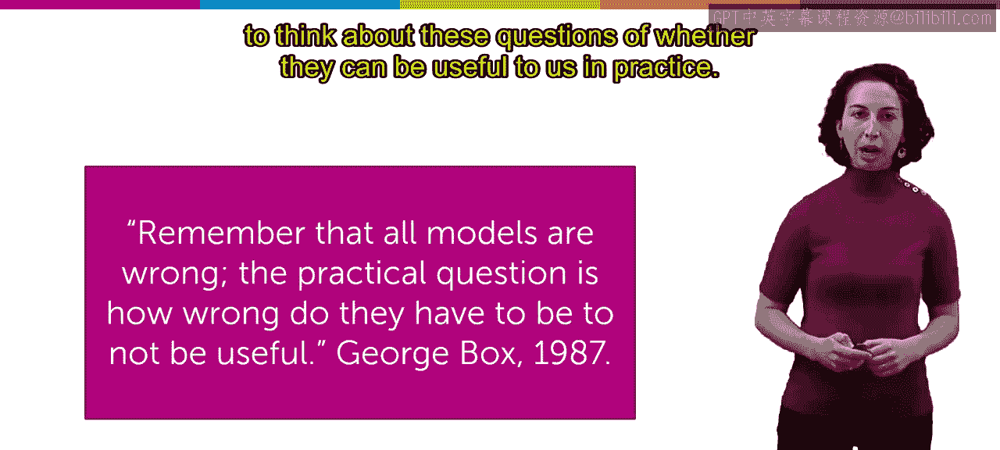

# 华盛顿大学《机器学习（回归，第2课⧸共4课）｜Machine Learning》中英字幕 p50 50_我们所说的损失是什么.zh_en -BV11b421H7XL_p50-

。

So having finished the preceding modules I'm feeling pretty confident that I come in。

 I can specify a model and I can also specify an algorithm for how to fit that model in doing that。

 I come in and I get some fitted function and I know how to use that function to make predictions so I go I make predictions about the value of my house I go to sell my house and I make money and I'm happy right I did a good job。

Well， maybe maybe not， maybe my predictions weren't that good and so as a result the value that I list my house for was inaccurate。

 and maybe I end up losing money as a result of that so what we can think about is a measure of how much are we losing when we make a certain prediction。

So for example， in the housing application， if we list the house value as too low。

 then maybe we get low offers and that's a cost to me relative to having made a better prediction。

 or if I list the value as too high， maybe people don't come see the house and I don't get any offers or maybe people notice that not many people are showing up to look at the house and they make me a very low offer。

 so again I'm in the situation of being in a worse financial state。

 having made a poor prediction of the value of my house。

So a question is how much am I losing compared to having made perfect predictions。

 of course we can never make perfect predictions the way in which the world works is really complicated and we can't hope to perfectly model that as well as the noise that's inherent in the process of any observations we might see。

But let's just imagine that we could perfectly predict the value then we'd say in that case。

 our loss is zero， we're not losing any money because we did perfectly。

So a question is how do we formalize this notion of how much we're losing and in machine learning we do this by defining something called the loss function and what the loss function specifies is the cost incurred when the true observation is y and I make some other prediction so a bit more explicitly what we're going to do is we're going to estimate our model parameters and those are W hat we're going to use those to form predictions so this notation here。

 F subw hat is something we've equivalently written as F hat。

 but for reasons that we'll see later in this module。

 this notation is very convenient and what it is is it's our predicted observation or our predicted value at some input X and y is the true value。

And this loss function L is somehow measuring the difference between these two things。

And there are a couple ways in which we could define loss functions Well， there's actually many。

 many ways， but I'm just going to go through a couple examples and in particular these examples that I'm going to go through assume that the cost you incur by doing an overest relative to an underestimate are exactly the same so there's no difference in listing my house as $1000 to high relative to $1000 too low okay so we're assuming what's called a symmetric loss function in these examples in very common choices include assuming something that's called absolute error。

 which just looks at the absolute value of the difference between your true value and your predicted value。

And another common choice is something called squared air。

 where instead of just looking at the absolute value， you look at the square of that difference。

 and so that means that you have a very high cost if that difference is large relative to just absolute air。

So as we're going through this module， it's useful to keep in the back of your mind this quote by George Box。

 which says that remember that all models are wrong。

 and the practical question is how wrong do they have to be to not be useful？Okay。

 so we have spent a lot of time defining different models。

 and now we're going to have tools to assess the performance of these methods to think about these questions of whether they can be useful to us in practice。

🎼。