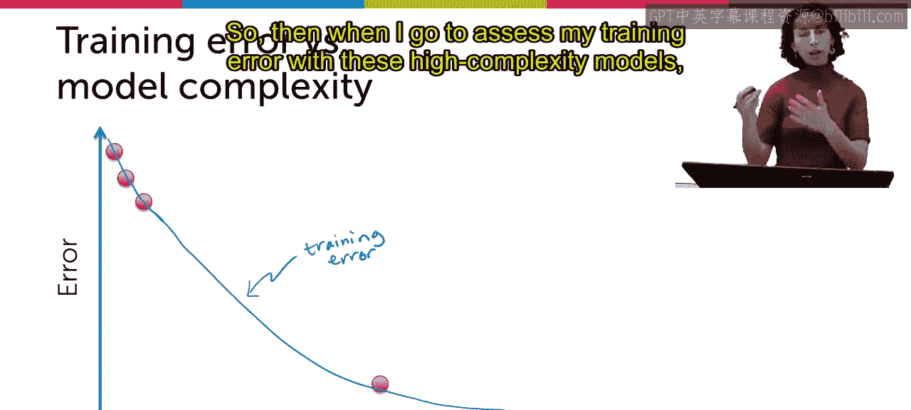
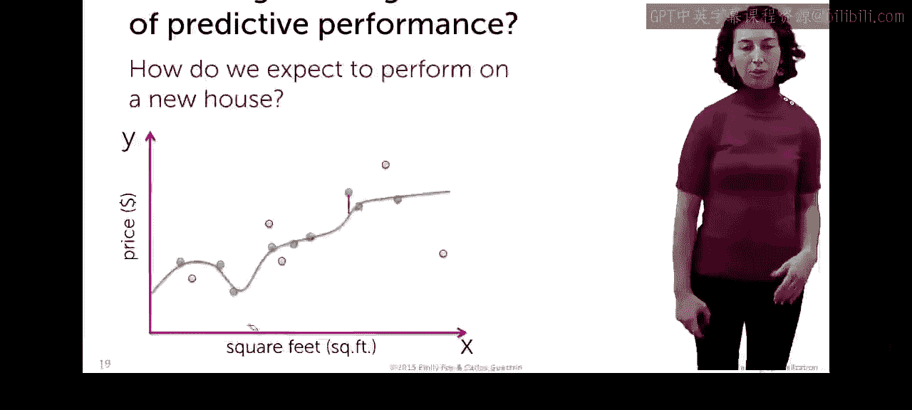
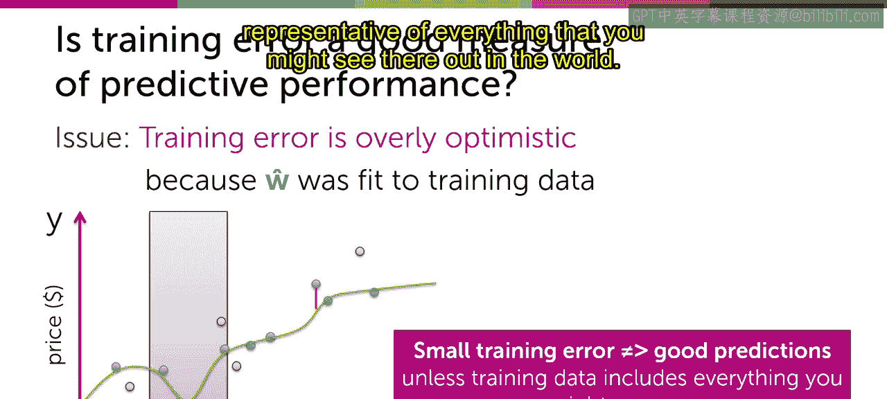
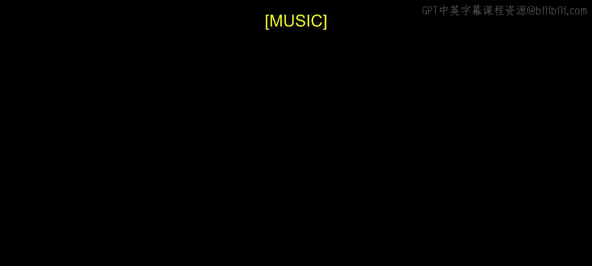

# 华盛顿大学《机器学习（回归，第2课⧸共4课）｜Machine Learning》中英字幕 p51 51_训练误差：评估训练集上的损失.zh_en -BV11b421H7XL_p51-

。

So the first measure of error of our predictions that we can look at is something called training error。

 and we discussed this at a high level in the first course of this specialization。

 but now let's go through it in a little bit more detail。

So to define training error we first have to define training data。

 so training data typically you have some data set which are shown in these blue circles here and we're going to choose our training data set to be just some subset of these points。

 so the grade circles are ones that are not included in the training set。

 the blue circles are the ones that we're keeping in this training set。

And then we take our training data and as we've discussed in previous modules of this course。

 we use it in order to fit our model so to estimate our model parameters and just as an example。

 for example， with this data set here， maybe we choose to fit some quadratic function to the data and like we've talked about in order to fit this quadratic function。

 we're going to minimize the residual sum squares on these training data points。

So now we have our estimated model parameters， W hatt。

 and we want to assess the training error of that estimated model and the way we do that is first we need to define some loss function。

 so maybe we look at square error or absolute error or any one of the many possibilities for our loss function。

 and then the way training error is defined is simply as the average loss defined over the training points。

 so mathematically what this is is simply one over n。

 so n or the total number of observations in my training set。

 some of the loss over each one of those training observations。And just to remember。

 to be very clear。The estimated parameters were estimated on the training set。

 They were minimizing the residual sum squares for these training points that we're looking at again in defining this training error。

So we can go through this pictorially in the following example where in this case we're specifically looking at using squared error as our loss function。

And in this case， our training error is simply one over n times the sum of。

The difference between our actual house sales price and our predicted house sales price squared。

 where that sum is taken over all houses in our training data set。

And what we see is that in this case， where we choose squared error as our loss function。

Then the form of training error is exactly one over n times our residual sum of squares。

 and I want to note here that there's some difference in convention that people use whether there's the one over n as the definition of training error or not。

 so just be aware of that when you're computing training error and reporting these numbers here we're defining it as the average loss。

More formally， we can write our training error as follows。

 and then we can define something that's commonly referred to just as RMSE and the full name is rootot。

Mean square error。And RMSE is simply the square root of our average loss on the training houses。

 so the square root of our training error。And the reason one might consider looking at root mean squared error is because the units in this case are just dollars。

 whereas when we thought about our training error， the units were dollars squared。

 remember we're taking the squares of all these differences in dollars so the result is dollars squared。

 so that's a little bit less intuitive as an error metric than just an error in terms of dollars themselves。

Now that we've defined training error， we can look at how training error behaves as model complexity increases。

So to start with， let's look at the simplest possible model you might fit。

 which is just a constant model。So this is the simplest model。We're going to consider。

Or could consider。 And you see that if there's pretty significant training error。

 So let's just say that that has some value here。 This is the training error of the。

 the constant model。Then let's say I fit a linear model Well a line。

 these are all linear models we're looking at it' linear regression but just fitting a line to the data and you see that my training error has gone down so some other value that I'm showing with this pink circle here。

 then I fit a quadratic function again training error goes down and what I see is that as I increase my model complexity to maybe this higher order polynomial and very low training error just this one pink bar here so training error decreases quite significantly with model complexity。

And。In total， now that we've gone through these examples。

 we can look at what the plot of training error。Versus model complexity tends to look like。

So there's a decrease in training error。As you increase your model complexity。And why is that？Well。

 it's pretty intuitive because the model was fit on the training points and then I'm saying。

 well how well does it fit it as I increase the model complexity I'm better and better able to fit my training data points so then when I go to assess my training error with these high complexity models I have very low training there。

So a natural question is whether training error is a good measure of predictive performance and what we're showing here is one of our high complexity high order polynomial models that had very low training error so it really fit those training data points well。

 but how is it going to perform on some new house so in particular。

 maybe we're looking at a house in this gray region so with this range of square feet？

Question is， is there something particularly wrong with having Xt square feet。

 because what our fitted function is saying is that I believe or I'm predicting that the values of houses with roughly Xt square feet are less valuable than houses with fewer square feet because there's this dip down in this function？

Do we really believe that this is a true dip in value that these houses are just less desirable than houses with fewer or more square feet？

Probably not， so what's going wrong here？The issue is the fact that training error is overly optimistic when we're going to assess predictive performance。

 and that's because these parameters W hat were fit on the training data。

They were fit to minimize this training error。Or sorry， minimize residual summa squares。

 which can often be related to training error， and then we're using training error to assess predictive performance。

 but that's going to be very， very optimistic as this picture shows。So in general。

 having small training error does not imply having good predictive performance unless your training data set is really representative of everything that you might see out there in the world。

