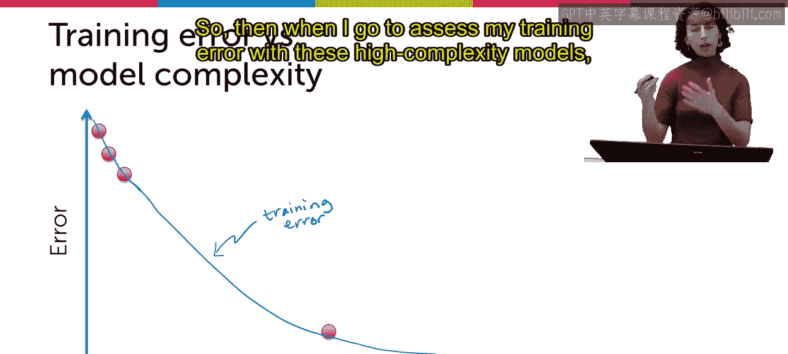
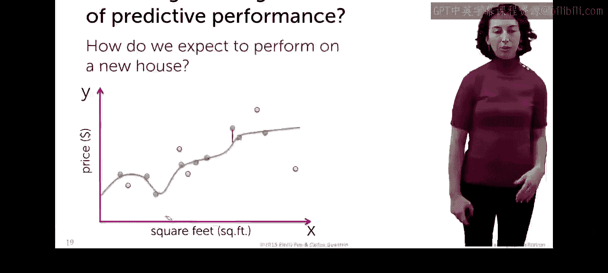
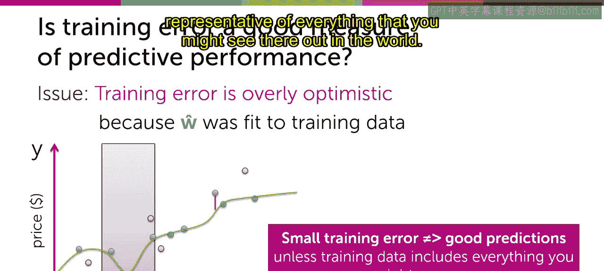
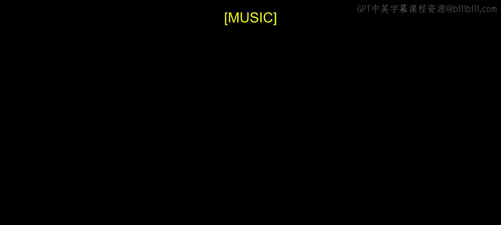

# 机器学习（回归）：第2课：训练误差：评估训练集上的损失 📊

在本节课中，我们将学习如何评估模型在训练数据上的表现，即计算**训练误差**。我们将了解其定义、计算方法，并探讨其与模型复杂度之间的关系及其局限性。

---

## 训练误差的定义

上一节我们介绍了模型拟合的基本概念，本节中我们来看看如何量化模型在训练数据上的表现。首先，我们需要明确什么是训练数据。

**训练数据**通常是我们从所有可用数据中选取的一个子集。在图表中，蓝色圆圈代表被选入训练集的数据点，而灰色圆圈则代表未被包含的点。

我们使用这个训练数据集来拟合模型，即估计模型参数。例如，对于一组数据，我们可能选择用一个二次函数来拟合。为了找到最佳拟合，我们会最小化这些训练数据点上的**残差平方和**。

在获得估计的模型参数 **Ŵ** 后，我们希望评估该模型的训练误差。为此，我们首先需要定义一个**损失函数**，例如平方误差或绝对误差。

**训练误差**的定义是：在训练点上计算的平均损失。其数学公式如下：

**训练误差 = (1 / n) * Σ L(y_i, ŷ_i)**

其中：
*   **n** 是训练集中的观测总数。
*   **Σ** 表示对所有训练观测值求和。
*   **L(y_i, ŷ_i)** 是第 i 个观测值的损失函数值（例如，平方误差）。

需要明确的是，模型参数 **Ŵ** 正是在这个训练集上通过最小化残差平方和（或其他目标函数）估计出来的。现在，我们又在同一个训练集上评估其误差。

---

## 以平方误差为例

为了更具体地理解，我们来看一个使用**平方误差**作为损失函数的例子。

在这种情况下，训练误差的公式变为：

**训练误差 = (1 / n) * Σ (y_i - ŷ_i)²**

这个公式计算的是所有训练房屋的实际销售价格与预测销售价格之差的平方的平均值。

我们可以看到，当损失函数为平方误差时，训练误差的形式恰好是**残差平方和**除以 **n**。这里需要注意一个惯例差异：有些人定义训练误差时包含 **1/n**（即平均损失），有些人则直接使用残差平方和。在本教程中，我们采用平均损失的定义。

此外，我们经常使用一个相关的指标：**均方根误差**。

**RMSE = √(训练误差)**

RMSE 是训练误差的平方根。考虑使用 RMSE 的原因是它的单位更直观。在我们的房价例子中，训练误差的单位是“美元²”，而 RMSE 的单位是“美元”，这更符合我们对误差的常规理解。

---

## 训练误差与模型复杂度

现在我们已经定义了训练误差，接下来可以观察训练误差如何随着模型复杂度的增加而变化。

我们从最简单的模型开始：**常数模型**（例如，用所有房价的平均值来预测）。这个模型非常简单，通常会产生较大的训练误差。

以下是随着模型复杂度增加，训练误差变化的典型趋势：

*   **线性模型**：当我们用一条直线（线性回归）拟合数据时，训练误差通常会比常数模型有所下降。
*   **二次模型**：使用二次函数拟合时，模型能更好地捕捉数据中的曲线关系，训练误差会进一步降低。
*   **高次多项式模型**：随着我们使用更高阶的多项式，模型拥有更多的灵活性，可以几乎完美地穿过每一个训练数据点，从而导致训练误差变得非常低，甚至接近于零。

总的来说，**训练误差随着模型复杂度的增加而单调下降**。原因很直观：模型是在训练数据上拟合的，模型越复杂，它“记住”或拟合训练数据点的能力就越强。因此，当我们在这些高复杂度模型上评估训练误差时，自然会得到非常低的值。

---

## 训练误差的局限性：过拟合问题

一个自然的问题是：**训练误差是衡量模型预测性能的好指标吗？**

上图展示了一个高阶多项式模型，它在训练数据上误差极低，完美地拟合了那些蓝色数据点。然而，如果我们用它来预测一个位于灰色区域的新房屋（具有特定平方英尺数），问题就出现了。

这个拟合函数预测，拥有大约 Xt 平方英尺的房屋，其价值反而比面积更小或更大的房屋要低（因为函数在此处有一个向下的“凹陷”）。我们真的相信这是一个真实的价值洼地吗？很可能不是。

这里的问题在于：**训练误差在评估预测性能时过于乐观**。这是因为模型参数 **Ŵ** 是为了最小化训练集上的误差（如残差平方和）而专门调整的。然后，我们又用同一个数据集来评估它的表现，这就像让一个学生用自己的复习笔记来出题并参加考试，然后得了高分一样——这并不能代表他面对全新试题时的真实能力。

因此，**训练误差小并不一定意味着预测性能好**，除非你的训练数据集能够完美代表未来可能遇到的所有情况。这种现象就是**过拟合**：模型过于复杂，以至于它不仅学到了数据中潜在的真实规律，还“记住”了训练数据中的随机噪声和特定细节，导致其在新数据上的泛化能力变差。

---

## 总结

本节课中我们一起学习了：
1.  **训练误差**的定义：它是模型在**训练数据集**上的平均预测损失。
2.  其计算公式为 **平均损失**，当使用平方误差时，它与残差平方和相关，并引出了单位更直观的 **RMSE**。
3.  训练误差随**模型复杂度**增加而**下降**，因为更复杂的模型能更好地拟合训练数据。
4.  训练误差的主要**局限性**：它是一个**过于乐观**的指标，低训练误差不能保证模型在新数据（测试数据）上有良好的预测性能，这引出了**过拟合**的核心问题。

认识到训练误差的局限性至关重要，它促使我们在下一节中引入更可靠的评估方法：**测试误差**。