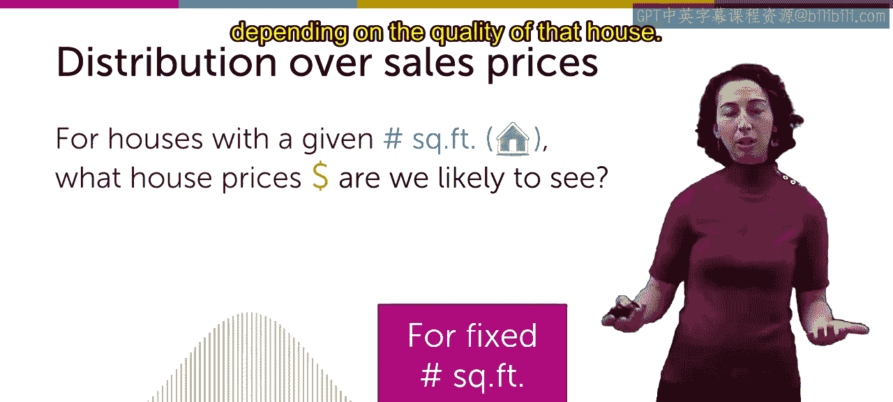
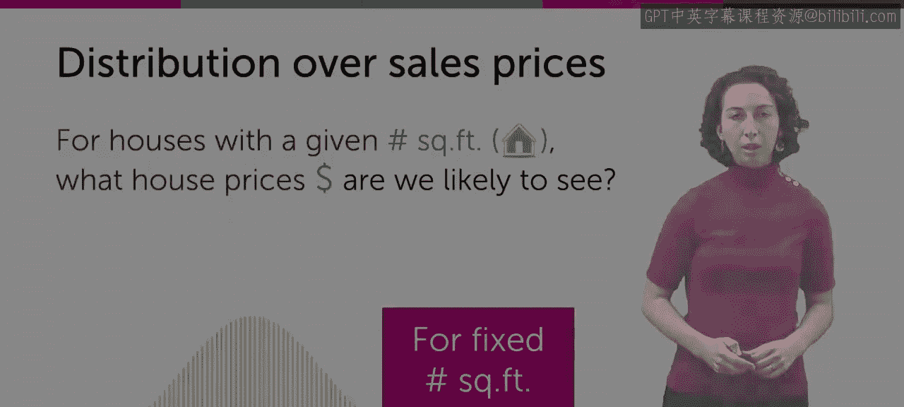
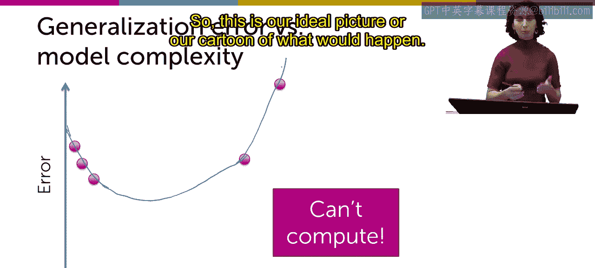
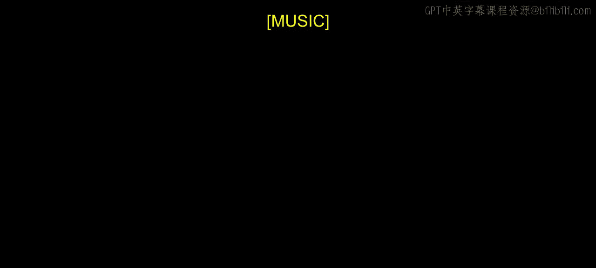

# 华盛顿大学《机器学习（回归，第2课⧸共4课）｜Machine Learning》中英字幕 p52 52_泛化误差：我们真正想要的.zh_en -BV11b421H7XL_p52-

。

So instead of using training error to assess our predictive performance。

 what we'd really like to do is analyze something that's called generalization or true error。

So in particular， we really want an estimate of what the loss is averaged over all houses that we might ever see in our neighborhood。

But really in our data， we only have a few examples of houses that were sold。

 but there are lots of other houses that are in our neighborhood that we don't have in our data or other houses that you might imagine having been sold。

Okay， so to compute this estimate over all houses that we might see in our data。

 wed like to weight these house pairs， so the pair of house attributes and the house sales price by how likely that pair is to have occurred in our data。

So to do this we can think about defining a distribution in this case over square feet of houses in our neighborhood。

 so what this little cartoon is trying to show is a distribution over the real line of square feet。

 but you can think of it as just a really dense， in essence。

 histogram counting how many houses that we might see with a given square feet for every possible square feet value。

Okay and so what this picture is showing is a distribution that says we're very unlikely to see houses with very small or low number of square feet。

 very small houses and we're also very unlikely to see really really massive houses so there's some bell curve to this。

 there's some sweet spot of kind of typical houses in our neighborhood and then the likelihood drops off from there。

Likewise， what we can do is define a distribution that。

That says for a given square footage of a house， what's the distribution over the sales price of that house。

 So let's say the house has 2640 square feet， maybe I expect the range of house prices to be somewhere between 680。

thsand dollars to maybe $950，000 that might be a typical range。

 but of course you might see much lower valued houses or higher value depending on the quality of that house。

 and that's what this distribution here is representing。

Okay， so formally， when we go to define our generalization error。

We're saying that we're taking the average value of our loss。

Wighted by how likely those pairs were in our data set。

 so specifically we estimate our model parameters on our training data。

 so that's what gives us W hatt that defines the model we're using for prediction。

And then we have our loss function assessing the cost of predicting this F sub w hat at our square foot x when the true value was y。

 and then what we're going to do is we're going to average over all possible xy's。

 but weighted by how likely they are according to those distributions over square feet and value given square feet。

Okay， so let's go back to these plots of looking at error versus model complexity。

 but in this case let's quantify our generalization error as a function of this complexity。

And to do this， what I'm showing by this crazy。Blue region here。

 and it has different gradation going from white to darker blue is the distribution of houses that I'm likely to see in my data set。

 So this white region here。Are the houses。 now I just made it not white。

 but hopefully you still see these are the houses that I'm very， very likely to see。

And then as I go further away from this， I get to less likely how sales prices given a specific square foot value。

 And so what I'm going to do when I look at thinking about generalization error is I'm going to take my fitted function。

Where remember， this green line was fit。On the training data， which are these blue circles。

And then I'm going to say， how well does it predict houses in this shaded blue region？

Waied by how likely they are， how close to that that white region there are these kind of。

 if you imagine in 3D， there are these distributions popping up off of this shaded gray。

 I mean's shaded blue area， maybe I can try and draw it。So maybe the distribution。

Add a given square foot。Okay， that doesn't look good at all， let me try and do it again。

Maybe it looks something like this。Our houses with。Xt square feet。

 And so when I think about how well my prediction is doing at X T， this x here。嗯。

I'm looking at the difference between this and all points along this line weighted by how likely they are in the general population of houses I might see。

 and then I do that across this entire region of possible square feet。Okay。

 so what I see here is this constant model really doesn't approximate things well。

 except maybe in this region here。So overall， it has a reasonably high generalization error。

 and I can go to my more complex just fitting a line through the data and I see I have better performance but still not doing great。

In these regions。So my generalization error drops a bit。

 but when I get to this higher complexity quadratic fit， things are starting to look a bit better。

 maybe not great out in these regions here， so again the generalization error drops。

Then I get to this much higher order polynomial。And when we were looking at training error。

 the training error was lower， right， but now when we think about generalization error。

We actually see that the generalization error is going to go up relative to the simpler model。

 because if we look at this region here， it's doing really horribly。

So we might get a generalization error that's actually larger than the quadratic and then we can fit even a higher order polynomial and we get this really。

 really crazy fit and it's doing horrible basically everywhere except maybe at these very。

 very small little regions where it's doing okay so in this case we get dramatically bad generalization error。

Okay， so this is starting to match a lot more of our intuition behind what might be a good fit to this data。

So let's think about just drawing the curve over all possible models now that weve fit these few specific points。

So our generalization error。In general， we'll have some shape where it's going down。

 and then we get to a point。Where the error starts increasing。Sorry。

 that should have been a smoother curve。The air starts increasing because we're getting to these overly complex models that fit the training data really well。

 but don't generalize to other houses that we might see。But importantly。

 in contrast to training error， we can't actually compute generalization error because everything was relative to this true distribution like the true way in which the world works。

 how likely houses are to appear in our data over all possible square feet and all possible house values and of course we don't know what that is。

 so this is our ideal picture or our cartoon of what would happen。

 but we can't actually go along and compute these different points。

🎼。

