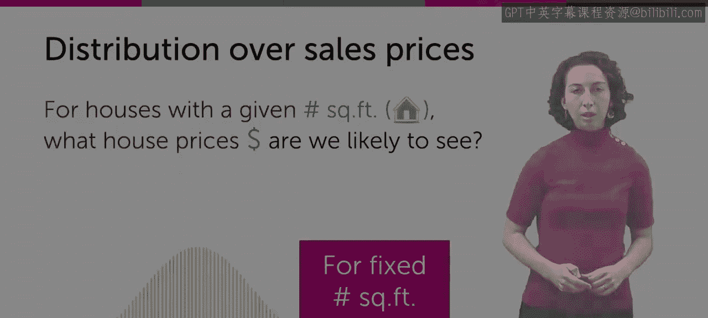
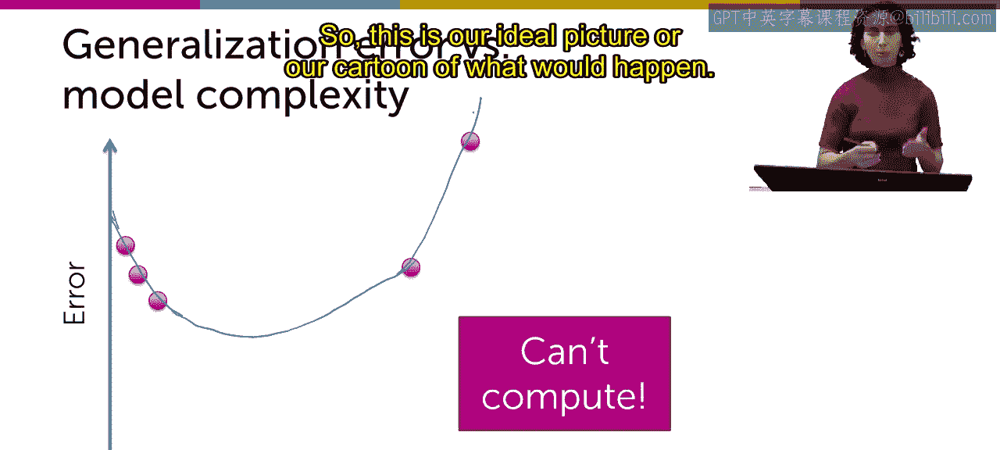
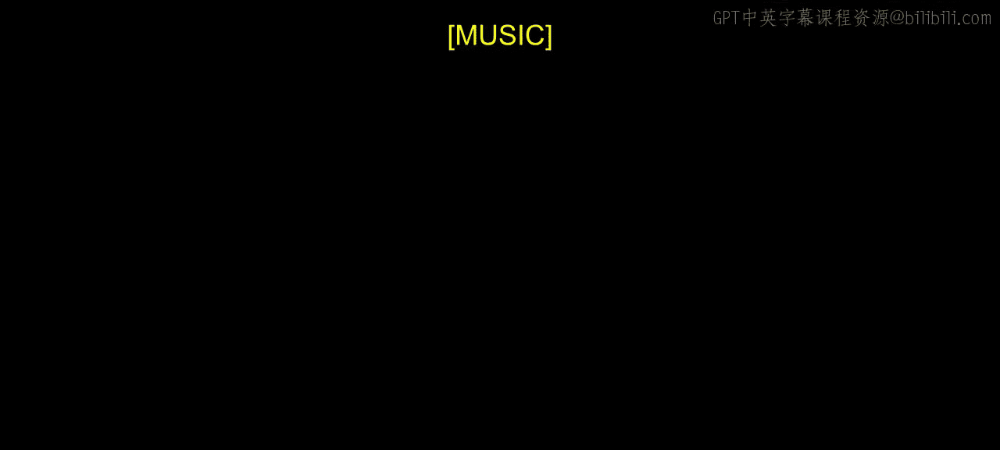

# 机器学习（回归）：第2课：泛化误差：我们真正想要的

在本节课中，我们将要学习一个比训练误差更重要的概念——泛化误差。我们将探讨为什么评估模型在未知数据上的表现至关重要，以及如何从理论上理解它。

## 概述：从训练误差到泛化误差

上一节我们介绍了训练误差，即模型在训练数据上的表现。然而，训练误差并不能完全反映模型在真实世界中的预测能力。本节中我们来看看一个更核心的评估指标：泛化误差。

训练误差仅衡量模型对已见数据的拟合程度。我们真正需要评估的，是模型对所有可能遇到的新数据的预测性能。这被称为**泛化误差**或**真实误差**。

具体来说，我们真正希望得到的是，模型在我们社区所有可能出现的房屋（而不仅仅是已售出的样本）上的平均损失估计。

## 定义泛化误差

为了计算对所有可能房屋的误差估计，我们需要根据每对“房屋特征”和“销售价格”在数据中出现的可能性对其进行加权。

这可以通过定义两个分布来实现：
1.  **房屋面积分布**：描述我们社区中不同面积房屋出现的可能性。它类似于一个非常密集的直方图，显示了每个可能面积值对应的房屋数量。通常，极小或极大的房屋都较少见，呈现一种类似钟形曲线的分布。
2.  **给定面积下的房价分布**：对于特定面积（例如2640平方英尺）的房屋，其销售价格也有一个分布范围（例如68万到95万美元），具体价值取决于房屋的其他品质。

因此，泛化误差的形式化定义为：我们根据训练数据估计出模型参数 **W_hat**，然后计算损失函数 **L( f_W_hat(x), y )**，最后对所有可能的 **(x, y)** 对求平均，但需按它们根据上述分布出现的可能性进行加权。

用公式表示如下：
**泛化误差 = E_(x, y)~P_data [ L( f_W_hat(x), y ) ]**
其中，**P_data** 代表真实世界中数据（特征x和标签y）的联合概率分布。

## 模型复杂度与泛化误差的关系

现在，让我们回到观察误差与模型复杂度的关系图，但这次我们量化**泛化误差**随复杂度的变化。

以下是不同复杂度模型下泛化误差的直观分析：

*   **常数模型**：泛化误差较高。它只在中间某个区域表现尚可，但整体上对数据分布的近似效果很差。
*   **线性模型**：泛化误差有所下降，表现优于常数模型，但在数据分布的边缘区域仍然不佳。
*   **二次模型**：泛化误差进一步降低。模型开始更好地捕捉数据的整体趋势，尽管在极端区域可能仍有改进空间。
*   **高阶多项式模型**：当我们观察训练误差时，它确实更低了。但现在考虑泛化误差，它实际上会开始**上升**。模型在训练数据点附近拟合得过于完美，但在其他广大区域（如图中所示）预测非常糟糕，导致整体泛化性能变差。
*   **极高阶多项式模型**：得到极其曲折的拟合线。除了在个别训练数据点附近，它在几乎所有区域的预测都极其糟糕，因此泛化误差会急剧升高。

## 泛化误差曲线与核心挑战

综合以上分析，我们可以描绘出泛化误差随模型复杂度变化的一般曲线：

泛化误差曲线通常呈**U形**。随着复杂度增加，误差最初下降，到达一个**最优复杂度点**后，误差开始重新上升。这是因为模型变得过于复杂，虽然能完美拟合训练数据（训练误差低），但丧失了推广到新数据的能力，即发生了**过拟合**。

然而，与训练误差不同，**我们无法直接计算泛化误差**。因为它的定义依赖于真实的、未知的数据分布 **P_data**（即世界运行的真实规律）。我们只能通过一些方法（如验证集、交叉验证）来估计它，而无法精确获得图中每个点。

## 总结

本节课中我们一起学习了**泛化误差**的概念。我们明白了评估模型不应只关注其在训练数据上的表现（训练误差），而更应关注其在所有可能新数据上的预期表现（泛化误差）。泛化误差通过考虑数据真实分布对预测损失进行加权平均来定义。随着模型复杂度增加，泛化误差会先减后增，揭示出偏差-方差权衡与过拟合现象的核心问题。理解这一点是构建实用、稳健机器学习模型的基础。