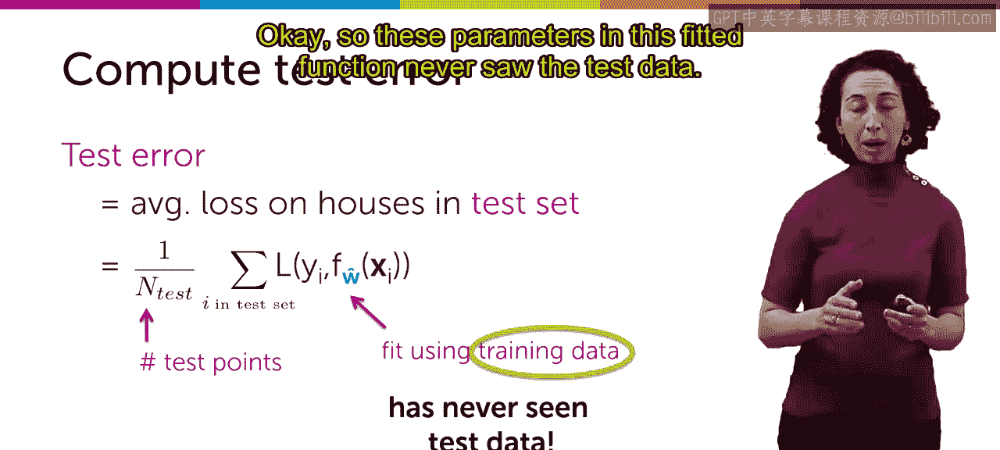
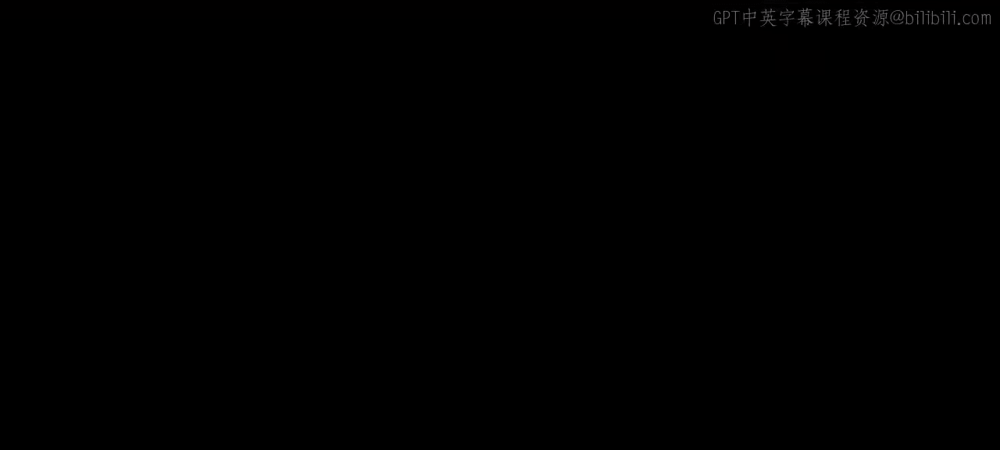
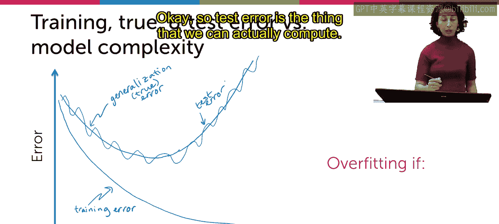
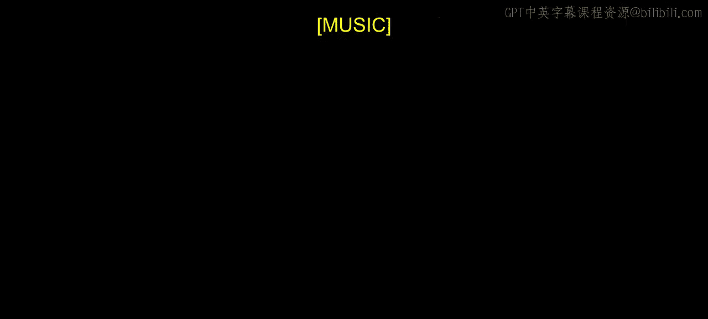

# 华盛顿大学《机器学习（回归，第2课⧸共4课）｜Machine Learning》中英字幕 p53 53_测试误差：我们实际可以计算的.zh_en -BV11b421H7XL_p53-

。

Okay， so we can't compute generalization error， but we want some better measure of our predictive performance than training error gives us。

 and so this takes us to something called test error and what test error is going to allow us to do is approximate generalization error。

And the way we're going to do this is by approximating the air looking at houses that aren't in our training set。

 so to do that we have to hold out some houses， so instead of including all these colored houses in our training set。

 which is entire these colored houses our entire recorded data set we're going to shade out some of them these shaded gray houses and we're going to make these into what's called a test set。

Okay， so here we have houses that are not included in our training set。

 the training set are the remaining colored houses here。And when we go to fit our models。

 we're just going to fit our models on the training data set。

 but then when we go to assess our performance of that model。

 we can look at these test houses and these are hopefully going to serve as a proxy of everything out there in the world。

 so hopefully our test data set。Is a good measure of other houses that we might see。

 at least in order to think of how well a given model is performing。Okay。

 so tester is going to be our average loss computed over the houses in our test data set。

 so formally we write it as follows where we have one over end test and tester the number of houses in our test data set。

Times the sum of the loss defined over those test set houses。But I want to emphasize。

 and this is really， really important that the estimated parameters W hat were fit on the training data set。

Okay， so even though this function looks very， very， very much like training error。

 the sum is over the test houses， but the function we're looking at was fit on training data。 Okay。

 so these parameters in this fitted function never saw the test data。

So just to illustrate this， like in our previous example。

 we might think of fitting a quadratic function through this data where we're going to minimize the residual sum squares on the training points。

 those blue circles to get our estimated parameters W hat。Then when we go to compute our test error。

 which in this case again， we're going to use squared error as an example。

We're computing this error over。The test points， all these gray different circles here。

 So test error is one over n times the sum of the difference between our true house sales prices and our predicted price squared。

 summing over all houses in our test data set。Okay so this is where the difference arises。

 where this function was fit with the blue circles， but when we're assessing the performance。

 we're looking at these gray circles。Okay， so let's summarize our measures of error as a function of model complexity。

And what we saw was that our training error。Decreased with increasing model complexity。So here。

This is our training error。And in contrast， our generalization error。

Went down for some period of time。 but then we。Started getting to overly complex models that didn't generalize well。

 and the generalization error started increasing。So here we have。Generalization error。Or true。Air。

And what is our test error， Well， our test error is a noisy approximation of generalization error。

 because if our test data set included everything we might ever see in the world in proportion to how likely it was to be seen。

 then。That would be exactly our generalization error。 But， of course。

 our test data set is just some finite data set。 and we're using it to approximate generalization error。

 So it's going to be some noisy version of this curve here。So this is。Our test error。Okay。

So test error is the thing that we can actually compute。

 generalization error is the thing that we really want。

