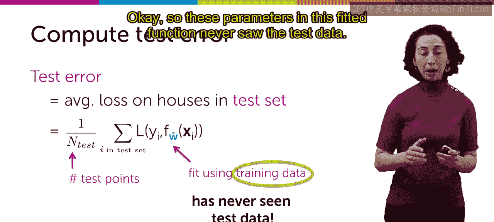
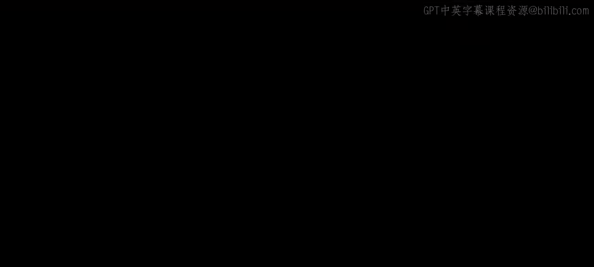
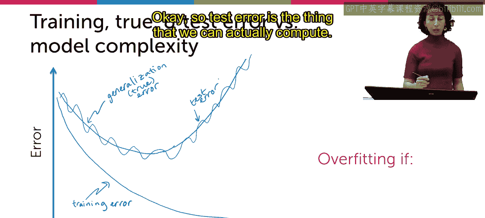
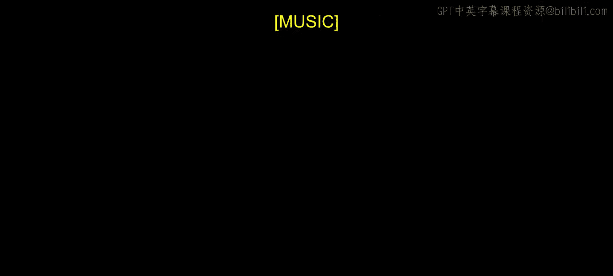

机器学习：第2课：测试误差：我们实际可以计算的

在本节课中，我们将学习如何评估机器学习模型的预测性能。我们将了解到，虽然我们无法直接计算模型在未知数据上的真实误差（泛化误差），但可以通过一种称为“测试误差”的指标来近似它。我们将探讨测试误差的计算方法、它与训练误差的区别，以及它如何随模型复杂度变化。

---

上一节我们讨论了训练误差及其局限性，它无法很好地反映模型在新数据上的表现。本节中我们来看看如何通过“测试误差”来更好地评估模型。

### 什么是测试误差？

我们无法计算泛化误差，但需要一个比训练误差更好的指标来衡量预测性能。测试误差允许我们近似泛化误差。

实现方法是：通过评估那些**不在**训练集中的数据点来近似误差。为此，我们必须预留一部分数据。

假设我们有一个包含所有彩色房屋的完整数据集。我们不将所有数据都用于训练，而是将其中一部分（图中灰色房屋）留出，形成一个**测试集**。

测试集中的房屋不包含在训练集中。训练集由剩余的彩色房屋组成。当我们拟合模型时，只使用训练数据集。然后，在评估该模型的性能时，我们查看这些测试房屋。我们希望测试集能作为世界上所有潜在数据的一个代表，至少能用来衡量给定模型的性能好坏。

### 如何计算测试误差？

测试误差是我们在测试数据集上计算的平均损失。其正式定义如下：

**公式**：
`测试误差 = (1 / n_test) * Σ loss(y_i, f(x_i; ŵ))`

其中：
*   `n_test` 是测试集中的房屋数量。
*   `loss` 是损失函数（例如平方误差）。
*   `ŵ` 是模型参数。
*   求和 `Σ` 是针对所有测试集房屋进行的。

需要**特别强调**的是：估计参数 `ŵ` 是在训练数据集上拟合得到的。

尽管这个公式看起来与训练误差非常相似，但求和是在测试房屋上进行的，而我们评估的函数（模型）是在训练数据上拟合的。这些拟合函数中的参数从未见过测试数据。

### 测试误差计算示例

为了说明这一点，我们沿用之前的例子。我们考虑用一个二次函数来拟合数据，通过最小化训练点（蓝色圆圈）上的残差平方和来获得估计参数 `ŵ`。

然后，当我们计算测试误差时（这里仍以平方误差为例），我们是在测试点（所有这些不同的灰色圆圈）上计算这个误差。

**公式**：
`测试误差 = (1 / n) * Σ (真实房价 - 预测房价)^2`

求和针对测试数据集中的所有房屋。关键区别在于：这个函数是用蓝色圆圈拟合的，但我们在评估性能时，看的是这些灰色圆圈。

### 误差与模型复杂度的关系

现在，让我们总结一下误差作为模型复杂度函数的变化趋势。

我们发现，**训练误差**随着模型复杂度的增加而下降。

相比之下，**泛化误差**（或真实误差）在一段时间内下降，但当我们开始使用过于复杂、泛化能力差的模型时，泛化误差开始上升。

那么，我们的**测试误差**是怎样的呢？测试误差是泛化误差的一个有噪声的近似。因为如果我们的测试数据集包含了世界上我们可能看到的所有数据，并且比例与其出现的可能性成比例，那么测试误差就恰好等于泛化误差。但当然，我们的测试集只是一个有限的数据集，我们用它来近似泛化误差。因此，它将是这条曲线的一个有噪声的版本。

---

本节课中我们一起学习了测试误差的概念。我们了解到，测试误差是我们实际可以计算的指标，通过在预留的、模型未见过的测试集上评估模型性能而得。它是我们真正关心的泛化误差的一个近似。测试误差与训练误差的关键区别在于评估数据的不同：训练误差使用模型拟合时见过的数据，而测试误差使用模型未见过的数据。理解这一点对于正确评估和选择模型至关重要。