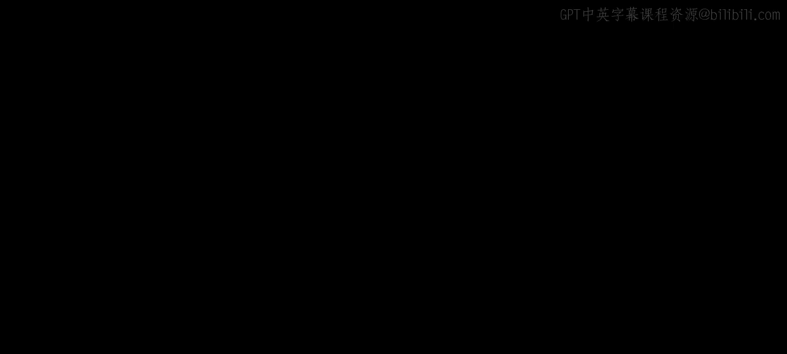
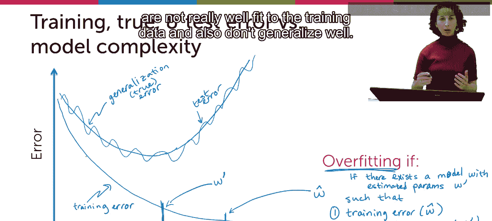
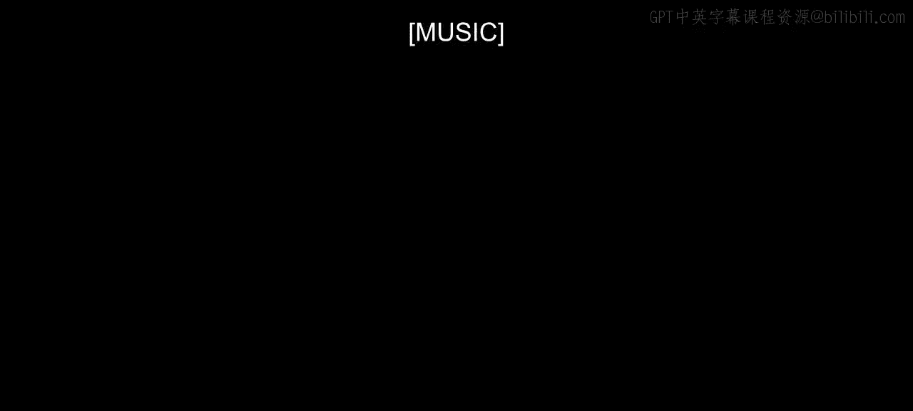

# 华盛顿大学《机器学习（回归，第2课⧸共4课）｜Machine Learning》中英字幕 p54 54_定义过拟合.zh_en -BV11b421H7XL_p54-

。

And I want to talk about this notion of overfitting because this is something that we've talked about before in the course。

 I want to formalize it and we're going to discuss it a lot more in the remainder of this course。

Okay， so the notion of overfitting is if you have。Some model， let's say a model here。With。

Parameterters W hat， so it has this model has some complexity and some associated estimated parameters W hat。

Well， this model is overfit。If。So if there。Exists。A model。With。Estimated。Prameterters。

I'll just call them W prime， so let's just say。Some other point here。

 let's say these have parameters。W prime。Such that。Two conditions hold。The training there。 So one is。

Training can't spell right now。trainraining error。Of W hat。Is less than the training error。

Of W1 W prime。But on the other hand， the。True error。Of W hat is greater than the true error。

Of W prime。Okay， so this might not seem that intuitive。

 but let me go through it in terms of this picture here。

 which is exactly what these points one and two are saying。

Which is there are a wide range of models that have true error larger than， for example。

 this W prime here。But the ones that are overfit are the ones that have smaller training error。

 These are the ones that are really really highly fit the training data set。

 but don't generalize well， whereas the other points on the other half of the space are the ones that are not really well fit to the training data and also don't generalize well Okay。

 so this is formerly our notion of what an overfitted model is。

