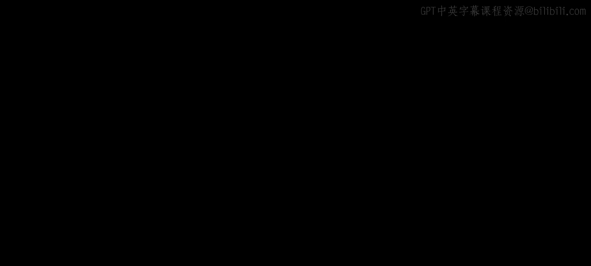
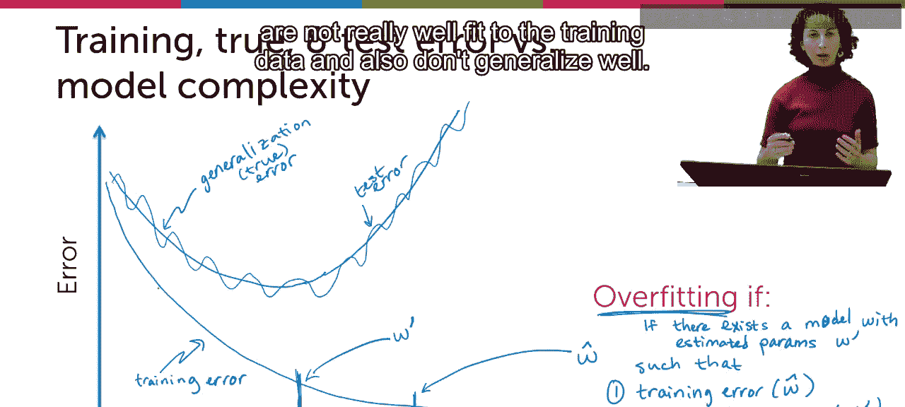
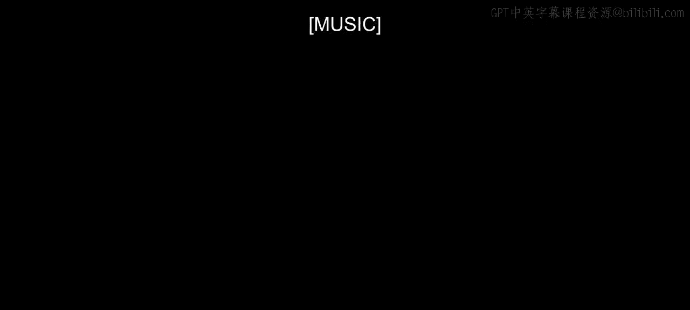

机器学习：第2课：定义过拟合 📈

在本节课中，我们将正式定义机器学习中的一个核心概念——过拟合。我们将通过清晰的图示和条件描述，帮助你理解什么是过拟合，以及如何识别它。

---

上一节我们讨论了模型复杂性与泛化能力的关系，本节中我们来看看如何正式定义“过拟合”。

过拟合是指，当你有一个模型（例如，一个具有参数 **Ŵ** 和一定复杂度的模型）时，如果满足以下两个条件，则该模型是过拟合的：

以下是判断模型是否过拟合的两个核心条件：

1.  模型 **Ŵ** 的**训练误差**小于另一个模型 **W‘** 的训练误差。
2.  模型 **Ŵ** 的**真实误差**大于另一个模型 **W‘** 的真实误差。

用公式可以表示为：
*   **条件一**：`训练误差(Ŵ) < 训练误差(W‘)`
*   **条件二**：`真实误差(Ŵ) > 真实误差(W‘)`

这个概念可能看起来不那么直观。让我们结合这张图来解释，图中的点正好对应了上述两个条件。

图中存在一系列真实误差大于 **W‘** 的模型。而过拟合的模型是那些**训练误差特别小**的模型。这些模型对训练数据集的拟合程度非常高，但泛化能力很差。而图中另一半空间的点，则是对训练数据拟合不好、同时泛化能力也差的模型。

---

本节课中我们一起学习了过拟合的正式定义。一个模型如果**在训练集上表现优异（误差小），但在真实数据上表现不佳（误差大）**，并且存在另一个在两方面表现更均衡的模型，那么它就是过拟合的。理解这一定义是后续讨论如何避免和解决过拟合问题的基础。