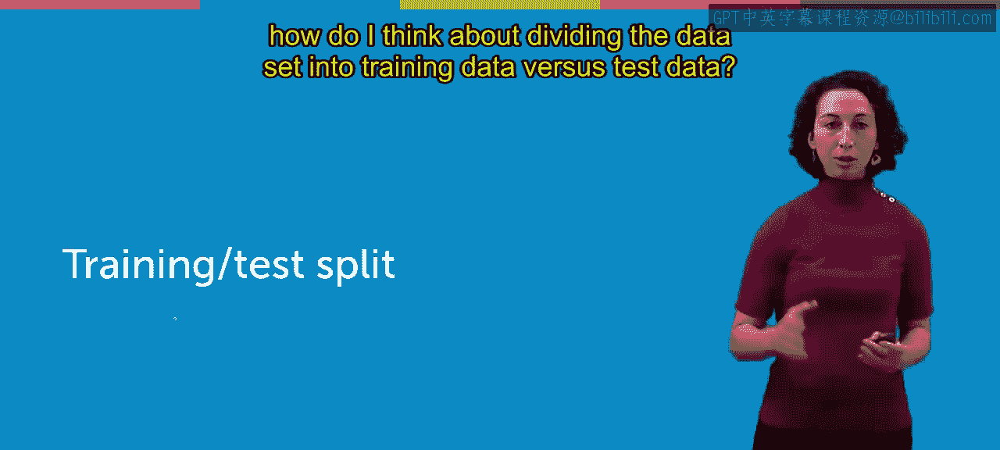
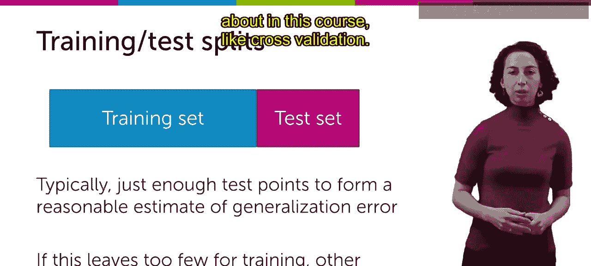

# 华盛顿大学《机器学习（回归，第2课⧸共4课）｜Machine Learning》中英字幕 p55 55_训练测试集分割.zh_en -BV11b421H7XL_p55-

。

So we've said to assess the performance of our model。

 we really need to have a test data set carved out from our full data set。

 so this raises the question of how do I think about dividing the data into training data versus test data？

So in pictures。How many points do I put in this blue space here， this training set。

 versus this pink space， this test set？Well， if I put two few points in my training set。

 then I'm not going to estimate my model well， and so I'm going to have clearly bad predictiveor performance because of that。

But on the other hand， if I put too few points in my test set。

 that's going to be a bad approximation to generalization error because it's not going to represent a wide enough range of things that I might see out there in the world。

So there's no perfect formula for how to split a data into training versus test。

 but a general rule of thumb if you can figure out how to do this is typically you want just enough points in your test set to approximate generalization error well。

 and you want all the rest of your points in your training data。

 because you want to have as many points in your training data set to learn a good model。

 especially when you're looking at very complex models。But you still， like we've said before。

 I want to have enough points in your test set to。Analyze the performance of the fitted model。Okay。

 well this is assuming that you have enough data to do this type of split。

So that you can leave enough points both in the training and test sets， but if that isn't the case。

 there are other methods we're going to talk about in this course like cross validation。

