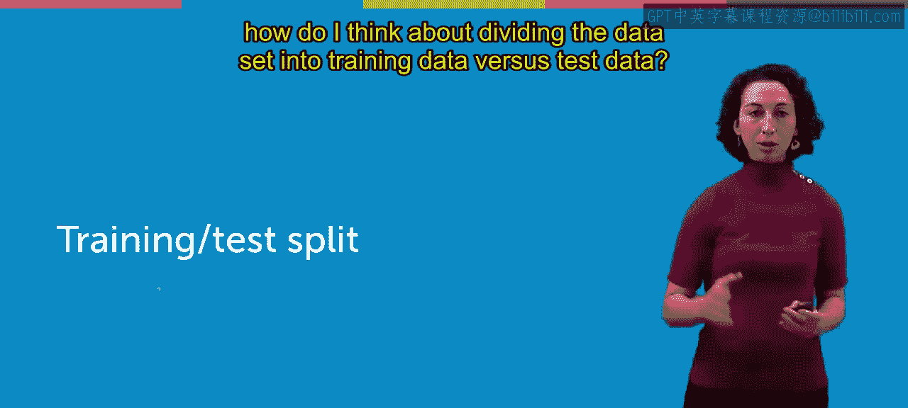
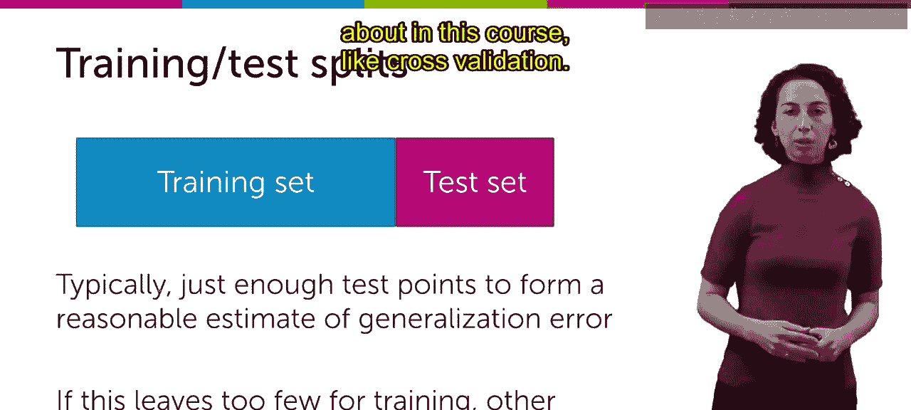

# 机器学习：第2课：训练集与测试集分割

在本节课中，我们将学习如何将数据集分割为训练集和测试集，这是评估模型性能的关键步骤。我们将探讨分割的原则、权衡以及一些实用的经验法则。

---

为了评估模型的性能，我们确实需要从完整数据集中划分出一个测试数据集。这就引出了一个问题：应如何考虑将数据划分为训练数据与测试数据？

用图示来说，我应该在这个蓝色区域（即训练集）中放入多少个数据点，又应该在这个粉色区域（即测试集）中放入多少个数据点？

如果我在训练集中放入的点太少，那么我将无法很好地估计我的模型，因此模型的预测性能显然会很差。

另一方面，如果我在测试集中放入的点太少，那将是对泛化误差的一个糟糕近似，因为它无法充分代表我在现实世界中可能遇到的各种情况。

将数据分割为训练集和测试集并没有完美的公式，但如果你能确定如何操作，一个通用的经验法则是：你只需要在测试集中放入足够多的点来很好地近似泛化误差，而将剩余的所有点都放入训练数据中。因为你希望在训练数据集中有尽可能多的点来学习一个好的模型，尤其是在处理非常复杂的模型时。

但正如我们之前所说，你仍然需要在测试集中有足够的点来分析拟合模型的性能。

以上讨论假设你有足够的数据来进行这种分割，以便在训练集和测试集中都留有足够的点。但如果情况并非如此，本课程后续将讨论其他方法，例如交叉验证。

---

本节课中，我们一起学习了数据集分割的重要性。我们了解到，需要在训练集和测试集之间取得平衡：训练集需要足够的数据来学习有效的模型，而测试集也需要足够的数据来可靠地评估模型的泛化能力。当数据量不足时，可以考虑使用交叉验证等其他方法。