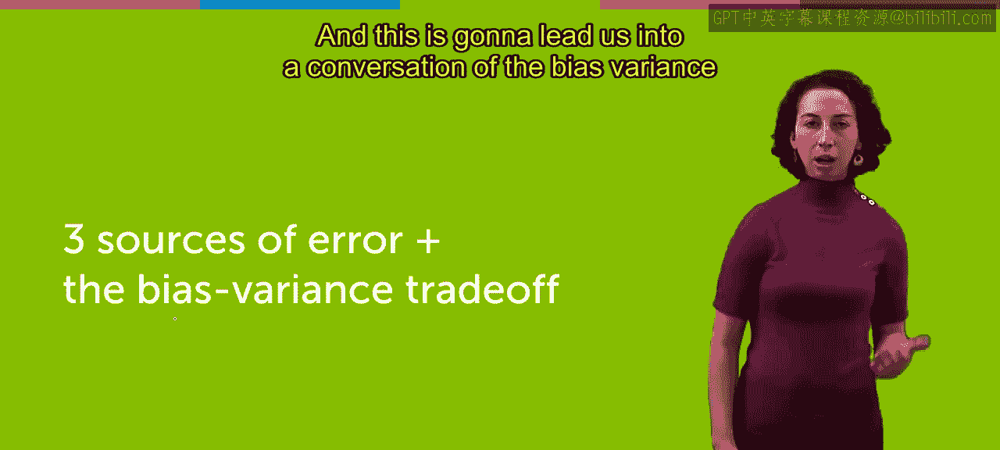
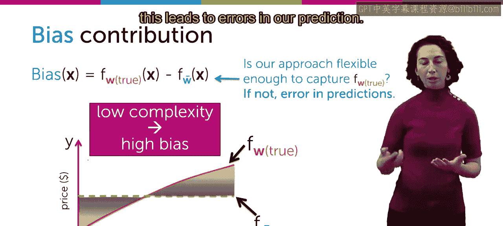

# 华盛顿大学《机器学习（回归，第2课⧸共4课）｜Machine Learning》中英字幕 p56 56_不可约误差和偏差.zh_en -BV11b421H7XL_p56-

。

Okay， so we've talked about three different measures of error。

 and now in this part we're going to talk about three different sources of error。

 and this is going to lead us into a conversation of the biovariance trade off。

Okay， so when we're forming our predictions， there are three different sources of error， noise。

 bias and variance， and in this part we're going to walk through these three different components at a very high level at a more intuitive level。

 and then following this they're going to be too optional sections that go into much more formalism in detail about this。

 but those are optional because we're not requiring that you know this to get through the course。

 but for those that are interested， we will be providing the formalism behind these notions that I'm presenting now。

Let's look at this first term， this noise term。 And as we've mentioned many times in this specialization。

 data are inherently noisy。 So the way the world works is that there's some true relationship between square feet and the value of a house or generically between X and Y。

 and we're representing that arbitrary relationship defined by the world by F sub w true。

 It's just notation we're using for that functional relationship。 But， of course。

 that's not a perfect description between x and Y。 the number of square feet and the house value。

 there are a lot of other contributing factors， including other attributes of the house that are not included just in square feet or how a person feels when they go in and make a purchase of a house or a personal relationship they might have with the owners or lots and lots of other things that we can't ever perfectly capture with just some function between square feet and value。

 And so that is the noise that's inherent in this process represented by this epsilon term。

So in particular， for any observation Yi， it's the sum of。

This relationship between square feet and the value plus this noise term epsilon I specific to that eh house。

 and we've talked before about our assumption that this noise has zero mean。

Because if it didn't that could be shoved into the F function instead。

 but what we haven't talked about is the spread of that noise， so at any given square feet。

 what kind of variation in house price are we likely to see based on this type of noise that's inherent in our observations and so this is referred to as the variance of this noise term epsilon。

And this is something that's just a property of the data。 We don't have control over this。

 This has nothing to do with our model nor our estimation procedure。

 It's just something that we have to deal with。 And so this is called irreducible error because it's nothing that we can reduce through choosing a better model or better estimation procedure Okay so the things that we can control our bias invariance。

 So we're going to focus quite heavily on those two terms。 So let's start by talking about bias。

 And this is basically just an assessment of how well my model can fit the true relationship between X and Y。

So to think about this， let's think about how we get data in our data set。

 so here these points that we observed， they're just a random snapshot of end houses that were sold and recorded and we tabulated in our data set。

嗯。Well， based on that data， we fit some function and this thinking about bias。

 it's intuitive to start， which is a very， very simple model of just a constant function。

 So that's what I'm going to show here， but we fit whatever model we're specifying。

But what if another set of end houses had been sold？

Then we would have had a different data set that we were using， and when we went to fit our model。

 we would have gotten a different line。Okay， and to make this point pretty explicit。

 I want to go back and look a little bit at these points that I drew here。In the first data。

 I tended to draw points that were below the true relationship。

 so they happened to have our houses in our data happen to have values less than what the world kind of specifies as typical。

And on the right hand side， I drew points that tended to lie above the line。

 So these are pretty extremely different data sets。

 But what you see is that the fits are pretty similar。 So this is going to come up later。

 And I wanted to point this out now。 Okay， but let's get back to this notion of bias。

So what we are saying is over all possible data sets of size n that we might have been presented with of how sales。

What do we expect our fit to look like So for one data set of size n we get this fit。

 here's another data set， here's another data set or the fits associated with those data sets。

 and of course there's a continuum of possible fits we might have gotten and for all those possible fits here this dashed green line represents our average fit averaged over all those fits waiteded by how likely they were to have appeared。

Okay， so now we can start talking about bias what bias is is it's the difference between this average fit and the true function。

F true。Okay， so that's what this equation shows here。

 and we're seeing this with this gray shaded region。

 that's the difference between the true function and our average fit。And so intuitively。

 what bias is saying is， is our model flexible enough to， on average。

 be able to capture the true relationship between square feet and house value and what we see is that for this very simple。

 constant model，This low complexity model has high bias。

 it's not flexible enough to have a good approximation to the true relationship。

And because of these differences， because of this bias， this leads to errors in our prediction。

