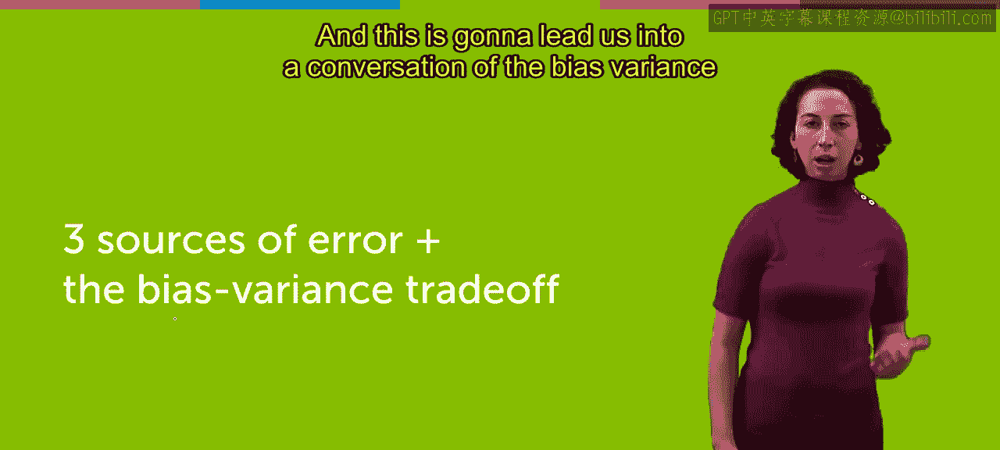
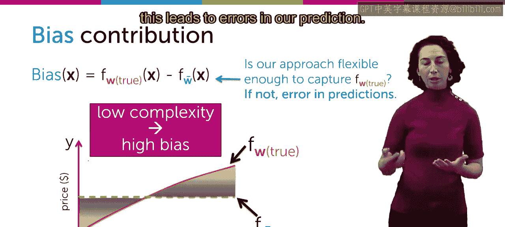

# 机器学习：第2课：不可约误差与偏差

在本节课中，我们将学习预测误差的三个主要来源：噪声、偏差和方差。我们将首先理解什么是不可约误差，然后深入探讨偏差的概念，并直观地理解它如何影响我们的模型预测。

## 概述

当我们构建预测模型时，预测值与真实值之间的误差并非凭空产生。它主要来源于三个方面：数据中固有的**噪声**、模型本身因过于简单而导致的**偏差**，以及模型对训练数据随机波动的敏感性所导致的**方差**。本节我们将重点讨论噪声和偏差，理解它们为何产生以及如何影响我们的预测。

---

## 噪声：不可约误差

上一节我们介绍了不同的误差衡量方式。本节中，我们来看看误差的来源。首先，让我们认识第一个误差来源——噪声。

数据本身具有固有的噪声。世界运行的方式是，在房屋面积（X）和房价（Y）之间，或者说在一般的X和Y之间，存在某种真实的关系。我们用 `F_w_true` 这个函数来表示这种由世界定义的任意关系。但这并非X和Y之间完美的描述。除了面积，还有许多其他因素影响房价，例如房屋的其他属性、购房者的个人感受、与房主的关系等。这些我们无法仅通过一个函数完美捕捉的因素，就是过程中的固有噪声，我们用 `ε` 来表示。

具体来说，对于任何一个观测值 `Y_i`，它都是真实关系与针对该房屋的特定噪声项 `ε_i` 之和：
`Y_i = F_w_true(x_i) + ε_i`

我们之前假设这个噪声的均值为零（否则其均值部分可以被并入F函数中）。但我们尚未讨论的是这个噪声的离散程度，即在任何给定的房屋面积下，基于这种观测中固有的噪声，我们可能看到的房价波动范围。这被称为噪声项 `ε` 的**方差**。

这是数据本身的一种属性。我们无法控制它，它与我们选择的模型或估计方法无关，是我们必须处理的问题。因此，这被称为**不可约误差**，因为我们无法通过选择更好的模型或估计方法来减少它。

---

## 偏差：模型的固有限制

既然噪声是我们无法控制的，那么我们可以控制的就是**偏差**和**方差**。接下来，让我们重点讨论偏差。

偏差本质上评估的是我们的模型**平均而言**拟合X和Y之间真实关系的能力。为了理解这一点，让我们思考数据是如何获得的。

我们观测到的数据点，只是已售出并被记录在案的N个房屋的一个随机快照。基于这些数据，我们拟合出一个函数。为了直观理解偏差，我们从最简单的模型——常数函数（例如，用所有房屋的平均房价来预测）开始思考。

如果我们观测到的是另一组N个已售房屋呢？那么我们就会得到一个不同的数据集，当我们去拟合模型时，就会得到一条不同的（水平）线。

为了更明确地说明这一点，请看示意图。在左侧数据集中，我倾向于绘制一些位于真实关系线之下的点（即数据中的房屋价格恰巧低于世界定义的典型值）。在右侧数据集中，我绘制了倾向于位于线上方的点。这是两个差异极大的数据集，但你会发现，拟合出的（水平）线却非常相似。这一点我们稍后会再次提到。

现在回到偏差的概念。我们所说的是，在所有可能出现的、大小为N的房屋销售数据集中，我们期望得到的拟合结果平均来看是什么样子。对于一个数据集，我们得到一条拟合线；对于另一个数据集，我们得到另一条拟合线。当然，存在一系列我们可能得到的拟合结果。对于所有这些可能的拟合，图中绿色的虚线代表了我们的**平均拟合**，即对所有拟合结果按其出现的可能性进行加权平均。

现在我们可以定义偏差了。**偏差**就是这个平均拟合与真实函数 `F_true` 之间的差异。在图中，这表现为灰色阴影区域，即真实函数与我们平均拟合线之间的差距。

直观地说，偏差衡量的是：我们的模型是否足够灵活，能够**平均而言**捕捉到房屋面积与房价之间的真实关系？我们看到，对于这个非常简单的、低复杂度的常数模型，它具有**高偏差**。它不够灵活，无法很好地近似真实关系。

由于这种差异，由于这种偏差，导致了我们预测中的误差。

---

## 总结

本节课我们一起学习了预测误差的两个重要来源。首先，我们认识了**不可约误差（噪声）**，它源于数据生成过程本身固有的随机性，是我们无法通过改进模型来消除的。接着，我们深入探讨了**偏差**，它反映了模型由于过于简单（例如假设房价与面积无关）而无法捕捉数据真实关系的固有限制。高偏差的模型会导致系统性的预测误差。

理解这些概念是迈向构建更好模型的第一步。在接下来的章节中，我们将探讨误差的第三个来源——方差，并学习如何在偏差和方差之间进行权衡，这就是著名的**偏差-方差权衡**。