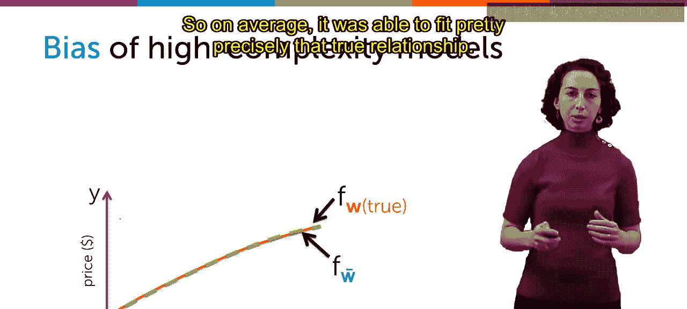
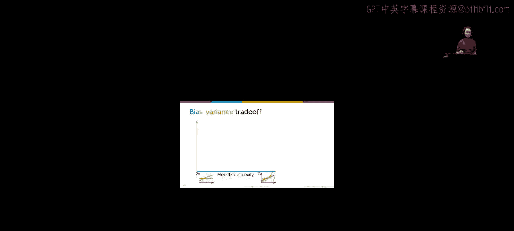
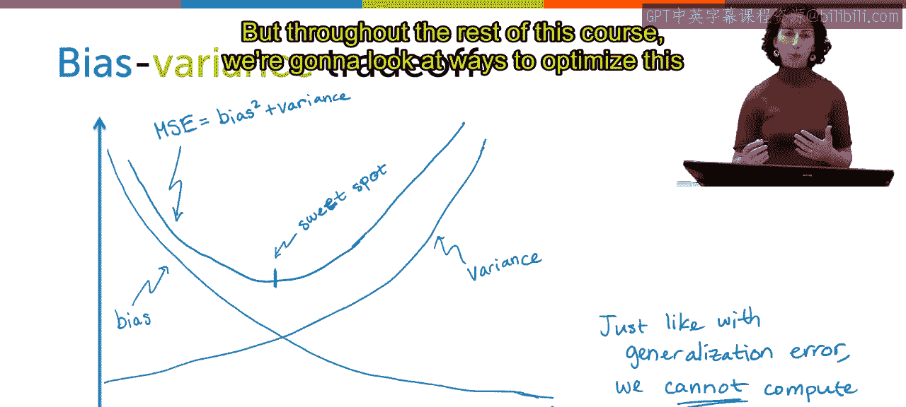

# 华盛顿大学《机器学习（回归，第2课⧸共4课）｜Machine Learning》中英字幕 p57 57_方差和偏差-方差权衡.zh_en -BV11b421H7XL_p57-

。

Okay， well now let's turn to this third component， which is variance and what variance is going to say is how different can my specific fits to a given data be from one another as I'm looking at different possible data sets。

And in this case， when we were looking at just this constant model。

 we showed by that early picture where I drew points that were mainly above the true relationship and points mainly below that the actual resulting fits didn't vary very much。

 And when you look at the space of all possible observations， you get。

 you see that the fits they're fairly similar， they're fairly stable。

 And so when you look at the variation in these fits， which I'm drawing with these gray bars here。

We see that they don't vary， very much。So for this low complexity model。

 we see that there's low variance。Okay， so to summarize what this variance is saying is how much can the fits vary and if they could vary dramatically from one data set to the other。

 then you would have very erratic predictions， your prediction would just be sensitive to what data set you got。

 so that would be a source of error in your predictions。And to see this。

 we can start looking at high complexity models。So in particular。

 let's look at this data set again and now let's fit some high order polynomial to it。

 so that's some fit shown here。And now let's take again this same data set。

 but let's choose two points， which I'm going to highlight as these pink circles。

And let's just move them a little bit Okay， so out of this whole data set。

 I've just moved two observations。And not too dramatically， but I get a dramatically different fit。

So then when I think about looking over all possible data sets I might get。

 I might get some very crazy set of curves。There is an average curve。And in this case。

 the average curve is actually pretty well behaved because this wild wggly curve is at any point。

Equally likely to have been wild above or wild below。 So on average， over all data sets。

 it's actually a fairly smooth， reasonable curve。 But if I look at the variation between these fits。

It's really， really， really large， so what we're saying is that high complexity models have high variances。

On the other hand。If I at complexity if I look at the bias of this model。So here again。

 I'm showing this average fit， which was this fairly well behaved curve。

I match pretty well to the true relationship between square feet and house value because my model was really。

 really flexible。So on average， it was able to fit pretty precisely that true relationship。

 so these high complexity models have low bias。

So we can now talk about this bias variance trade off so in particular we're going to plot bias and variance as a function of model complexity and so what we saw in the past slides is that as our model complexity increases。

Our bias decreases。Because we can better and better。

Approximate the true relationship between x and y， so this curve here is our bias curve。

On the other hand， variance increases。So， our。Very simple model had very low variances。

 and the high complexity models had high variances。So this is a picture of our variance。

And so what we see is there's this natural treat off between bias andvari。

 and one way to summarize this is something that's called mean squared error。

And so mean squared error， which if you watch the optional videos that go into all these concepts more in depth。

 you'll hear a lot more about mean squared error and the formal definition。Or the derivation of this。

 but mean squared error is simply the sum of bias squared plus variance。Okay。

I guess I'll write out variants to be very clear。So。This is my little cartoon of。

B a squared plus variance。This is my mean squared error curve。

And machine learning is all about this trade off between bias and variants。

 we're going to see this again and again in this course。

 and we're going to see it throughout the specialization。And the goal is finding this sweet spot。

This is the sweet spot where we get。Our minimum error。

 the minimum contribution of bias and variance to our prediction errors。Ah so not sweet sweet。

 it is sweet sweet， but it's what I'm trying to write is sweet spot。

And this is what we'd love to get at that's the model complexity that we'd want。嗯。

But just like with generalization error， so I'm going to write this down。With。Generalization error。

Can we compute this？So think about that while I'm writing。We。Can。Not。Compute。

Bs invari and thus mean squared error。And why。Well。

 the reason is because just like with generalization error。

 they were defined in terms of the true function， well bias was defined very explicitly in terms of the relationship relative to the true function。

 and when we think about defining variants， we have to average over all possible data sets and the same was true for bias2。

 but all possible data sets of size N we could have gotten from the world and we just don't know what that is。

Okay， so we can't compute these things exactly， but throughout the rest of this course。

 we're going to look at ways to optimize this trade off between bias andvari in a practical way。

