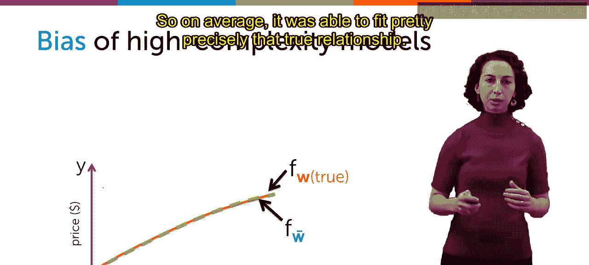
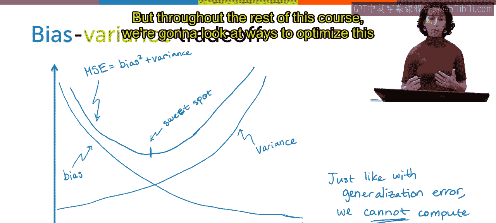

# 机器学习：第2课：方差与偏差-方差权衡

在本节课中，我们将学习机器学习模型评估中的两个核心概念：**方差**和**偏差-方差权衡**。理解这两者对于选择合适复杂度的模型至关重要。

## 方差的概念

上一节我们介绍了偏差，它衡量了模型预测的平均值与真实值之间的差距。本节中，我们来看看**方差**。

方差描述的是：对于不同的训练数据集，模型拟合出的具体结果之间差异有多大。换句话说，它衡量了模型预测的**稳定性**。

*   以一个简单的常数模型为例。即使数据点随机分布在真实关系线的上方或下方，模型拟合出的结果（一条水平线）变化并不大。这意味着该模型的预测在不同数据集上相当**稳定**。
*   当我们观察所有可能数据集的拟合结果时，会发现这些拟合线彼此非常相似。因此，这个低复杂度模型的**方差很低**。

总结来说，方差衡量的是模型拟合结果的波动程度。如果模型预测因训练数据的不同而产生剧烈变化，那么预测就会非常不稳定，这将成为预测误差的一个来源。

## 高复杂度模型的方差

为了更直观地理解，让我们观察高复杂度模型的情况。

*   再次观察同一个数据集，这次我们用一个高阶多项式来拟合，得到一条如示例所示的复杂曲线。
*   现在，保持数据集主体不变，仅轻微移动其中的两个数据点（例如图中标为粉色的点）。
*   尽管数据变动不大，但得到的拟合曲线却发生了**戏剧性的变化**。

这意味着，当我们考虑所有可能的数据集时，可能会得到一系列形状迥异、非常“疯狂”的曲线。虽然所有这些曲线的**平均**可能是一条相对平滑、合理的曲线（因为剧烈波动的部分在平均过程中被抵消了），但**不同拟合曲线之间的差异（即方差）确实非常大**。

因此，高复杂度模型具有**高方差**。

## 偏差-方差权衡

现在，我们可以将偏差和方差放在一起讨论，形成**偏差-方差权衡**的概念。

以下是偏差和方差随模型复杂度变化的趋势：

*   **偏差**：随着模型复杂度增加，模型能越来越精确地逼近X和Y之间的真实关系，因此**偏差会减小**。高复杂度模型具有**低偏差**。
*   **方差**：随着模型复杂度增加，模型对训练数据的变化变得极其敏感，因此**方差会增大**。高复杂度模型具有**高方差**。

一种总结这种权衡关系的方法是使用**均方误差**。均方误差可以近似分解为偏差的平方加上方差：

`MSE ≈ Bias² + Variance`

机器学习在很大程度上就是在处理这种偏差与方差之间的权衡。我们的目标是找到一个“最佳平衡点”，即模型复杂度的一个**甜区**。在这个甜区，偏差和方差共同贡献的预测总误差达到最小。

## 重要说明：与泛化误差的关系

然而，就像我们无法直接计算**泛化误差**一样，我们也**无法精确计算**偏差和方差，进而无法精确计算均方误差。

原因在于：
1.  偏差的定义明确依赖于我们未知的“真实函数”。
2.  方差和偏差的计算都需要对所有可能的数据集（从世界中抽取的、大小为N的所有样本）进行平均，而这在现实中是无法做到的。

尽管无法精确计算，但在本课程后续内容中，我们将学习如何在实践中优化这种偏差-方差的权衡，以构建更好的模型。

## 总结

本节课中，我们一起学习了：
1.  **方差**：衡量模型预测对于不同训练数据的敏感度或稳定性。低复杂度模型方差低，高复杂度模型方差高。
2.  **偏差-方差权衡**：模型复杂度存在一个内在的权衡。增加复杂度可以降低偏差，但会增大方差；降低复杂度可以减少方差，但会增加偏差。
3.  **目标**：通过实践方法，寻找偏差与方差之间的最佳平衡点，以最小化模型的整体预测误差。