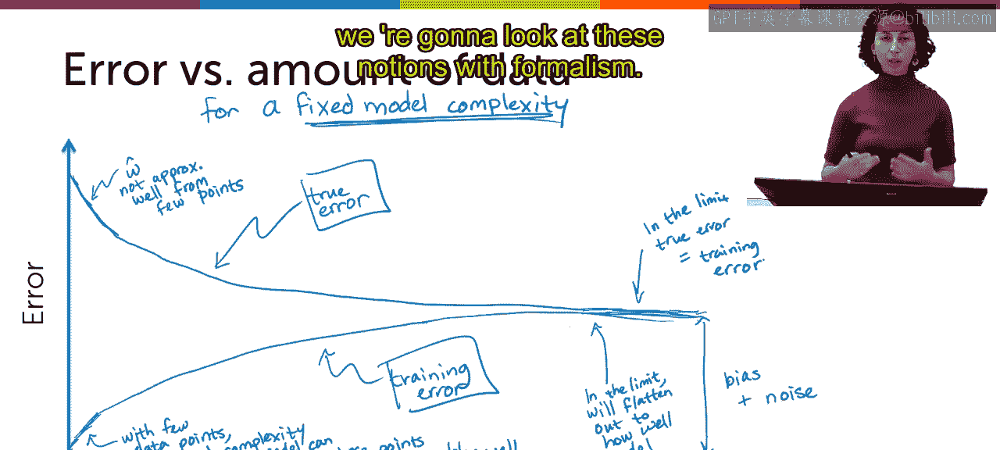

# 华盛顿大学《机器学习（回归，第2课⧸共4课）｜Machine Learning》中英字幕 p58 58_误差与数据量的关系.zh_en -BV11b421H7XL_p58-

。

Okay， so another thing we can look at now that we understand this notion of bias are our measures of error as a function of the number of data points in our training data。

Okay， so let's start with looking at our true error， our generalization error。 But first。

 I want to make sure it's clear we're looking at these errors for。A fixed model complexity。

 so previously we're looking at errorss versus model complexity。

 but now we're fixing the model complexity and looking as a function of the number of data points。

Fexed model。Complexity。And let's look at our true error and our true error starts somewhere and it's somewhere high because when we have very few data points。

 our fitted function is a pretty poor estimate of the true relationship between x and Y so our true error is going to be pretty high。

 so let's say that W hat is not。Approximateated well。From few points。

But as we get more and more data， we get a better and better approximation of our model and our true error decreases。

But it decreases to some limit， and what is that limit？So this is。True error， just to be clear。Well。

 that limit is the bias plus the noise inherent in the data。

 because as we get tons and tons of observations， well we're taking our model and we're fitting it as well as we could ever hope to fit it because we have every observation out there in the world。

But the model might just not be flexible enough to capture the true relationship between x and y。

 and that is our notion of bias。 Plus， of course， there's the error just from the noise and the observations that other contribution。

 Okay， so this difference here。Is the bias？In of the model。And noise of the data。Okay。

 so that might make sense as a plot of true error versus number of data points。

 but now let's look at training there。And this might look a little more surprising。

So let's say our training error starts somewhere。But what ends up happening is training error goes up as you get more and more data points because remember we're keeping the model complexity fixed so when we have few data points。

So， with。Few。Data points。A fixed complexity model can fit them。And I guess reasonably well。

 whatever it is。It needs。Points。Reasonably well or reasonably， of course。

 depends on what the complexity of the model is。But as I get more and more and more data points。

That same complexity of a model can't hope to fit all these points perfectly well。

And what is the limit？What is the limit of？嗯。Training error。

Let me just annotate this as training error。Well， that limit is exactly the same as the limit of our true error。

 And why is that， Well， I have tons and tons of points there。

 That's all points that there could ever be possibly in the world。 and I fit my model to it。

And if I measure training error， I'm measuring it to all the possible points there are out there in the world。

That's exactly what our definition of true error is。

 so they converge to exactly the same point in the limit where that difference again。

 is the bias inherent from the lack of flexibility of the model plus the noise inherent in the data。

Okay， so just to write this down。In the limit。Of getting lots and lots of data points。

This curve is going to flatten out。2， how well。冇咯。Can。Fit。True。Relationship F。F some true。Okay。

 so I feel like I should annotate here also saying。In the limit。Are true。Eor。

Equals our training error。Okay。So what we've seen so far in this module are three different measures of error。

 our training， our true or generalization error， as well as our test error approximation of generalization error。

 and we've seen three different contributions to our errors。

 thinking about the inherent noise in the data， and then thinking about this notion of bias and variance。

 and we finally concluded with this discussion on the trade off between bias andvaris。

 and how bias appears，No matter how much data we have。

 we can't escape the bias from having specified a model of a given complexity。Okay。

 and in the subsequent few videos， we're going to look at these notions with a lot more formalism。

