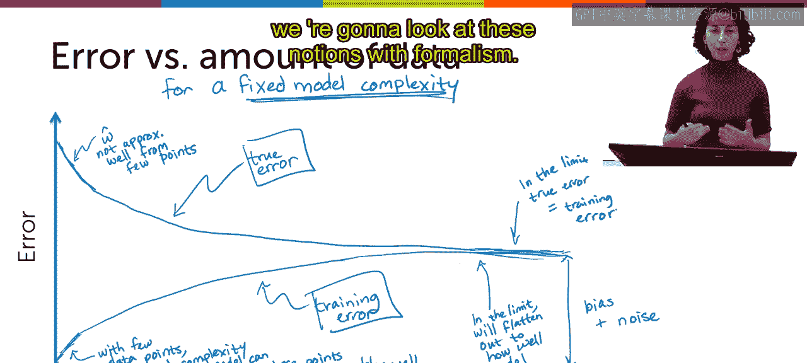

# 机器学习：第2课：误差与数据量的关系 📈


在本节课中，我们将探讨模型误差如何随着训练数据量的变化而变化。我们将重点关注在**模型复杂度固定**的前提下，真实误差与训练误差随数据点数量增加而呈现的不同趋势。

上一节我们介绍了偏差与方差的概念，本节中我们来看看当数据量变化时，它们如何影响我们的误差评估。

## 固定模型复杂度下的误差分析

首先需要明确，我们是在**模型复杂度固定**的条件下进行分析。这与之前观察误差随模型复杂度变化的情况不同。

## 真实误差（泛化误差）的趋势

让我们从观察真实误差（即泛化误差）开始。当训练数据点非常少时，我们拟合出的函数 `ŵ` 是对 `x` 和 `y` 之间真实关系的较差估计。因此，真实误差会相当高。

**公式表示：**
`ŵ` 无法从少量数据点中得到良好近似。

随着我们获得越来越多的数据，我们对模型的近似会越来越好，真实误差也随之下降。然而，这种下降存在一个极限。

这个极限就是模型的**偏差**加上数据中固有的**噪声**。因为即使我们拥有海量观测数据，并将模型拟合到极致，模型本身可能仍不够灵活，无法完全捕捉 `x` 和 `y` 之间的真实关系——这就是偏差的概念。此外，观测数据中的噪声也会贡献误差。

**图示总结：**
真实误差曲线从高点开始，随数据量增加而下降，最终趋于一个由 **偏差 + 噪声** 决定的平台。

## 训练误差的趋势

现在让我们看看训练误差。这个趋势可能看起来更令人惊讶。

训练误差的起点可能较低。但随着数据点越来越多，训练误差实际上会**上升**。这是因为我们保持模型复杂度固定：当数据点很少时，一个固定复杂度的模型可以相当好地拟合这些点。

**代码示例（概念性描述）：**
```python
# 当数据点少时，固定复杂度模型容易拟合（可能过拟合）
model.fit(few_data_points) # 训练误差低
# 当数据点多时，相同复杂度的模型无法完美拟合所有点
model.fit(many_data_points) # 训练误差升高
```

随着数据点不断增加，相同复杂度的模型无法期望完美拟合所有这些点。那么训练误差的极限是什么？

训练误差的极限与真实误差的极限**完全相同**。原因在于：当数据量趋于无穷时，训练集就包含了世界上所有可能的数据点。在此训练集上测量误差，其定义就等同于真实误差的定义。

因此，在数据量极大的极限情况下，两条曲线会收敛到同一点。这个收敛点同样由模型的**偏差**和数据固有的**噪声**决定。

**核心结论：**
在获取海量数据点的极限情况下，真实误差等于训练误差。

## 本课总结

在本节课中，我们一起学习了误差度量与训练数据量之间的关系。我们了解到：

*   在模型复杂度固定的前提下，**真实误差**随数据量增加而下降，并趋于由**偏差**和**噪声**决定的极限。
*   **训练误差**随数据量增加而上升，在数据量极大时与真实误差收敛于同一点。
*   无论我们拥有多少数据，由模型复杂度不足引起的**偏差**都是无法消除的。



至此，我们已经介绍了三种误差度量（训练误差、真实/泛化误差、测试误差）以及误差的三个来源（噪声、偏差、方差），并探讨了偏差与方差之间的权衡。在接下来的课程中，我们将以更形式化的方式深入探讨这些概念。