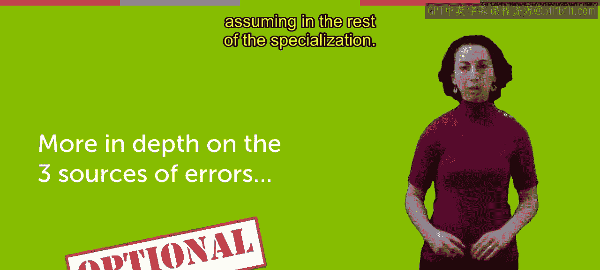
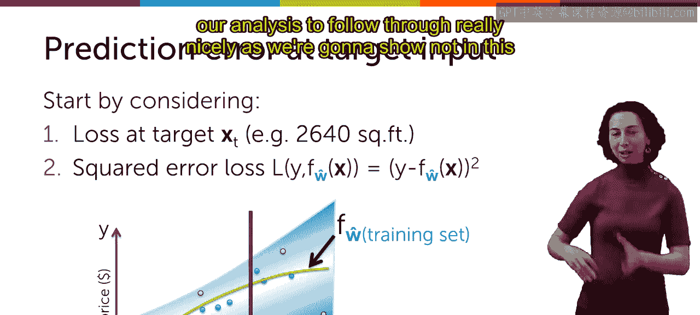
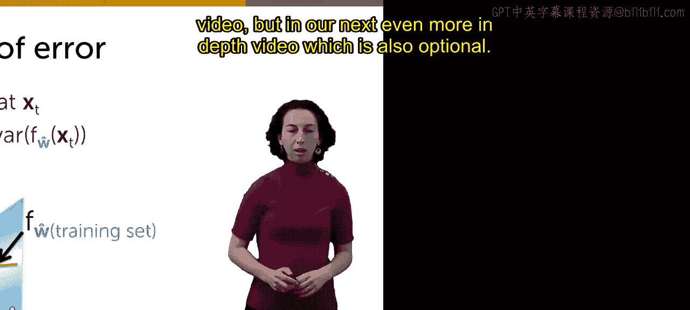
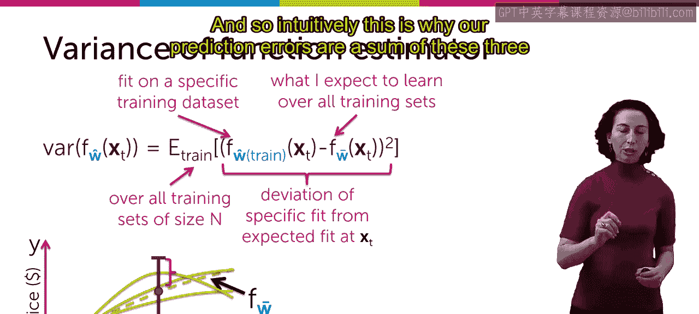
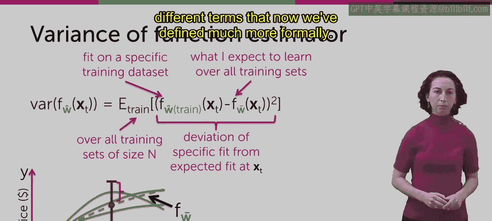

# 华盛顿大学《机器学习（回归，第2课⧸共4课）｜Machine Learning》中英字幕 p59 59_正式定义三种误差来源.zh_en -BV11b421H7XL_p59-

。

So by now we've gone through notions of three sources of error at a level that's needed to be a practitioner in machine learning。

 but we know that some of you are interested in more of the technical underpinnings of these ideas both in terms of mathematical formalisms and statistical understanding。

 and so what we've done is created this optional video that provides a much more technical definition of the three sources of error for those of you that are interested in this material。

 but we want to highlight that this is completely optional because this will be taught at a much more technical level than what we're assuming in the rest of the specialization。

So we'd mentioned that the training set is just a random sample of sun N observations in this case some N houses that were sold and recorded。

 but what if some n other houses had been sold and recorded。

 how would their performance change So for example。

 here in this picture we're showing one set of n observations that are used for training data those are the blue circles and we fit some quadratic function through this data and here we show some other set of n observations and we see that we get a different fit。

And to assess our performance of each one of these fits。

 we can think about looking at generalization error。

 so in the first case we might get one generalization error of this specific fit， W hat1。

 and in the second case we would get some different evaluation of generalization error。

 let's call it generalization error of W hat2。But one thing that we might be interested in is how do we perform on average for a training data set of N observations because imagine I'm trying to develop a tool that's going to be used by real estate agents to form these types of predictions I like to design my tool。

 package it up and send it out there and then a real estate agent might come in and have some set of observations of house sales from their neighborhood。

That they're using to make their predictions so that might be different than another real estate agent and what I'd like to know is for a given amount of data。

 some training set of size and how well should I expect the performance of this model to be。

 regardless of what specific training data set I'm looking at。So in these cases。

 what we'd like to do is average our performance over all possible fits that we might get。

 and what I mean by that is all possible training data sets that might have appeared and the resulting fits on those data sets。

So formally， we're going to define this thing called expected prediction error。

 which is the expected value of our generalization error over different training dataset sets。

 so very specifically for a given training dataset we get parameters that are fit to that dataset。

 so I'll call that W hat of training set and then for that estimated model I can evaluate my generalization error and what the expected prediction error is doing is it's taking a weighted average over all possible training sets that I might have seen where for each one I get a different set of estimated parameters and thus's a different notion of the generalization error。

And to start analyzing this quantity of prediction error。

 let's specifically look at some target input Xt， which might be a house with 2640 square feet。

 and let's also take our loss function to be squared error。So in this case。

 when we're talking specifically about target point XT。

 what we can do later after we do the analysis specifically for Xt is we can think about averaging this over all possible Xts over all X all square feet。

 but in some cases we might actually be interested in one region of our input space in particular。

 okay and then when we talk about using squared error in particular。

 this is going to allow our analysis to follow through really nicely as we're going to show not in this video but in our next even more in-depth video which is also optional。

Okay， but under these assumptions of looking specifically at Xt and looking at squared error as our measure of loss。

 you can show that the average prediction error at Xt is simply the sum of three terms which we're going to go through Sigma squared plus bias squared plus variance Okay。

 so these terms are yet to be defined。 and this is what we're going to walk through in this video in a much more formal way than we did in the previous set of slides。

So let's start by talking about this first term sigma squared and what this is going to represent is the noise that we talked about in the earlier videos。

So in particular， remember that we're saying that there's some true relationship between square feet and house value that that's just a relationship that exists out there in the world and that's captured by F subw true。

 but of course that doesn't fully capture how we think about the value of a house there are other factors at play and so all those other factors out there in the world are captured by our noise term。

 which here we write as just an additive term plus epsilon so epsilon is our noise。

 and we said that this noise term has zero mean because if not we could just shove that other component into F subw true。

But we're just going to make the assumption that epsilon has zero mean。

 then we can start talking about what is the spread of noise that you're likely to see at any point in the input space and that spread is called the variance okay。

 so we denote it by sigma squared and sigma squared is the variance of this noise epsilon。

And as we talked about before， this noise is just noise that's out there in the world。

 we have no control over it， no matter how complicated and interesting of a model we specify our algorithm for fitting that model。

 we can't do anything about the fact that we're using X for our prediction。

 but there's just inherently some noise in how our observations are generated in the world。Okay。

 so for this reason， this is called our irreducible error。

Because it's noise that we can't reduce through any choices that we have control over。

So now let's talk about this second term bias squared， and remember that when we talked about bias。

 this was a notion of how well our model could， on average。

 fit the true relationship between x and y。But now let's go through this at a much more formal level。

And in particular， let's just remember that there's some relationship between square feet and house value in our case。

 which is represented by this orange line， and then from this true world we get some data set and define a training set。

Which are these blue circles。 And using this training data， we estimate our model parameters。 Okay。

 well， if we had gotten some other set of endpoints， we would have fit some other functions。 Now。

 when I look over all possible。Data sets of size N that I might have gotten where remember this。

Blue shaded region that we're showing here represents the distribution over X and Y。

 So how likely it is to get different combinations of X and Y。

 And let's say I draw endpoint from this joint distribution over X and Y and over all possible values。

 I look at an estimated functions。 So for example， here the two estimated functions from the previous slide。

 those example data sets that I showed。 But of course。

 there's a whole continuum of estimated functions that I get for different training sets of size N。

 Well then when I average these estimated functions。

 these specific fits over all my possible training data sets， what I get is my average fit。

 So now let's talk about this a little bit more formally So this is we had already presented this in our previous video。

 this F subW bar But now let's define this。 This is the X。

Of a specific fit on a specific training data set， or let me rephrase that。

 the fit I get on a specific training data。Averd over all possible training data sets of size N that I might get。

Okay， so that is the formal definition of this F sub W bar。

 what we have been calling our average fit。And what we're talking about when we're talking about bias is we're talking about comparing this average fit to the true relationship and here remember again。

 we're focusing specifically on some target Xt and so the bias at Xt is the difference between the true relationship。

At X T between X T and y。 so between a given square feet and the house value。

 whatever the true relationship is between the that input and the observation versus this average。

Relationship estimated over all possible training data sets。Okay。

 so that is the formal notion of bias of Xt， and let's just remember that when it comes in as our error term we're looking at bias squared。

Okay， so that's the second term now let's turn to this third term。

 which is variance and let's go through this definition where again we're interested in this average fit F subW bar。

 this green dash line but that really isn't the quantity of interest。

 it's going to be used in our definition here， but the way the thing that we're really interested in is over all possible fits we might see。

How much do they deviate from this expected fit？Okay， so thinking about again。

 specifically at our target XT。How much variation is there in the training data set specific fits across all training data sets we might see？

And that's this variance term， and now again let's define it very formally， this is。Well。

 let me first stage just what variance is in general。

 so variance of some random variable is simply looking at the expected value of that random variable minus its mean squared。

Okay， so in this context， when we're looking at the variability of these functions at Xt。

 we're taking the expectation。And our random quantity is our estimated function for a specific training data set。

Add Xt。And then what's the mean？Of that random function， the mean is this average fit。

 this F sub W bar。 Okay， so we're looking at the difference between the fit on a specific training data set and what I expect to learn averaged over all possible training dataset sets。

 I look at that quantity squared。 And what is my expectation taken over。Sorry。

 let me just mention that this quantity， when I take this squared represents a notion of how much deviation a specific fit has from the expected fit at Xt。

And then when I think about what the expectation is taken over。

 it's taken over all possible training data sets of C N。Okay， so that's my variance term。

 And when we think intuitively about why it makes sense that we have the sum of these three terms in this specific form。

 But what we're saying is variance is telling us how much can my specific function that I'm using for prediction I'm just going to use one of these functions for prediction。

 I get a training data that gives me an F subw hat and I'm using that for prediction Well。

 how much can that deviate from my expected fit over all data sets I might have seen。 So again。

 going back to our analogy， I'm a real estate agent I grab my data I fit a specific function to that training data。

And I want to know， well， how wild of a fit could this be relative to what I might have seen on average over all possible data sets that all these other realtors are using out there？

Okay and so of course， if the function from one realtor to another realtor looking at different data sets can vary dramatically。

 that can be a source of error in our predictions。But another source of error。

 which the bias is capturing is over all these possible data sets， all these possible realtors。

If this average function just can never capture anything close to the true relationship between square feet and house value。

Then we can't hope to get good predictions either， and that's what our bias is capturing。

And why are we looking at bias squared？ Well， that's putting it on an equal footing of these variance terms。

 because remember bias was just the difference between the true value。And our expected value。

 but these variance terms are looking at these types of quantities， but squared。

 so that's intuitively why we get bias squared。And then finally， what's our third source of error？

Well， even if I could perfect， if let's say I have no variance in my estimator， I'm always， you know。

 very low variance in the model happens to be really good fit。

 So neither of these things are sources of error I'm you know doing basically magically perfect on my modeling side while still inherently there's noise in the data。

 There are things that just trying to form predictions from square feet alone can't capture。

And so that's where irreducible air or the sigma squared is coming through。And so intuitively。

 this is why our predictionaries are a sum of these three different terms that now we've defined much more formally。

