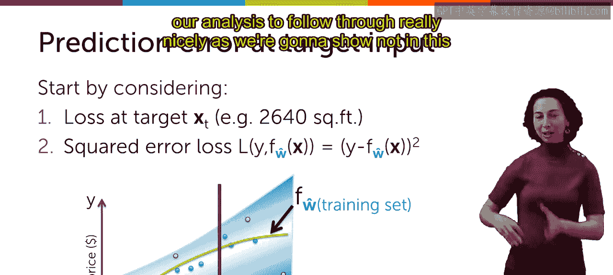
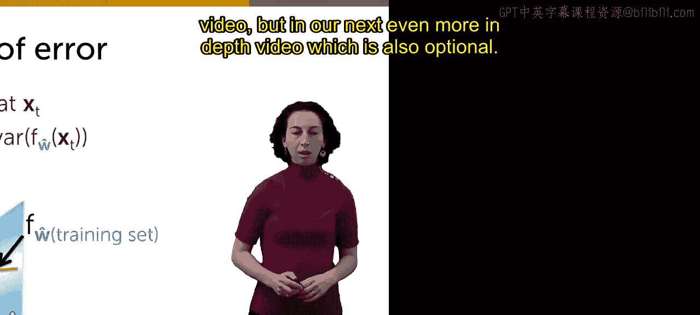
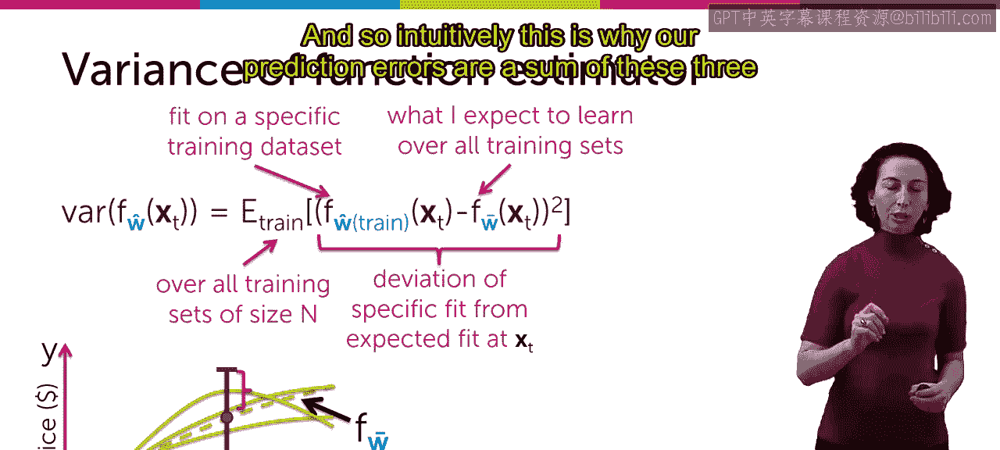
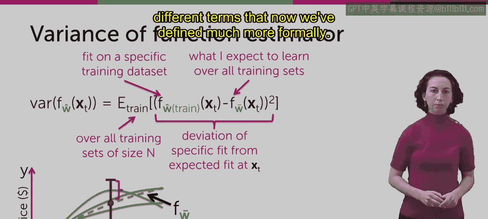

# 机器学习：第2课：正式定义三种误差来源 📊

在本节课中，我们将深入探讨机器学习模型预测误差的三个核心来源：噪声、偏差和方差。我们将以更正式、更技术性的方式定义这些概念，帮助你理解它们如何共同构成模型的总体预测误差。

---

## 概述

在前面的课程中，我们初步介绍了误差的三种来源。本节将提供一个更技术性的定义，使用数学形式化和统计理解来剖析这些概念。我们将看到，对于一个给定的目标输入点，其平均预测误差可以分解为三个明确的部分：**噪声方差**、**偏差的平方**和**估计量的方差**。

---

## 噪声方差 (σ²) 🎲

首先，我们来定义第一个误差项：噪声方差。

在现实世界中，我们假设特征 `X`（如房屋面积）和标签 `Y`（如房屋价值）之间存在一个真实但未知的关系，记作 `f_w_true(x)`。然而，我们的观测值 `Y` 并不仅仅由 `X` 决定，还受到其他无数未观测到或不可测量的因素影响。这些因素被统称为“噪声”。

我们通常将这种关系建模为：
`Y = f_w_true(x) + ε`

其中，`ε` 代表噪声项。我们假设噪声的**期望值（均值）为零**（`E[ε] = 0`），否则其非零部分可以被吸收到真实函数 `f_w_true` 中。噪声的**方差**（即其波动程度）被记为 `σ²`，也就是 `Var(ε) = σ²`。

**核心概念**：
*   **公式**：`Y = f_w_true(x) + ε`，其中 `E[ε]=0`，`Var(ε)=σ²`
*   **含义**：`σ²` 代表了数据生成过程中固有的、不可消除的随机波动。

这个误差项被称为**不可约误差**，因为无论我们选择多么复杂的模型或先进的算法，都无法减少这部分由世界本身的不确定性带来的误差。

---

## 偏差的平方 (Bias²) 🎯

上一节我们介绍了无法控制的噪声，本节我们来看看模型本身的选择所带来的误差：偏差。

偏差衡量的是，我们**平均拟合的函数**与**真实函数**之间的差距。更正式地说，假设我们从真实的数据分布中随机抽取一个大小为 `N` 的训练集，并用它来训练我们的模型，得到一个具体的拟合函数 `f_w_hat(x)`。如果我们重复这个过程无数次（抽取无数个不同的训练集），就会得到无数个具体的拟合函数。

所有这些可能拟合函数的**期望值**（即平均函数），我们称之为**平均拟合函数**，记作 `f_w_bar(x)`。

**核心概念**：
*   **公式**：`Bias(x) = f_w_true(x) - f_w_bar(x)`
*   **含义**：在输入点 `x` 处，偏差是真实函数值与所有可能模型平均预测值之间的差异。

偏差反映了模型**系统性地**偏离真实关系的能力。一个高偏差的模型（例如用直线去拟合曲线关系）可能过于简单，导致平均预测与真相相差甚远。在预测误差的分解中，我们使用的是**偏差的平方** `Bias(x)²`。

---

## 方差 (Variance) 📈

现在，我们来看第三个误差来源：方差。它描述的是模型对于训练数据随机波动的敏感程度。

方差衡量的是，**单个具体拟合函数** 相对于 **所有拟合函数的平均值（即 `f_w_bar(x)`）** 的波动情况。换句话说，如果我们更换不同的训练数据集，模型的预测结果会发生多大的变化。

**核心概念**：
*   **公式**：`Variance(x) = E[ (f_w_hat(x) - f_w_bar(x))² ]`
*   **含义**：方差计算了在特定输入点 `x` 处，模型预测值围绕其平均预测值的平均偏离程度（的平方）。这里的期望 `E` 是对所有可能的大小为 `N` 的训练集取的。

高方差意味着模型过于复杂，过度学习了训练数据中的噪声和随机细节（即“过拟合”）。因此，训练数据的微小变化会导致拟合出的函数发生巨大改变，使得预测不稳定。

---

## 误差分解公式 🧩

综合以上三个定义，对于一个给定的目标输入点 `x_t`，并使用平方误差作为损失函数时，模型的**期望预测误差**可以精确地分解为以下三项之和：

**核心公式**：
`Expected Prediction Error(x_t) = σ² + Bias(x_t)² + Variance(x_t)`

**直观理解**：
1.  **σ² (噪声)**：这是数据的“天灾”，无法通过改进模型消除。
2.  **Bias² (偏差)**：这是模型的“系统性错误”。如果平均预测就偏离真相，那么单个预测很难准确。
3.  **Variance (方差)**：这是模型的“不稳定性”。即使平均预测很准，但具体到某次训练，结果可能因为数据采样噪声而上下波动，导致误差。

这个公式完美地解释了偏差-方差权衡：过于简单的模型偏差高、方差低；过于复杂的模型偏差低、方差高。我们的目标是在两者之间找到最佳平衡点，以最小化总体的期望预测误差。

---

## 总结

本节课中，我们一起学习了机器学习模型预测误差的三种正式技术定义：
*   **噪声方差 (σ²)**：数据中固有的、不可约的随机误差。
*   **偏差的平方 (Bias²)**：模型平均预测与真实值之间的系统性差距。
*   **方差 (Variance)**：模型对于不同训练集的敏感性导致的预测波动。

理解这三者的构成与关系，是诊断模型问题、选择合适模型复杂度以及改进机器学习系统性能的基石。