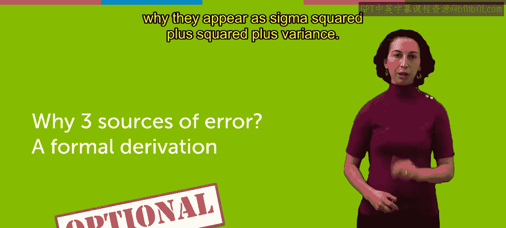
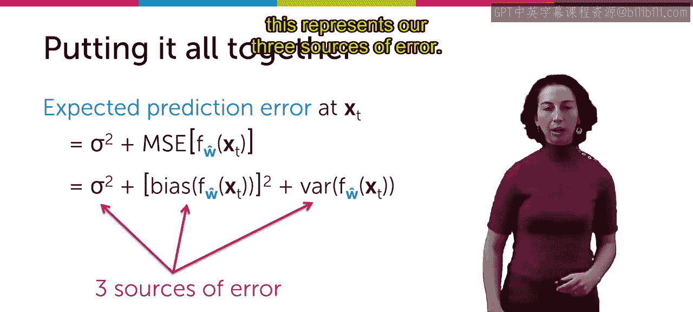

# 华盛顿大学《机器学习（回归，第2课⧸共4课）｜Machine Learning》中英字幕 p60 60_正式推导为什么有三种误差来源.zh_en -BV11b421H7XL_p60-

。

So we've just finished our deep dive into the formal definition of the three different sources of error that we have。

But now what we're going to do is we're going to turn to again。

 another optional video it's going to be even more technical possibly than the video that we just completed to derive why specifically these are the three sources of error and why they appear as sigma squared plus p squared plus variance。

Okay， so let's start by recalling our definition of expected prediction error。

 which was the expectation over training data sets of our generalization error。

And here I'm using just a shorthand notation train instead of training set just to save a little bit of space。

 I don't mean Cho Chi trains， I mean training data sets。Okay。

 so let's plug in the formal definition of our generalization error。

And remember that our generalization error was our expectation over all possible。

Input and output pairs， X Y pairs of our loss。And so that is what's written here on the second line。

And then let's remember that we talked about specifying things specifically at a target Xt and under an assumption of using a loss function of squared error。

 and so again we're going to use this to form all of our derivations。

And so when we make these two assumptions， then。This expected prediction error at Xt simplifies to the following where there's no longer an expectation over x because we're fixing our point in the input space to be Xt and our expectation over y becomes an expectation over Yt because we're only interested in the observations。

That appear for an input at X T。 Okay， so the other thing that we've done in this equation is we've plugged in our specific definition of our loss function as our squared error loss。

So for the remainder of this video， we're going to start with this equation and we're going to derive why we get the specific form sigma bias squared plus variance。

So this is the definition of expected prediction error at Xt that we had on the previous slide under our assumption of squared error loss。

And what we can do is we can rewrite this equation。As follows。

 where what we've done is we've simply added and subtracted。The true function。

 the true relationship between x and y specifically at Xt。

 and because we've just simply added and subtracted these two quantities。

 nothing in this equation has changed as a result。But what this allows us to do is complete our derivation。

 where in particular what we're going to use and maybe let me just switch colors quickly so that I can do a little aside here。

That's going to be a useful aside。To kind of follow what I'm going through here。

And for this little aside， so if we take the expectation。Of。some quantity。A plus B squared。

Then what I'm going to get is the expectation。Of a squared。Plus2 a B。Plus b squared。

Which is equal to the expectation of a squared。Plus。pl， the expectation。Or rather。Sorry。

 if this is getting sloppy here， let me just rewrite this little term。Plus。

 two times the expectation of A B。Plus， the expectation of B squared。

 And this is simply using the linearity of expectation after I have gone through and completed this square A plus B。

 Okay， and in our case， a。I'll just write this here as this mapping， this is going to be our A term。

And this here。Is going to be our B term Okay， so the next line I'm writing is using this little identity。

 defining the first term as A and the second term is B。Now let me switch to the blue color。

 which is specifically in this case。Let me do one more thing， which I think will be helpful。

I'm going to define some shorthand。 and I'll write in one other color， the shorthand。Notation。

Just to be very clear here。I'm going to say， for shorthand， that。Y T， I'm just going to write as Y。

F sub W true。I'm just going to write as F。And F subW hat of our training data。

 I'm just going to write as F hat。Okay， this will save me a lot of writing and you。A lot of watching。

Okay， so now that we've set the stage for this derivation， let's rewrite this term here。

 so we get the expectation over our training data set and our observation。

 it's remember I'm writing Y T just as y。And I'm going to get the first term squared。

 so I'm going to get y minus F。Squared， that's my a squared term， this first term here。And then。

I'm gonna get。two times the expectation of a times b。

And let me again specify what the expectation is over， the expectation is over。

The training data set and observation Y。 And when I do a。times b i get y minus f times，F minus F hat。

And then the final term is I'm going to get。The expectation over my training set and the observation Y of B squared。

 which is F minus F hat。Squared。Okay， so now let's simplify this a bit。

And does anything in this first term depend on my training set？Well。

 Y is not a function of the training data， F is not a function of the training data。

 that's the true function， so this expectation over the training set that's not relevant for this first term here。

嗯。And when I think about the expectation。Over why， well， what is this。

 this is the difference between my observation。And the true function。And that's specifically。

 that's Epsilon。And so what this term here is， is this is epsilon。Sorry。This is Epsilon squared。

And epsilon has zero mean， so if I take the expectation of epsilon squared。

 that's just my variance from the world， that's sigma squared。Okay。

 so this first term results in sigma squared。Now let's look at this second term。

You know what I'm going to write this a little bit differently to make it very clear here。

 So I'll just say that this first term here。Is sigma squared by definition。Okay。

 now let's look at this second term。And again， what is y minus f Well y minus f is this epsilon noise term。

 and our noise is a completely independent random variable from F or F hat。

 and so what that means is if you take the expectation。

I think I have some room to do it here if I take the expectation of A and B。Where。

A and B are independent random variables。Then the expectation of a times B is equal to the expectation of a times the expectation of B。

So this is another little aside。And so what I'll get here is I'm going to get at this term。

is the expectation of epsilon times the expectation of f minus f hat。

And what's the expectation of Epsilon my noise？It's 0。 Remember。

 we said that again and again that we're assuming that epsilon is zero noise。

 that can be incorporated into F。 So this term is 0。 The result of this whole thing。Is going to be 0。

 Okay， so we can ignore that second term。 Now， let's look at this last term and this term。

For this slide， I'm simply going to call the mean squared error。

 I'm going to define this little equal with a triangle on top is something that I'm defining here。

 I'm defining this to be equal to something called the mean squared error。

Let me write that out if you want to look it up later。Mean square。air。Of。F hat。Okay。

 so now that I've gone through and done that， I can say that the result of all this arivation is that I get a quantity sigma squared plus mean squared error。

Of F hat。But so far， we've said a million times that my expected prediction error at X T is sigma squared plus bias squared plus variance。

 So on the next slide， what we're going to do is we're going to show how our mean squared error is exactly equal to bias squared plus variance。

Okay， so what I've done is I've started this slide by writing mean squared error of remember on the previous slide。

 we were calling this F hat， that was our shorthand notation。

And so mean squared error of F hat according to the definition on the previous slide is it。

Looking at the expectation。嗯。Of F minus F hat squared。Anna。

I guess here I can mention when I take this expectation over training data and my observation Y。

 does the observation Y appear anywhere in here， F minus F at no。

 so I can get rid of that that y there。Okay。If I look at this。

 I'm repeating it here on this next slide where I have the expectation over my training data。

Of my true function， which I had on the last slide just been denoting as simply F。

And the estimated function， which I had been denoting。

 let me be clear it's inside the square that I'm looking at。

 I had been denoting this as F hat and both of these quantities were evaluated specifically at Xt。O。

So again， let's go through expanding this where in this case。

 when we rewrite this quantity in a way that's going to be useful for this derivation。

 we're going to add and subtract。F sub W bar。And what's F subW bar。

 Remember that it was the green dash line and all those biasvariance plots。

 What F subW bar is is looking averaged over all possible training data sets。

Where for each training data， I get a specific fitted function。

 and I average all those fitted functions over those different training datasets。

 that's what results in F subW bar it's my average fit。

That for my specific model that I'm getting averaging over my training data sets。

And so for simplicity here。I'm going to refer to F sub W hat。 I mean， sorry， W bar as F bar。

 So this is。New。😔，Notation。On this slide。I guess I'll call it again just to be clear new shorthand notation。

And this is just going to make things easier to write in these derivations here。ok。

 so using that same trick of。Taking the expectation of a plus B squared and completing the square and then passing the expectation through。

 I'm going to do the same thing here。 new definition of A plus B， but same idea again。

 So I'm going to get the expectation over my training set。Of now my first term squared。

 So I'm going to get。F minus。F bar squared。And then I'm going to get two expectation over my training set。

Of。A times B。 So that's going to be F minus F bar times B is。F bar minus F hat。

And then the final term is the expectation of。B squared， which in this case is。

F R minus F hat squared， and again， this expectation is over the training sets。Okay。

 so now let's go through and talk about what each of these quantities is。And the first thing is。

Let's just remember that FR， what was the definition of FR formally。

 it was my expectation over training data sets。Of F hat。

Of my fitted function on a specific training data set。

So I've already taken the expectation over the training set here。 F is a true relationship。

 F has nothing to do with the training data。This is a number。 This is the mean of a random variable。

 and it no longer has to do with the training dataset set either of average over training dataset sets。

 So here there's really no expectation over training dataset sets。

 Nothing is random in terms of the training dataset for this first quantity。 So this first quantity。

Is really simply。F minus F bar squared。And what is that？

That's the difference between the true function。And my average， my expected fit。Specifically。

 add X T。But squared。That is bias squared， that's by definition。Bye。Definition。this is equal to you。

Biaas squared。Of。F hat。Okay。Now let's look at this second。Term here。And here。嗯。Again。F minus F bar。

 just like here has。No， is not。A。Function。Of training data。So this is just like a scalar。

 it can just come out of the expectation， so for this second term。

I can rewrite this as F minus f bar。Well， let's keep the two there times the expectation over my training data。

Of。F bar minus F hat。Okay， and now。Let's rewrite this term。And just pass the expectation through。

 And the first thing is， again， F bar is not a function the training data。

 So the result of that is just F bar。 And then I'm going to get minus the expectation over my training data。

Oh。I've had。So what is this？This is the definition of F bar。

 this is taking my specific fit on a specific， so it's the fit on a specific training data set at XT。

And it's taking the expectation over all training data sets。

 that's exactly the definition of what f bar is that average fit。

 so this term here is equal to zero again by definition。

So what we end up seeing is this whole second term is going to disappear。

Because we have some quantity times0。Okay， that just leaves one more quantity to analyze。

 and that's this term here。Where what I have is an expectation。

Over a function minus its mean squared。 So let me just write this in words。 It's an expectation of。

Let's just say so the fact that I can equivalently write this as。F hat minus F bar squared。

I hope that's clear that the negative sign there doesn't matter。 it gets squared。

 they're exactly equivalent。 And so what is this， this is a。Random。Function。At x t。

Which is equal to just a random variable。And this is its mean。And so。The definition。

Of taking the expectation of some re variable minus its mean squared。

 That's the definition of variance。 So this term is the variance。Of F hat。Okay。

So now we can make our concluding statement about this mean squared error where what we see is the first term was equal to bias squared of F hat。

And the second term was zero， and this third term was variance。Of F hat。

So what we've shown on this slide is that mean squared error。Of our F hat is equal to bias squared。

Of F hat plus variance of F hat。 and that's exactly what we're hoping to show because now we can talk about putting it all together where what we see is that our expected predictionary at X T。

We derive to be equal to sigma squared plus mean squared error。

And then we derive the fact that mean squared error is equal to bias squared plus variance。

 so we get the end result that our expected prediction error at xt is sigma squared plus bias squared plus variance。

 and this represents our three sources of error， and we've now completed our formal derivation of this。

