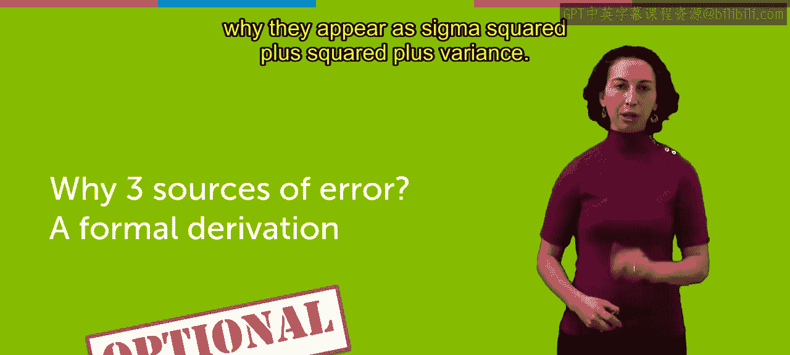
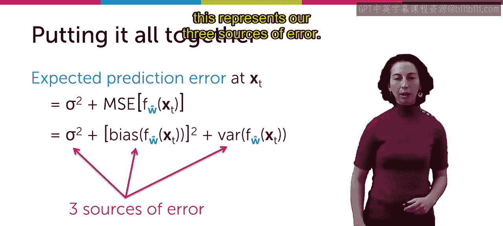
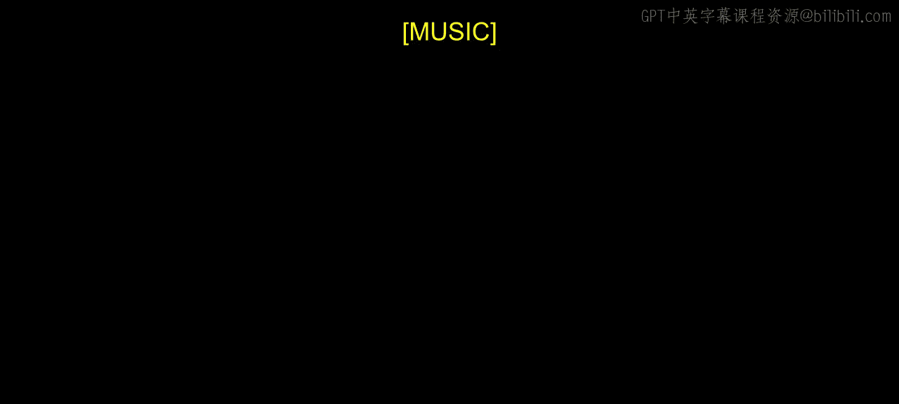

# 机器学习（回归）：第2课：正式推导三种误差来源的来源 🧮




在本节课中，我们将深入探讨机器学习回归模型中预测误差的三个来源：**噪声方差（σ²）**、**偏差平方（Bias²）** 和**方差（Variance）**。我们将通过严格的数学推导，解释为什么总预测误差可以分解为这三项之和。本教程旨在让初学者也能理解这一核心概念。

---

## 概述：预测误差的分解

我们首先回顾**期望预测误差**的定义，它是在所有可能训练集上平均的**泛化误差**。在特定输入点 **Xt** 并使用**平方误差损失**的假设下，我们将推导出期望预测误差的精确表达式：**σ² + Bias² + Variance**。

上一节我们介绍了三种误差来源的直观概念，本节中我们将通过正式推导来理解其数学本质。

---

## 期望预测误差的定义

我们从期望预测误差的正式定义开始。设训练数据集为 **D_train**，模型在 **D_train** 上训练得到的预测函数为 **f_hat**。对于固定的目标输入点 **Xt**，其对应的真实输出为 **Yt**。期望预测误差 **EPE(Xt)** 定义为：

```math
EPE(Xt) = E_{D_train}[E_{Yt}[(Yt - f_hat(Xt))^2]]
```

这里，外层期望 **E_{D_train}** 是对所有可能训练集的平均，内层期望 **E_{Yt}** 是对在 **Xt** 处可能观测到的输出 **Yt** 的平均。我们假设真实关系为 **Y = f(X) + ε**，其中 **ε** 是均值为0、方差为 **σ²** 的噪声。

---

## 推导第一步：引入真实函数

为了分解误差，我们在平方误差项中同时加上和减去真实函数值 **f(Xt)**：

```math
EPE(Xt) = E_{D_train, Yt}[(Yt - f(Xt) + f(Xt) - f_hat(Xt))^2]
```

令 **A = Yt - f(Xt)**， **B = f(Xt) - f_hat(Xt)**。根据期望的线性性质以及 **E[(A+B)²] = E[A²] + 2E[AB] + E[B²]**，我们可以展开上式。

以下是展开后的各项分析：

1.  **第一项 E[A²]**：此项为 **E[(Yt - f(Xt))²]**。由于 **Yt - f(Xt) = ε**，且噪声均值为0，方差为σ²，因此 **E[ε²] = σ²**。这一项代表了数据中固有的、不可约的**噪声方差**。
2.  **第二项 2E[AB]**：此项为 **2 * E[(Yt - f(Xt)) * (f(Xt) - f_hat(Xt))]**。由于噪声 **ε = Yt - f(Xt)** 与模型预测 **f_hat(Xt)** 独立（噪声不依赖于模型），且 **E[ε] = 0**，因此该项等于 **2 * E[ε] * E[f(Xt) - f_hat(Xt)] = 0**。
3.  **第三项 E[B²]**：此项为 **E[(f(Xt) - f_hat(Xt))²]**。它衡量了模型预测与真实函数之间的平均平方差异，我们称之为**均方误差**。

因此，我们得到：
```math
EPE(Xt) = σ² + MSE(f_hat)
```
其中，**MSE(f_hat) = E_{D_train}[(f(Xt) - f_hat(Xt))²]**。

---

## 推导第二步：分解均方误差为偏差与方差

现在，我们需要分解 **MSE(f_hat)**。我们引入一个新量：在所有可能训练集上平均的模型预测，记作 **f_bar(Xt) = E_{D_train}[f_hat(Xt)]**。

同样，我们在 **MSE** 的表达式中同时加上和减去 **f_bar(Xt)**：

```math
MSE(f_hat) = E_{D_train}[(f(Xt) - f_bar(Xt) + f_bar(Xt) - f_hat(Xt))^2]
```

令 **C = f(Xt) - f_bar(Xt)**， **D = f_bar(Xt) - f_hat(Xt)**。再次展开平方项：

```math
MSE = E[C²] + 2E[CD] + E[D²]
```

以下是各项分析：

1.  **第一项 E[C²]**：此项为 **(f(Xt) - f_bar(Xt))²**。注意，**f(Xt)** 和 **f_bar(Xt)** 都是固定值（不依赖于当前训练集 **D_train**），因此期望就是其本身。这衡量了真实函数与模型平均预测之间的差异，其平方正是**偏差的平方**：**Bias² = (f(Xt) - f_bar(Xt))²**。
2.  **第二项 2E[CD]**：此项为 **2 * (f(Xt) - f_bar(Xt)) * E_{D_train}[f_bar(Xt) - f_hat(Xt)]**。因子 **(f(Xt) - f_bar(Xt))** 是常数，可以提到期望外。而 **E[f_bar(Xt) - f_hat(Xt)] = f_bar(Xt) - E[f_hat(Xt)] = f_bar(Xt) - f_bar(Xt) = 0**。因此，整个第二项为 **0**。
3.  **第三项 E[D²]**：此项为 **E_{D_train}[(f_bar(Xt) - f_hat(Xt))²]**。这衡量了单个模型预测 **f_hat(Xt)** 围绕其平均值 **f_bar(Xt)** 的波动程度，这正是**方差**的定义：**Variance = E[(f_hat(Xt) - f_bar(Xt))²]**。

因此，我们得到：
```math
MSE(f_hat) = Bias² + Variance
```

---

## 最终结论：三种误差来源

将两步推导的结果结合，我们得到了著名的偏差-方差分解公式：

```math
EPE(Xt) = σ² + Bias² + Variance
```

这个公式清晰地展示了在点 **Xt** 处的期望预测误差来源于三个部分：

*   **σ² (噪声方差)**：数据本身的随机噪声，无法通过改进模型消除。
*   **Bias² (偏差平方)**：模型平均预测与真实值之间的系统性差异，反映了模型本身的拟合能力。
*   **Variance (方差)**：模型对于不同训练数据的敏感度，反映了模型的稳定性。

---

## 总结





本节课中，我们一起学习了机器学习回归模型中预测误差的正式分解方法。我们从期望预测误差的定义出发，通过严谨的数学推导，证明了总误差可以分解为**噪声方差**、**偏差平方**和**方差**三项之和。理解这一分解有助于我们诊断模型问题：高偏差意味着模型欠拟合，高方差意味着模型过拟合，而噪声方差则是我们无法控制的固有不确定性。在后续课程中，我们将学习如何利用这一理论指导模型选择与优化。