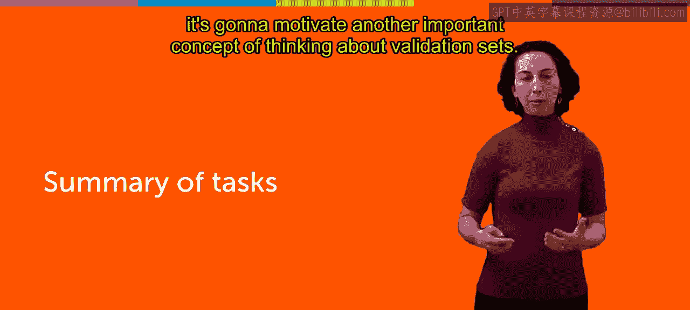
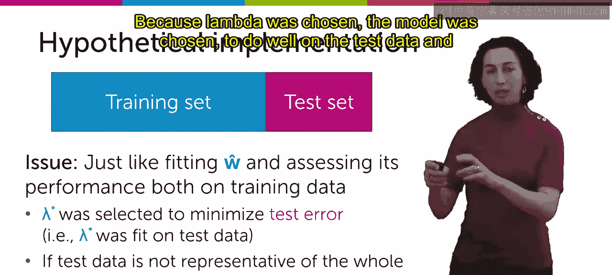
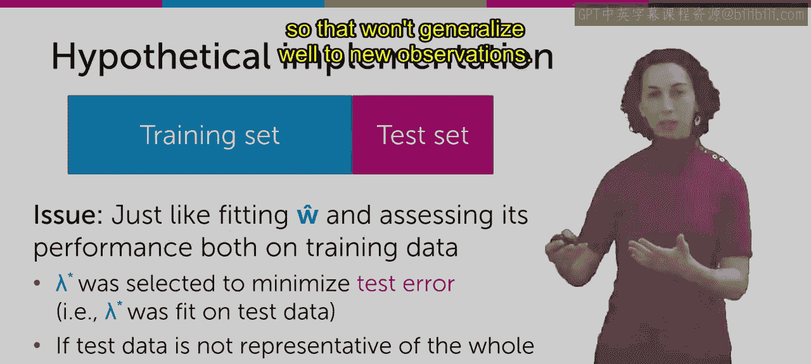
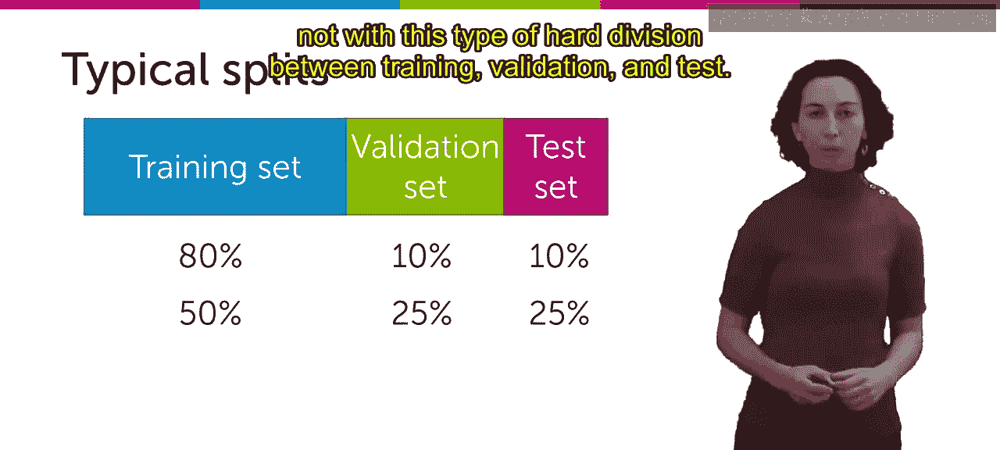

# 华盛顿大学《机器学习（回归，第2课⧸共4课）｜Machine Learning》中英字幕 p61 61_用于模型选择、拟合和评估的训练-验证-测试集分割.zh_en -BV11b421H7XL_p61-

。

Okay， let's wrap up by talking about two really important tasks when you're doing regression and through this discussion it's going to motivate another important concept of thinking about validation sets。

Okay so the two important tasks in regression is first we need to choose a specific model complexity。

 so for example， when we're talking about polynomial regression。

 what's the degree of that polynomial and then for our selected model we need to assess its performance。

And actually， these two steps aren't specific just to regression。

 We're going to see this in all different aspects of machine learning where we have to specify our model。

 and then we need to assess the performance of that model。

 So what we're going to talk about in this portion of this module generalizes well beyond regression and for this first task where we're talking about choosing the specific model。

 we're going to talk about it in terms of some set of tuning parameters， Lambda。

 which control the model complexity again， for example。

 Lambda might specify the degree of the polynomial and polynomial regression。

So let's first talk about how we can think about choosing Lambda。

And then for a given model specified by Lada， a given model complexity。

 let's think about how we're going to assess the performance of that model。Okay well。

 one really naive approach is to do what we've described before where you take your data set and split it into a training set and a test set。

And then what we're going to do is for our model selection portion where we're choosing the model complexity Lambda。

 we're going to for every possible choice of Lambda。

 we're going to estimate model parameters associated with that Lambda model on the training set。

And then we're going to test the performance of that fitted model on the test set。

And we're going to tabulate that for every lambda that we're considering。

 and we're going to choose our tuning parameters as that the ones that minimize this test error。Okay。

 so the ones that perform best on the test data。Okay。

 and we're going to call those parameters Lambda star。 So now I have my model。

 I have my specific degree of polynomial that I'm going to use。

 and I want to go and general and assess the performance of this specific model。

 and the way I'm going to do this is I'm going to take my test data again and I'm going to say well。

 okay， I know that test error is an approximation of generalization error。

 So I'm just going to compute the test error。For this Lambda star fitted model。

And I'm going to use that as my approximation of the performance of this model。

Well what's the issue with this， is this going to perform well？No， it's really overly optimistic。

Okay so this issue is just like what we saw when we weren't dealing with this notion of choosing model complexity。

 we just assumed we had a specific model like a specific degree polynomial。

 but we wanted to assess the performance of the model and the naive approach we took there was saying well we fit the model to the training data。

And then we're going to use training error to assess the performance of the model。

 And we said that was overly optimistic because we were double dipping。

 We had already used the data to fit our model。 And then so that error。

Was not a good measure of how we were going to perform on new data。

 well it's exactly the same notion here and let's walk through why。

specifically when we're thinking about choosing our model complexity。

 we were using our test data to compare between different Lambda values and we chose the Lambda value that minimized the error on that test data that performed the best there so you can think of this as having fit lambmbda。

 this model complexity tuning parameter。On the test data and now we're thinking about using test error as a notion of approximating how well we'll do on new data。

 but the issue is unless our test data represents everything we might see out there in the world。

 that's going to be way too optimistic because Lambda was chosen。

 the model was chosen to do well on the test data， and so that won't generalize well to new observations。

So what's our solution？Well we can just create two test data sets They won't both be called test sets。

 we're going to call one of them a validation set， so we're going to take our entire data set just to be clear。

 and now we're going to split it into three data sets， one will be our training data set。

 one will be what we call our validation set， and the other will be our test set。

And then what we're going to do is we're going to fit our model parameters always on our training data。

For every given model complexity that we're considering。

 but then we're going to select our model complexity as the model that performs best on the validation set as the lowest validation error。

And then we're going to assess the performance of that selected model。On the test set。

 and we're going to say that that test error is now an approximation of our generalization error because that test set was never used in either fitting our parameters that we hat or selecting our model complexity lambda。

 that other tuning parameter， so that data was completely held out never touch and it now forms a fair estimate of our generalization error。

So in summary， we're going to fit our model parameters for any given model complexity on our training set。

 then we're going to for every fitted model and for every model complexity。

 we're going to assess the performance and tabulate this on our validation set and we're going to use that to select the optimal set of tuning parameters。

 Lambda star， and then for that resulting model that。W hatt sub Lambda star。

 we're going to assess a notion of the generalization error using our test set。And so a question is。

 how can we think about doing the split between our training set， validation set and test set？

And there's no hard and fast rule here， there's no one answer that's the right answer。

 but typical splits that you see out there， something like an 801010 split。

 so 80% of your data for training data， 10% for validation。

 10% for test or another common split is 50%， 25%， 25%。

 but again this is assuming that you have enough data to do this type of split and still get reasonable estimates of your model parameters。

 reasonable notions of how different model complexities compare because you have a large enough validation set and you still have a large enough test set in order to assess the generalization error of the resulting model and if this isn't the case we're going to talk about other methods that allow us to do the same types of notions but not with this type of hard division between training。

 validation and test。

