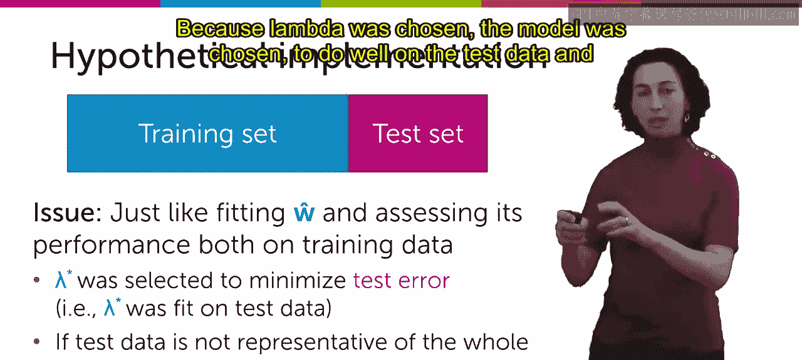
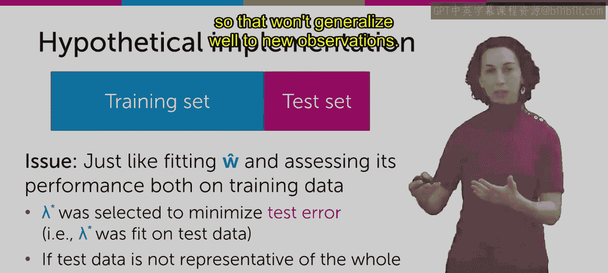
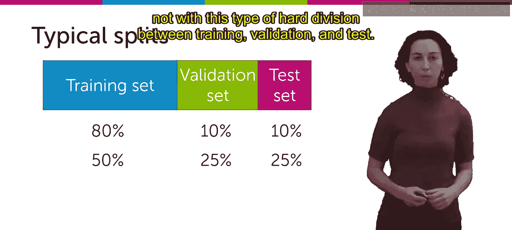

# 机器学习：第2课：用于模型选择、拟合和评估的训练-验证-测试集分割

在本节课中，我们将要学习回归分析中两个至关重要的任务：**选择模型复杂度**和**评估模型性能**。通过讨论这两个任务，我们将引入一个核心概念——**验证集**，并学习如何通过分割数据集来避免评估偏差，从而获得对模型泛化能力的可靠估计。

## 选择模型复杂度与评估性能

上一节我们介绍了回归分析的基本概念，本节中我们来看看模型开发过程中的两个核心步骤。

在回归任务中，我们首先需要选择一个具体的模型复杂度。例如，在多项式回归中，我们需要确定多项式的**阶数**。其次，对于选定的模型，我们需要评估其性能。这两个步骤并非回归所独有，而是贯穿于机器学习的各个方面。

为了讨论方便，我们将模型复杂度选择问题形式化为选择一组**调优参数**，记为 **λ**。例如，λ 可以指定多项式回归的阶数。

## 一种天真的方法及其问题

首先，让我们讨论如何选择 λ。一种非常天真的方法是沿用之前介绍过的做法：将数据集分割为**训练集**和**测试集**。

以下是具体步骤：
1.  对于每一个可能的 λ 值，在训练集上估计对应模型的参数。
2.  将拟合好的模型在测试集上进行测试，计算测试误差。
3.  在所有考虑的 λ 值中，选择在测试集上表现最好（即测试误差最小）的那个，记为 **λ***。

现在，我们有了选定的模型（例如，确定了多项式阶数），接下来需要评估这个特定模型的性能。按照上述逻辑，我们会再次使用测试集，计算 **λ*** 模型的测试误差，并将其作为模型泛化误差的近似。

**这个方法存在什么问题？它的评估结果会准确吗？**

答案是否定的，这种方法会给出**过于乐观**的估计。这与我们之前讨论过的问题本质相同：**数据被重复使用了**。在选择模型复杂度 λ 时，我们已经利用了测试集来比较不同模型的性能，并选择了在测试集上表现最好的 λ。这相当于在测试集上“拟合”了调优参数 λ。因此，再用同一个测试集来评估最终模型的性能，其结果必然偏向于高估模型在全新数据上的表现，无法很好地泛化。

## 解决方案：引入验证集

那么，我们的解决方案是什么？我们可以创建**两个**独立的“测试”数据集。为了避免混淆，我们不把它们都称为测试集，而是将其中一个称为**验证集**。

具体做法是：将整个数据集分割成三个互斥的部分：
*   **训练集**
*   **验证集**
*   **测试集**

以下是使用这三个数据集的标准流程：
1.  **模型拟合**：对于每一个考虑的模型复杂度 λ，我们总是在**训练集**上估计模型参数。
2.  **模型选择**：对于每一个拟合好的模型，我们在**验证集**上评估其性能（计算验证误差）。我们选择在验证集上表现最好（验证误差最小）的模型复杂度，记为 **λ***。
3.  **性能评估**：最后，我们评估这个最终选定模型（参数在训练集上拟合，复杂度 **λ*** 由验证集选出）在**测试集**上的性能。此时得到的测试误差才是对模型**泛化误差**的合理近似，因为测试集在之前两个步骤中完全没有被使用过。

总结一下：
*   在**训练集**上拟合模型参数。
*   在**验证集**上评估不同模型并选择最优调优参数 **λ***。
*   在**测试集**上评估最终模型的泛化性能。

## 数据集分割比例

一个自然的问题是：我们应该如何划分训练集、验证集和测试集的比例？这里没有一成不变的铁律，但有一些常见的经验分割比例。

以下是两种典型的分割方式：
*   **80/10/10 分割**：80% 数据用于训练，10% 用于验证，10% 用于测试。
*   **50/25/25 分割**：50% 数据用于训练，25% 用于验证，25% 用于测试。

选择哪种比例取决于一个关键前提：**你有足够的数据**。你需要确保训练集足够大以可靠地估计模型参数，验证集足够大以公平地比较不同模型的复杂度，测试集也足够大以提供对泛化误差的稳定估计。如果数据量不足，这种硬性的分割方式可能不再适用，我们将需要讨论其他方法（如交叉验证）来实现相同的目标。

本节课中我们一起学习了在机器学习中正确评估模型性能的关键方法。通过引入**验证集**，我们将数据集分为训练、验证、测试三部分，分别用于**拟合模型**、**选择模型复杂度**和**最终性能评估**，从而避免了因数据重复使用而产生的乐观偏差，获得了对模型泛化能力更可靠的估计。