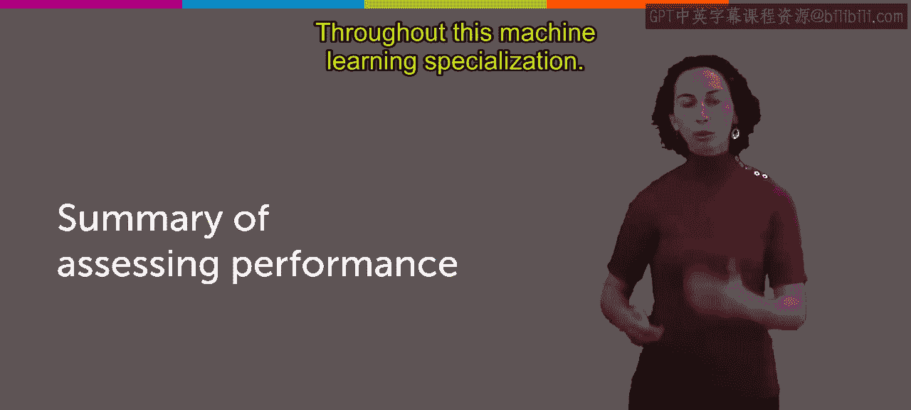
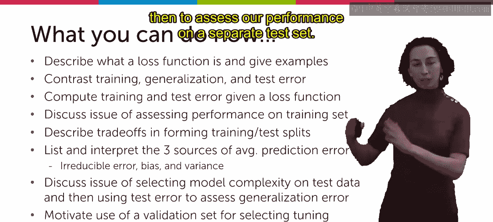

# 华盛顿大学《机器学习（回归，第2课⧸共4课）｜Machine Learning》中英字幕 p62 62_简要回顾.zh_en -BV11b421H7XL_p62-

。

Okay， so let's summarize what we've learned in this module and these notions that we've learned here are really。

 really important to machine learning well beyond just this regression task。

 so this was a really important module on how to assess performance that we're going to see again and again throughout this machine learning specialization。

So in particular， we described what a loss function is and we gave different examples of loss functions。

 and we also talked about differentiating between notions of training error。

 our true or generalization error and test error， and we talked about how to think about splitting our data into training and test sets in order to both fit our model parameters as well as to estimate our generalization error。

 and we also talked about how to think about three notions of error that come into our predictions。

And finally， we talked about this idea of choosing the model complexity as a key component of our workflow。

 but how to think about doing that by introducing this notion of a validation set and using this to allow us to choose model complexity and then to assess our performance on a separate test set。

