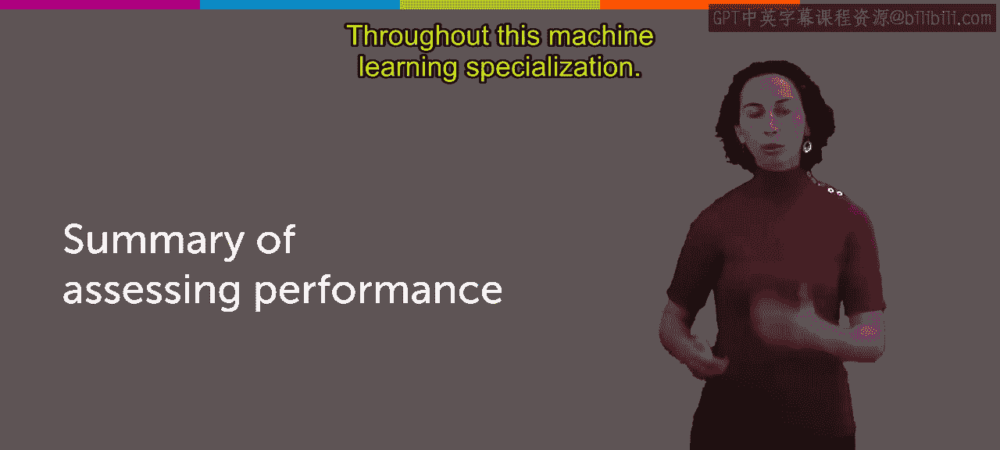
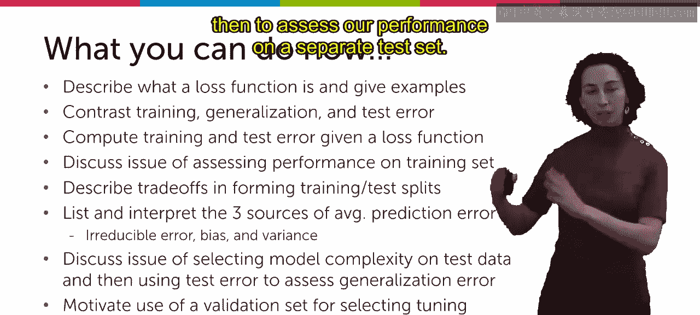

# 机器学习：第2课：性能评估核心概念回顾 🧠


在本节课中，我们将回顾并总结机器学习性能评估的核心概念。这些概念不仅对回归任务至关重要，也是贯穿整个机器学习领域的基石。我们将学习损失函数、不同误差的定义、数据集的划分方法，以及如何选择模型复杂度。

---

## 损失函数与误差类型 📉

上一节我们介绍了模型评估的基本框架，本节中我们来看看其核心组成部分：损失函数与误差类型。

损失函数用于量化模型预测值与真实值之间的差异。我们讨论了多种损失函数的例子，例如平方误差损失。

**平方误差损失公式**：
```
L(y, ŷ) = (y - ŷ)²
```



在评估模型时，我们需要区分三种不同的误差概念：
*   **训练误差**：模型在训练数据集上计算出的平均损失。
*   **泛化误差（真实误差）**：模型在整个数据分布（包括未见过的数据）上的期望损失。
*   **测试误差**：使用独立的测试数据集来近似估计的泛化误差。

为了同时完成模型参数拟合和泛化误差估计，我们需要将数据划分为训练集和测试集。

---

## 数据集划分与验证集 🧩

理解了误差类型后，我们需要一个系统的方法来管理数据，以进行可靠的评估。这涉及到数据集的划分。

以下是数据划分的核心步骤：
1.  **训练集**：用于拟合模型参数。
2.  **测试集**：在模型完全确定后，用于最终评估模型性能，近似泛化误差。测试集在训练过程中应保持“未见”状态。

然而，模型性能不仅取决于参数，还受模型复杂度（如多项式阶数）的影响。直接使用测试集来选择复杂度会导致对泛化误差的乐观估计。

为了解决这个问题，我们引入了**验证集**的概念。我们将数据分为三部分：
*   **训练集**：拟合模型参数。
*   **验证集**：用于选择模型复杂度、调整超参数。
*   **测试集**：用于最终性能报告。

这种方法确保了我们可以客观地选择模型，并在一个完全独立的数据集上评估其最终表现。

---

## 总结 📚

本节课中我们一起学习了机器学习性能评估的核心工作流程。

我们首先定义了**损失函数**，它是衡量预测好坏的量化工具。接着，我们区分了**训练误差**、**泛化误差**和**测试误差**这三种关键概念，并解释了为何需要将数据划分为**训练集**和**测试集**。



最后，我们探讨了**模型复杂度选择**这一关键步骤。通过引入**验证集**，我们构建了一个稳健的流程：使用训练集拟合参数，用验证集选择模型复杂度，最终在独立的测试集上评估模型性能。这套方法论是构建可靠机器学习模型的基础。