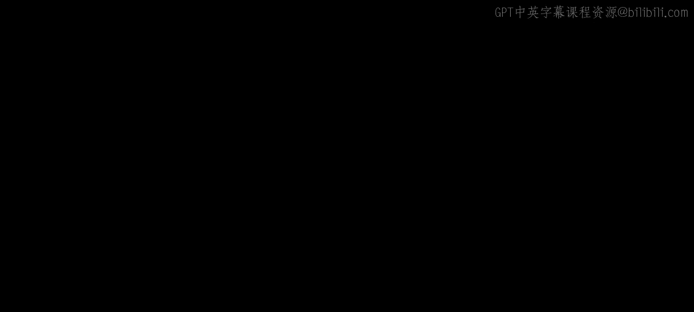
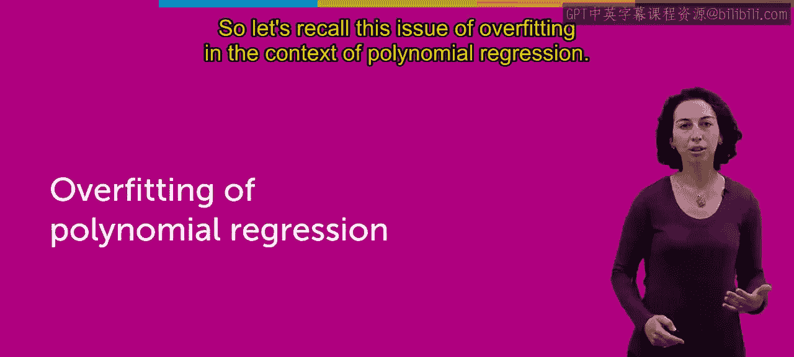
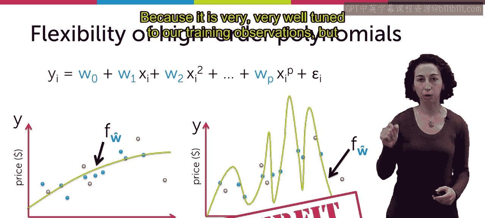
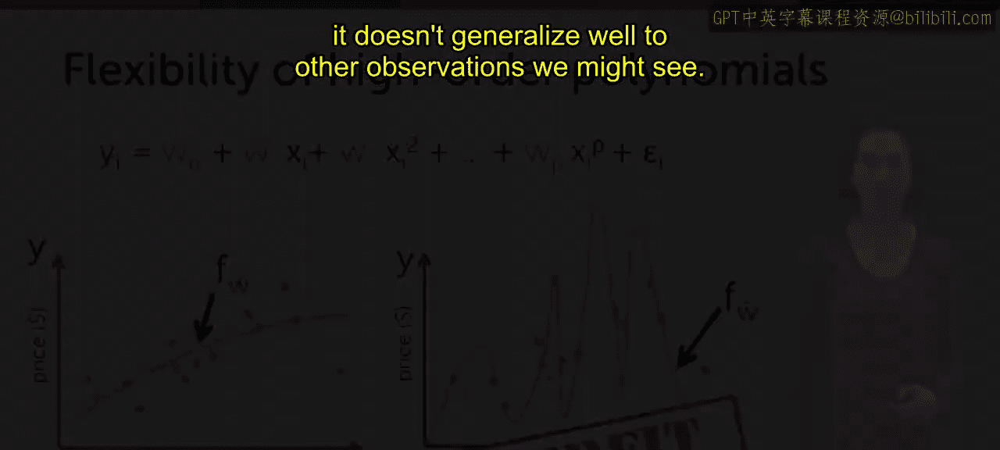
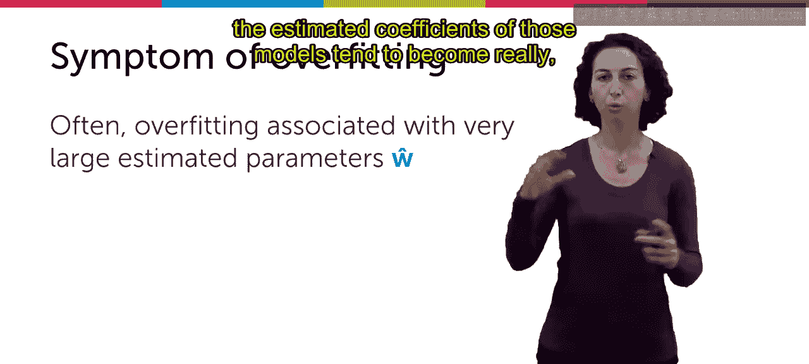

# 华盛顿大学《机器学习（回归，第2课⧸共4课）｜Machine Learning》中英字幕 p63 63_多项式回归中过拟合的症状.zh_en -BV11b421H7XL_p63-

。

In the last module， we talked about the potential for high complexity models to become overfit to the data。

 and we also did discussed this idea of a bias variance tradeoff where high complexity models could have very low bias but high variance。

 whereas low complexity models have high bias but low variance。

 and we said that we wanted to trade off between bias invaris to get to that sweet spot of having good predictive performance and in this module what we're going to do is talk about a way to automatically balance between bias and variances using something called rid regression。

So let's recall this issue of overfitting in the context of polynomial regression。

And remember this is our polynomial regression model and if we assume we have some low order polynomial that we're fitting to our data。

 we might get a fit that looks like the following， this is just a quadratic fit to the data but once we get to a much higher order polynomial we can get these really wild fits to our training observations again this is an instance of high varianceance model but we refer to this model or this fit as being overfit。

Because it is very， very well tuned to our training observations。

 but it doesn't generalize well to other observations we might see So previously we had discussed a very formal notion of what it means for a model to be overfit in terms of the training error being less than the training error of another model whose true error is actually smaller than the true error of the model with smaller training error okay hopefully you remember that from the last module。

 but a question we have now is is there some type of quantitative measure that's indicative of when a model is overfit and to see this。

 let's look at the following demo where what we're going to show is that when models become overfit。

 the coefficients， the estimated coefficients of those models tend to become really， really。

 really large in magnitude。

