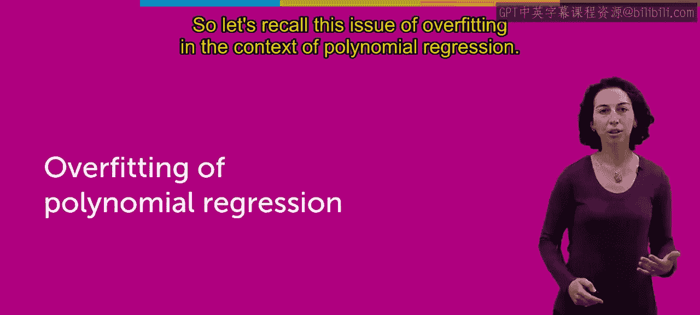
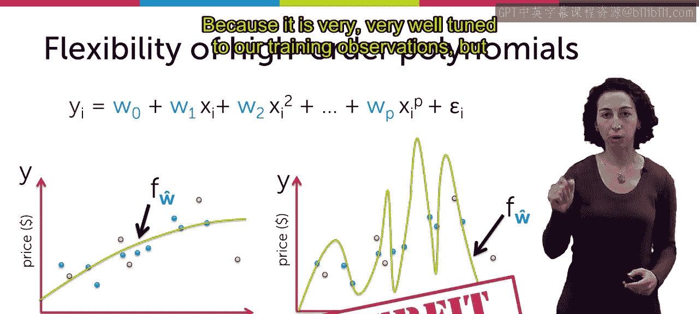
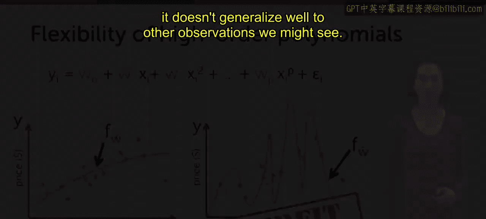
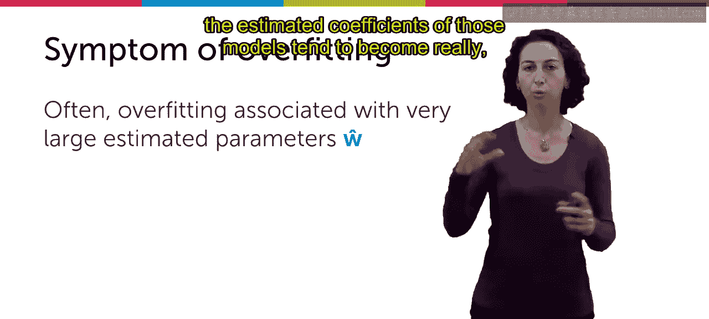

# 机器学习：第2课：多项式回归与过拟合症状 🧠

在本节课中，我们将学习多项式回归中过拟合的症状，并探讨如何通过观察模型系数的大小来识别过拟合。上一节我们介绍了高复杂度模型可能导致过拟合以及偏差-方差权衡的概念。本节中，我们来看看一个具体的定量指标，帮助我们判断模型是否过拟合。

## 回顾过拟合问题

在多项式回归的背景下，过拟合是一个常见问题。回忆一下，多项式回归模型的形式如下：

**公式：** `y = w₀ + w₁x + w₂x² + ... + w_d x^d`

如果我们用一个低阶多项式（例如二次多项式）拟合数据，可能会得到一条平滑的曲线，能够较好地捕捉数据的整体趋势。然而，当我们使用一个非常高阶的多项式时，模型会变得异常复杂，其拟合曲线可能会剧烈波动，穿过每一个训练数据点。

这种模型被称为**高方差**模型，我们称其为**过拟合**。因为它对训练数据的拟合过于“完美”，以至于捕捉到了数据中的噪声和随机波动，导致其在新数据上的泛化能力很差。

## 识别过拟合的定量指标

一个关键的问题是：是否存在某种定量指标，可以指示模型何时发生了过拟合？答案是肯定的。通过观察模型学习到的系数（权重），我们可以发现一个明显的规律。

以下是识别过拟合的关键观察：

**当过拟合发生时，模型估计出的系数（w₁, w₂, ..., w_d）的绝对值往往会变得非常大。**

为了理解这一点，我们可以思考：高阶多项式模型为了精确穿过每一个训练点，需要利用那些高次项（如 x^15, x^20）进行剧烈的调整。这些调整会体现在对应的高次项系数上，导致它们的值异常巨大。相反，一个泛化能力好的模型，其系数通常保持在相对合理、较小的范围内。

因此，**系数的大小可以作为模型是否过拟合的一个警示信号**。巨大的系数值往往意味着模型过于复杂，并可能对训练数据中的噪声进行了建模。

## 总结

本节课中我们一起学习了多项式回归中过拟合的症状。我们回顾了过拟合的概念，即模型在训练集上表现完美但在新数据上表现不佳。更重要的是，我们探讨了一个实用的定量识别方法：**当过拟合发生时，模型的系数往往会爆炸性增长，变得非常大**。这为我们后续引入正则化等技术来控制模型复杂度、防止过拟合奠定了基础。下一节，我们将学习一种名为“岭回归”的方法，它能够自动在偏差和方差之间进行权衡。