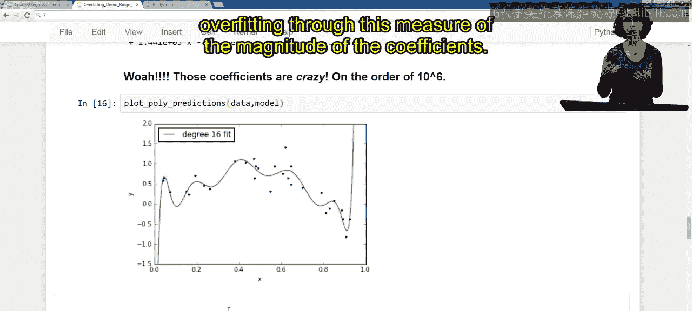

# 华盛顿大学《机器学习（回归，第2课⧸共4课）｜Machine Learning》中英字幕 p64 64_过拟合演示.zh_en -BV11b421H7XL_p64-

。

So let's generate some data and fit polynomials of increasing degrees and see what happens to the estimated coefficients。

 so to start with let's just import some libraries that are going to be useful and then we're going to just。

Create 30 different x values so in the end we're going to create a data set with 30 observations and then what we're going to do is we're going to compute the value of this sine function so evaluate the signine function at these 30 x values。

 but of course when we're doing our analyses we're going to assume that we have noisy data so we're going to add noise。

To these true s values， to get our actual observations。 So here we're just adding noise。

 and then we're going to put this into an S frame。And so here's what our data looks like。

 we have a set of x values and they're corresponding y values。

 but of course it's easier to just visualize what this data looks like so let's just make a plot of X versus y so here you can see that there's an underlying trend like this so the true trend like we talked about is this sine function so it's going up and coming down here and these black dots are our observed values。

Okay， so now let's get to our polynomial regression task and to start with what we're going to do is we're first just going to define our polynomial features so what we're doing with this function polynomial underscore features is we're taking our S frame。

And then we're just going to make a copy of that S frame and for any degree polynomial that we're considering。

 we're going to manipulate the S frame to include extra columns that are powers of X based on how whatever degree we've specified for that polynomial so that's what this function does right here。

 and then the very important function is polynomial regression， which is implementing our。

Multiple regression model using the features specified by by this polynomial underscore features function。

 So again， for simplicity， we're just using GraphLb create and we're going to use the dot linear regression function where the features were specifying。

Are just the powers specified by the degree of the polynomial we're looking at and then our target is our observation Y and then there are these two terms are L2 penalty and L1 penalty that we set to be equal to zero。

 So this module on Rige regression is going to be all about this L2 penalty and we're going to get to that And then the next module。

Is going to be all about this L1 penalty， but for now。

 let's just understand that if we set these values to zero。

 we just return to our standard least squares regression。Okay。

 so that's what our polynomial regression。Function is is doing and the next function we're going to define allows us to plot our fit。

And finally， we're going to define a function that allows us to in a very nice way print the coefficients of our polynomial regression。

 and for this， we're going to use this nuP library because that allows for this really pretty printing of our polynomial。

Okay， so now we're going to use all these functions again and again as we explore different degrees of polynomials fit to this data。

 so to start with let's just consider fitting a very low order degree2 polynomial so first we're going to do our polynomial regression fit taking our S frame which we call data and specifying that the degree is two for this polynomial regression then let's look at the coefficients。

That we've estimated。And here's where we've done this really nice printing of these coefficients using that Ny library。

 where here what we see is that we have some coefficient on x squared， coefficient on x。

 and just our intercept term here and these values are I don't know how to call them reasonable or not reasonable。

 but they're relatively small numbers， numbers we you know can kind of appreciate numbers like5 and4 and something close to zero。

And now let's plot。What our estimated fit looks like and this looks pretty good。

 it's a nice smooth curve。It goeses between the values pretty well and in between values。

 you'd imagine believing what this fit is。But now let's go to a slightly higher degree polynomial。

 just a order for polynomial。And here we're doing all the steps at once where we're going to fit our model。

 print the coefficients and plot the fit， and so if we look at the estimated coefficients of our fourth order polynomial。

 we see that the coefficients have increased in magnitude， we have numbers like 23 and 53 and 35。

And the fit is looking a bit wiglier， still actually looks pretty reasonable。

 but now let's get to our degree 16 polynomial， so remember we only have 30 observations and we're trying to fit 16th order polynomial。

 so what happens here？So in this case。We see that the coefficients have just become really。

 really massive here we have 2。583 times 10 to the6 and here 1。

295 times 10 to the seventh so these are really， really。

 really large numbers and let's look at the fit。As expected。

 this fit is also really wiggly and crazy， and we probably don't believe that this is what's really going on in this data。

 so this is an example。Picctorialally of an overfit function。

But what we see in the take home message from this demo is the fact that when we're in these situations of being very overfit。

Then we get these very， very， very large estimated coefficients associated with our model。So yeah。

 whoa， these coefficients are crazy。U。So。What Rige regression is going to do is it's going to quantify overfitting through this measure of the magnitude of the coefficients。

