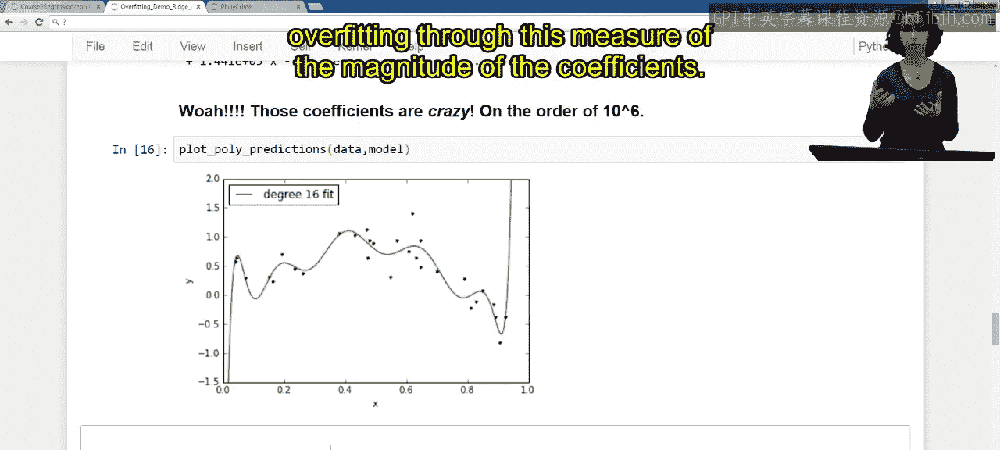

# 机器学习：第2课：过拟合演示 🧪


在本节课中，我们将通过一个具体的代码演示，直观地理解什么是过拟合。我们将生成一些数据，并拟合不同阶数的多项式模型，观察随着模型复杂度增加，会发生什么现象，特别是模型系数如何变化。

## 数据生成与可视化 📊

首先，我们需要导入必要的库，并生成用于演示的数据。

```python
import numpy as np
import pandas as pd
import matplotlib.pyplot as plt
```

我们创建30个观测点。对于每个x值，我们计算其正弦函数值作为真实趋势，然后添加一些随机噪声来模拟现实世界中带有噪声的观测数据。

```python
np.random.seed(0)
n = 30
x = np.linspace(0, 2*np.pi, n)
y_true = np.sin(x)
y = y_true + np.random.normal(0, 0.3, n)  # 添加噪声

data = pd.DataFrame({'X': x, 'y': y})
```

以下是生成数据的可视化结果。黑色圆点代表我们的观测值，它们大致遵循一个正弦曲线的趋势，但被噪声干扰。


## 多项式回归函数定义 ⚙️

上一节我们生成了数据，本节中我们来看看如何构建多项式回归模型。我们将定义几个辅助函数。

第一个函数用于创建多项式特征。它接收一个数据框和指定的多项式阶数 `degree`，然后生成 `X` 的1次方到 `degree` 次方的新列。

```python
def polynomial_features(data, degree):
    data = data.copy()
    for deg in range(2, degree+1):
        data[f'X^{deg}'] = data['X']**deg
    return data
```

接下来是核心的回归函数。它使用线性回归来拟合多项式模型。目前，我们将L1和L2惩罚项都设置为零，这意味着我们使用的是普通最小二乘法。

```python
from sklearn.linear_model import LinearRegression

def polynomial_regression(data, degree, l2_penalty=0, l1_penalty=0):
    poly_data = polynomial_features(data, degree)
    features = ['X'] + [f'X^{d}' for d in range(2, degree+1)]
    model = LinearRegression()
    model.fit(poly_data[features], data['y'])
    return model, features
```

我们还需要函数来绘制拟合曲线，以及美观地打印多项式系数。

```python
def plot_fit(model, features, data):
    x_plot = np.linspace(data['X'].min(), data['X'].max(), 200)
    X_plot = pd.DataFrame({'X': x_plot})
    for f in features[1:]:
        deg = int(f.split('^')[1])
        X_plot[f] = X_plot['X']**deg
    y_plot = model.predict(X_plot[features])
    plt.scatter(data['X'], data['y'], color='black')
    plt.plot(x_plot, y_plot, 'r-', linewidth=2)
    plt.show()

def print_coefficients(model, features):
    coeffs = model.coef_
    intercept = model.intercept_
    print(f"截距: {intercept:.4f}")
    for feat, coef in zip(features, coeffs):
        print(f"{feat}: {coef:.4f}")
```

## 拟合不同阶数的多项式 🔬

现在，让我们使用这些函数来拟合不同复杂度的模型，并观察结果。

### 拟合二阶多项式

首先，我们从简单的二阶多项式开始。

```python
model_deg2, features_deg2 = polynomial_regression(data, degree=2)
print_coefficients(model_deg2, features_deg2)
plot_fit(model_deg2, features_deg2, data)
```

以下是二阶多项式的系数示例和拟合曲线。系数是相对较小的数字（例如0.5， -0.3），拟合曲线是一条平滑的抛物线，看起来能够合理地捕捉数据的整体趋势。



### 拟合四阶多项式

接下来，我们增加模型复杂度，拟合一个四阶多项式。

```python
model_deg4, features_deg4 = polynomial_regression(data, degree=4)
print_coefficients(model_deg4, features_deg4)
plot_fit(model_deg4, features_deg4, data)
```

观察四阶模型，我们发现系数值开始变大（例如出现23.5， -15.2这样的值）。拟合曲线变得有些“波浪形”，但总体上仍然可以接受。

### 拟合十六阶多项式

最后，我们尝试拟合一个非常高阶的模型——十六阶多项式。请注意，我们只有30个数据点，却要估计17个参数（1个截距 + 16个系数）。

```python
model_deg16, features_deg16 = polynomial_regression(data, degree=16)
print_coefficients(model_deg16, features_deg16)
plot_fit(model_deg16, features_deg16, data)
```

结果非常惊人。系数变得极其巨大（例如 `2.583e6`, `-1.295e7`）。拟合曲线极度扭曲和振荡，穿过了几乎所有数据点，但在数据点之间出现了不合理的剧烈波动。我们显然不会相信这是数据背后的真实规律。


## 核心结论与过渡 🎯

本节课中我们一起学习了过拟合的直观演示。我们从低阶多项式开始，逐步增加模型复杂度，并观察了模型系数和拟合曲线的变化。

通过这个演示，我们得到了一个关键结论：**当过拟合发生时，模型的学习系数往往会变得异常巨大**。模型试图用这些巨大的系数来“硬记”每一个数据点，包括其中的噪声，从而导致在未知数据上表现糟糕。

这个观察至关重要。它告诉我们，可以通过检查模型系数的大小来量化过拟合的程度。如果系数非常大，模型很可能过拟合了。这直接引出了我们下一课要学习的核心内容——**正则化**。

下一节我们将看到，如何通过给损失函数添加一个惩罚项，来限制系数的大小，从而防止过拟合。这种方法就是**岭回归（Ridge Regression）**，它使用的正是 **L2惩罚项**。


**总结**：本节课我们通过代码演示，直观展示了过拟合现象。我们发现，随着多项式阶数增加，模型为了完美拟合训练数据（包括噪声），其系数会急剧膨胀，导致拟合曲线失去平滑性，泛化能力变差。控制系数大小是解决过拟合的一个关键思路。