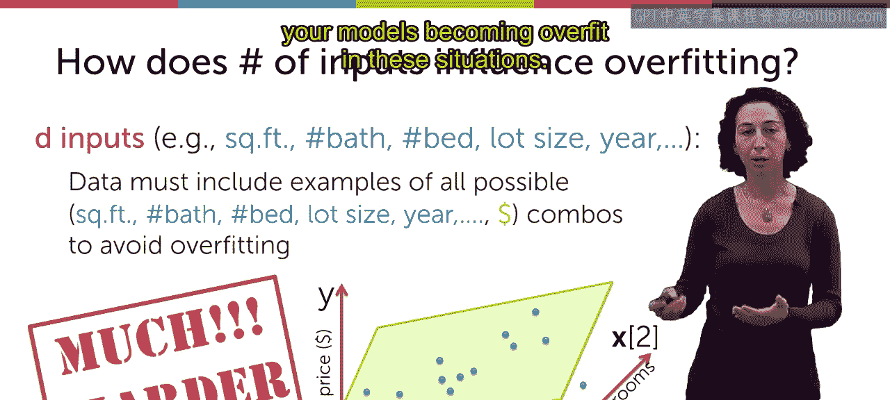

# 华盛顿大学《机器学习（回归，第2课⧸共4课）｜Machine Learning》中英字幕 p65 65_更一般的多元回归模型的过拟合.zh_en -BV11b421H7XL_p65-

。

So we just saw a demo of overfitting in the context of polynomial regression。

 but this issue is something that we see much more generally in complex models and it's not specific just to polynomial regression so in particular we can also face this issue of overfitting when we get lots and lots of inputs so for example in our housing data if we fit a model that has square feet number bathrooms number bedrooms lot size year built in a massive list of possible features that represents a very flexible model that can run into the same issues that we saw in our demo for polynomial regression or more generally we can say just if we have lots of features so we'll say that capital D is very large and this could be different functions of our input but when you include lots and lots of these functions of our inputs in our regression model then again we're in this place where the model has a lot of flexibility to explain the data and we're subject to becoming overfi。

But this issue of overfitting with respect to increasing model complexity is really relative to how much data that we have。

 so let's talk about overfitting as a function of the number of observations we have。

 as well as a function of the number of inputs or the complexity of the model。So in particular。

 if we have very few observations， n is small， then our models can rapidly become overfit to the data because we have only a few points and as we're increasing our model complexity like the order of the polynomial。

 it becomes very easy to hit all of our observations。

 but in between where we have those observations， things can go very wild。On the other hand。

 if we have lots and lots and lots of observations， even with really， really complex models。

We're not going to as quickly become overfit because we have dense observations across our input。

 so the function is pinned down basically everywhere in this example as a function of square feet and it's not able to hit every observation。

 it's not able to do these really crazy wigggly things。Okay， so on the other hand。

 when we have just one input。Like number of square feet of a house。In order to avoid overfitting。

 we need to have observations that are very dense across a number of square feet。

 so we need to have lots of representative examples of square feet and house value pairs。嗯。

So this is actually pretty hard to do to have lots of examples of houses of every possible square feet that you might see。

 so this is already a hard problem， but it becomes even harder when I increase the number of inputs in my model so for example。

 just think of a model where I have square feet and number of bathrooms。

And I want to cover all possible combinations of those two inputs in order to provide representative examples and avoid overfitting well that's really really hard but now imagine a model where you have square feet number of bathrooms。

 number of bedrooms lot size year and a massive list of features and if you want to cover all possible combinations of these things that you might see that's really really basically impossibly hard to do so this is a much much harder problem and you're much more subject to your models becoming overfi in these situations。

