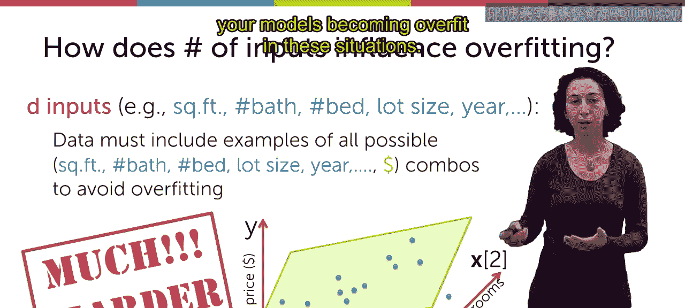

# 机器学习：第2课：更一般的多元回归模型中的过拟合

在本节课中，我们将探讨过拟合问题，它不仅仅存在于多项式回归中，在包含大量输入特征的复杂多元回归模型中同样普遍存在。我们将分析过拟合如何与数据量及模型复杂度相关联，并理解为何在高维特征空间中避免过拟合尤为困难。

## 过拟合在复杂模型中的普遍性

上一节我们通过多项式回归演示了过拟合现象。然而，过拟合问题在更广泛的复杂模型中都可能出现，并非多项式回归所独有。

具体而言，当我们的模型包含大量输入特征时，同样会面临过拟合问题。例如，在房价预测数据中，如果我们拟合一个包含房屋面积、浴室数量、卧室数量、地块大小、建造年份等一长串可能特征的模型，这个高度灵活的模型就会遇到与多项式回归演示中相同的问题。

更一般地说，只要特征数量（用大写 **D** 表示）非常大，就可能出现过拟合。这些特征可以是原始输入的不同函数变换。当回归模型中包含了大量这些输入的函数时，模型就拥有了极大的灵活性来解释数据，从而容易变得过拟合。

## 数据量与模型复杂度的平衡

但是，模型复杂度增加导致的过拟合问题，实际上与我们拥有的数据量密切相关。接下来，我们将过拟合视为观测数据数量（n）以及输入特征数量（模型复杂度）的函数来讨论。

具体来说：
*   如果观测数据很少（**n 很小**），我们的模型会迅速对数据过拟合。因为我们只有少数几个数据点，随着模型复杂度（如多项式阶数）增加，模型可以轻易地穿过所有观测点，但在这些点之间，函数形态可能会变得非常怪异且不切实际。
*   另一方面，如果我们拥有**海量的观测数据**，即使模型真的非常复杂，也不会那么快出现过拟合。因为输入空间中被密集的观测数据所覆盖，函数在整个区域内基本上都被“固定”住了。在这个以房屋面积为输入的例子中，模型无法穿过每一个观测点，也就无法产生那些极其疯狂的、曲折的波动。

## 高维空间带来的挑战

另一方面，当我们仅有一个输入（例如房屋面积）时，为了避免过拟合，我们需要在该输入（面积）的取值范围内拥有密集的观测数据。也就是说，我们需要大量具有代表性的（面积，房价）配对样本。

实际上，要获得你可能见到的每一种可能面积的房屋的大量例子，这已经相当困难了。然而，当我增加模型中的输入特征数量时，这个问题会变得**更加困难**。

例如，考虑一个包含房屋面积和浴室数量的模型。为了提供具有代表性的样本并避免过拟合，我需要覆盖这两个输入所有可能的组合，这已经非常非常困难了。

现在，请想象一个包含房屋面积、浴室数量、卧室数量、地块大小、建造年份以及一长串特征的模型。如果你想覆盖所有这些特征所有可能出现的组合，这基本上是不可能完成的艰巨任务。因此，这是一个困难得多的问题，在这些情况下，你的模型**更容易**变得过拟合。

## 总结

本节课中，我们一起学习了过拟合在一般多元回归模型中的表现。我们认识到过拟合是模型复杂度和可用数据量之间不平衡的结果：数据不足时，复杂模型极易过拟合；而充足的数据可以在一定程度上约束复杂模型的行为。更重要的是，我们理解了随着特征维度（D）的增加，要获得能充分覆盖整个特征空间的代表性数据变得异常困难，这使得高维模型尤其容易受到过拟合的威胁。这为后续介绍正则化等应对过拟合的技术奠定了基础。