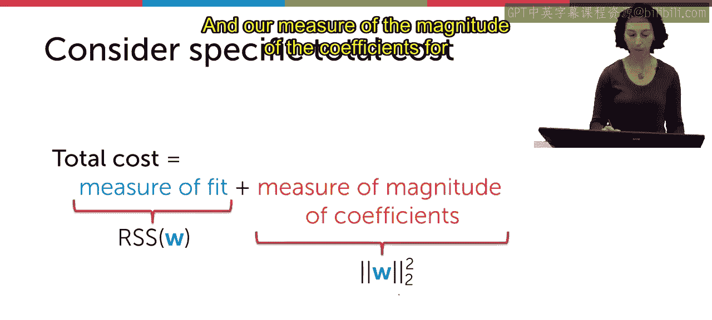

# 华盛顿大学《机器学习（回归，第2课⧸共4课）｜Machine Learning》中英字幕 p66 66_平衡拟合和系数大小.zh_en -BV11b421H7XL_p66-

。

So now let's talk about a way to automatically address this issue by modifying the cost term that we're minimizing when we're addressing how good our fit is。

Okay， so in particular we're looking at this orange box， this quality metric。

 and before our quality metric just depended on the difference between our predicted how sales price and our actual house sales price。

 in particular we're looking at residual sum squares for a measure of fit。

 but now we're going to modify this quality metric to also take into account a measure of the complexity of the model。

 in particular in order to biass towards simpler models。

So when we're thinking about defining this modified cost function。

 what we're going to want to do is balance between how well the function fits the data and a measure of how complex or how potentially overfit the model is。

 and what do we see as an indicator of that？The magnitude of our estimated coefficients。

So what we're going to balance between is the fit of the model to the data and the magnitude of the coefficients of the model Okay。

 so we can write down a total cost that has these two terms where this is our new measure of the quality of the fit。

And when I say measure a fit here， what I mean is that a small number indicates that there's a good fit to the data。

And on the other hand， the measure of the magnitude of the coefficients， if that number is small。

 that means the size of the coefficients are small and we're unlikely to be in the setting of a very overfit model。

Okay， so clearly we want to balance between these two measures because if I just optimize the magnitude of the coefficients。

 well I'd set all the coefficients to zero and that would sure not be overfit but it also would not fit the data well so that would be a very high bias solution on the other hand if I just focused on optimizing the measure fit。

 that's what we did before， that's the thing that was subject to becoming overfit in the face of complex models。

 so somehow we want to treat off between these two terms and that's what we're going to discuss now。

Okay， well what's our measure of fit at this point you guys should be pretty sick of hearing me say this it's our residual sum of squares which I've written here and hopefully this formula is quite familiar to you at this point。

 but sometimes we also write it as follows where remember this is our，Predicted。Value。Using。

W in our model to make these predictions。And just remember that。A small。

Residual sum of squares is indicative of the model。Fitting the training data well。

So just as we said on the previous slide， when we're thinking about measure of fit。

 a small number is going to indicate a good fit。Okay。

 so now what we need is a measure of the magnitude of the coefficients。

 so what summary number might be indicative of the size of the regression coefficients？Well。

 maybe you think about just summing all the coefficients together。

Is this going to be a good measure of the overall magnitude of the coefficients？

Probably not in a lot of cases because you might end up with a situation where let's say W zero is。

1527301 and W1 is。- 1605253。Well， if you look at， and let's say W0 and W1。

 the only two coefficients in our model， if I look at w0。Plus w1。

 this is going to be some small number。Despite the fact that each of the coefficients themselves were quite large Okay。

 so you might say I know how to fix this， I'll just look at the absolute value。

 so maybe what I'll do is I'll look at。absolutebsolute value。W0。Plus， W1 plus all the way up to。WD。

And this is。I'll just write this compact pack sum from J equals zero to capital D。

 the number of features we have。Absolute value of WD， sorry， WJ。And this。

Is defined to be equal to what's called the one norm of the vector of coefficients W。So we write it。

 so this is a vector， I'll try and make this。A thick font here。Sub one， and this is called。L1 norm。

And。This is actually a very reasonable choice and we're going to discuss this more in the next module。

But for now， the thing that we're going to consider。

Is to consider the sum of the squares of the coefficient。

 So W0 squared W1 squared all the way up to W D squared。

 So this is the sum J equals 0 to capital D of W J squared。And this is defined to be equal to。

We've actually seen this norm。Many times in this class so far， it's the two norm squared。

So this is called our L2 norm or really the L2 norm squared。

 and this is going to be the focus of this module。Okay。So again， what we have。

 just to summarize is we have our total cost is a sum of the measure of fit。

Plus a measure of the magnitude of coefficients， and we said our measure of fit is our residual sum of squares。

 and our measure of the magnitude of the coefficients for this module is going to be this two norm of the W vector squared。

