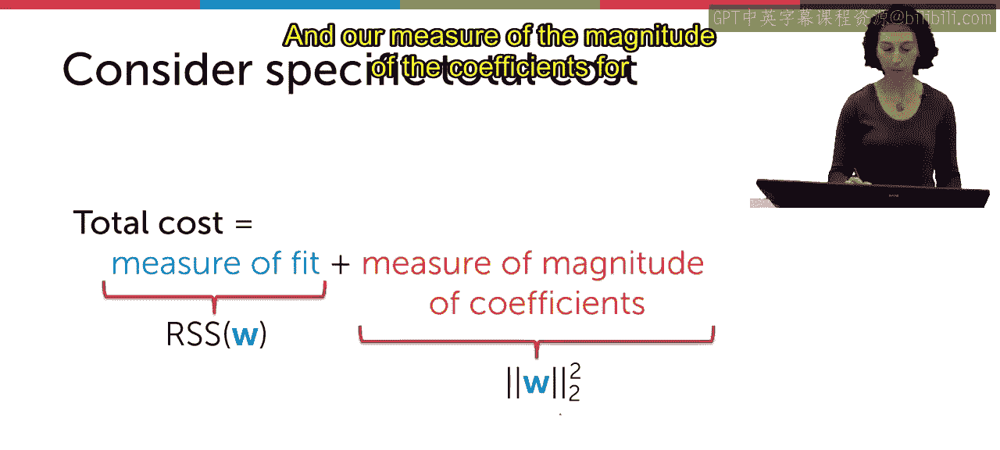

# 机器学习：第2课：平衡拟合与系数大小 ⚖️

在本节课中，我们将学习如何通过修改成本函数，来自动解决模型过拟合的问题。我们将引入一个平衡模型拟合优度与模型复杂度的新方法。

## 概述

上一节我们讨论了过拟合问题，即模型在训练数据上表现很好，但在新数据上表现不佳。本节中，我们来看看如何通过修改成本函数来避免过拟合。核心思想是，在衡量模型好坏时，不仅要看它对数据的拟合程度，还要考虑模型本身的复杂度，特别是回归系数的大小。

## 修改成本函数

我们之前衡量模型质量的指标，只依赖于预测房价与实际房价之间的差异，具体使用的是残差平方和。现在，我们将修改这个质量指标，使其同时考虑模型复杂度的度量，目的是偏向于更简单的模型。

定义这个修改后的成本函数时，我们需要在函数对数据的拟合程度与模型复杂度（或潜在过拟合程度）的度量之间取得平衡。那么，什么可以作为复杂度的指标呢？答案是：我们估计的系数的大小。

因此，我们要平衡的是模型对数据的拟合度与模型系数的大小。我们可以写出一个包含这两项的总成本，其中一项是我们新的拟合质量度量。

这里所说的“拟合度量”，数值越小表示对数据的拟合越好。另一方面，“系数大小度量”，如果数值小，则意味着系数的大小很小，我们不太可能处于一个严重过拟合的模型中。

显然，我们需要在这两个度量之间取得平衡。因为如果我只优化系数大小，我会将所有系数设为零，这当然不会过拟合，但也不能很好地拟合数据，这将是一个高偏差的解。另一方面，如果我只专注于优化拟合度量，那就是我们之前所做的，在面对复杂模型时容易导致过拟合。因此，我们需要在这两项之间进行权衡。

## 拟合度量：残差平方和

我们当前的拟合度量是残差平方和，公式如下：

`RSS(w) = Σ (yi - ŷi)^2`

其中，`ŷi` 是使用参数向量 `w` 的模型做出的预测值。有时我们也写作：

`RSS(w) = Σ (yi - f(xi))^2`

请记住，**残差平方和越小，表明模型对训练数据的拟合越好**。正如上一张幻灯片所说，对于拟合度量，数值小表示拟合好。

## 系数大小度量

现在我们需要一个系数大小的度量。什么汇总数字可以表示回归系数的大小呢？你可能会想直接对所有系数求和。

但这在很多时候并不是一个好的度量，因为你可能会遇到这样的情况：假设 `w0 = 1527301`，`w1 = -1605253`。如果模型中只有这两个系数，那么 `w0 + w1` 会是一个很小的数，尽管每个系数本身都很大。

你可能会说，我知道如何解决，我可以看绝对值。也许我会看：

`|w0| + |w1| + ... + |wD|`

这可以紧凑地写为 `Σ |wj|`，其中 `j` 从 0 到特征数量 `D`。这被定义为系数向量 `w` 的 **L1 范数**，记作 `||w||₁`。

这是一个非常合理的选择，我们将在下一个模块中详细讨论。但现在，我们将考虑另一种度量：系数平方和。

即 `w0² + w1² + ... + wD²`，也就是 `Σ wj²`。这被定义为 **L2 范数的平方**，记作 `||w||₂²`。这将是本模块的重点。

## 总成本函数

总结一下，我们的总成本是拟合度量与系数大小度量的和。我们说过，拟合度量是残差平方和，而本模块中系数大小的度量将是系数向量 `w` 的 L2 范数的平方。

因此，新的总成本函数可以表示为：

`总成本(w) = RSS(w) + λ * ||w||₂²`

其中，`λ` 是一个控制两项权重的超参数。

## 总结

本节课中，我们一起学习了如何通过修改成本函数来平衡模型的拟合优度与复杂度，从而对抗过拟合。我们引入了残差平方和作为拟合度量，并引入了系数向量的 L2 范数平方作为复杂度惩罚项。通过在这两者之间进行权衡，我们可以引导模型找到既不过于简单（高偏差）也不过于复杂（高方差）的解决方案。在接下来的课程中，我们将深入探讨基于这个新成本函数的具体优化方法。