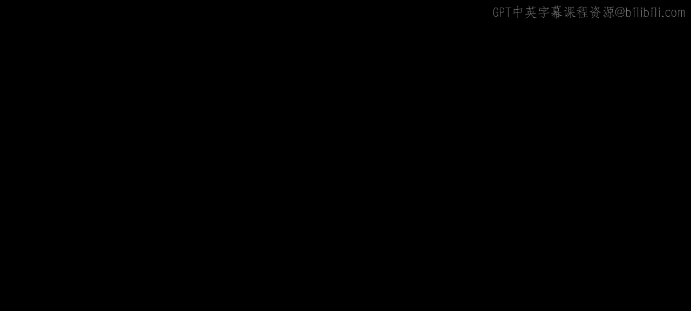
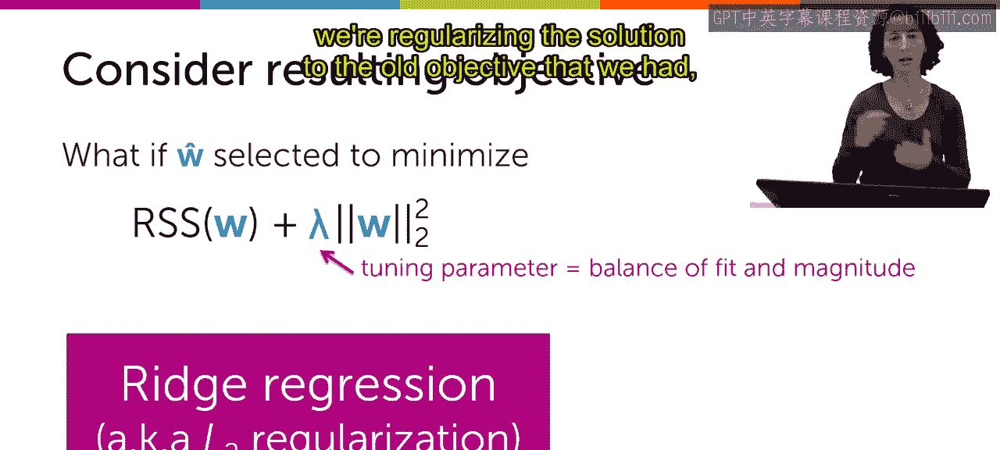

# 华盛顿大学《机器学习（回归，第2课⧸共4课）｜Machine Learning》中英字幕 p67 67_岭回归目标及其极端解.zh_en -BV11b421H7XL_p67-

。

Okay， so let's consider the resulting objective where I'm going to try and search over all possible W vectors to find the ones that minimize the sum of residual sum of squares plus the square of the2 norm of W。

So that's going to be my W hat， my estimated model parameters。

 but really what I'd like to do is I'd like to be able to control how much I'm weighing the complexity of the model as measured by this magnitude of my coefficients relative to the fit of the model I like to balance between these two terms and so I'm going to introduce another parameter and this is called a tuning parameter of the model and it's a lambda and this is balancing between this fit and magnitude。

So let's see what happens if I choose lambmbda to be zero。Well， if I choose lambda to be zero，0。

 this magnitude term that we've introduced completely disappears and my objective reduces down just to minimizing the residual sum squares。

 which was exactly the same as my objective before。So。This reduces。2。Minimizing。

Residual sum of squares of W。As before。So this is our old solution。

Which leads to some W hat that I'm going to call W hat。Superscript LS for。Least squares。

Because what we were doing before is commonly referred to as the least square solution。

 so I'm going to specifically represent the parameters associated with that old procedure we're doing as the least squares parameters。

On the other hand， what if I completely crank up that tuning parameter to be infinity？

So I have a really， really massively large weight on this this magnitude term。

 massively large being infinitely large。So as large as you can possibly imagine。

So what happens to any solution？Where W hat is not equal to zero。So。Four solutions。Where。

W hat does not equal zero。Then the total cost is what？

Well I get something that's non zero times infinity plus something， my residual sum squares。

 whatever that happens to be， but the sum of that is infinity。Okay， so my total cost is infinite。

On the other hand， what if W had is exactly equal to zero？Then。If W hat equals zero。Then， total。

Cost is equal to the residual sum of squares of this zero vector。And that's some number。

But it's probably not infinity， actually it's not infinity。

 so the minimizing solution here is always going to be W hat equals zero。

Because that's the thing that's going to minimize the total cost over all possible Ws。Okay。

 so just to recap， we said that if we。Put that tuning parameter all the way to zero， make it very。

 very small， all the way to zero， then we return to our previously square solution。

 and if we crank that parameter all the way up to be infinite in that limit。

 we get all of our coefficients being exactly zero。Okay。

But we're going to be operating in a regime where lambmbda is somewhere in between zero and infinity。

And in this case。Then we know that the magnitude。Of our coefficients。Of our estimated coefficients。

 it's going to be。They're going to be less than or equal to the magnitude of our least squares coefficients。

In particular， the two norm。Will be less than。But we also know it's going to be greater than or equal to zero。

 so we're going to be somewhere in between these two regions。嗯。

And a key question is what lambda do we actually want。

 how much do we want to bias away from our least square solution。

 which was subject to potentially overfitting down to this really simple。

 the most trivial model you can consider which is nothing no model so well not no model。

 no coefficients in the model， what's the model， if all the coefficients are zero， just noise。

 we just have y equals epsilon， that noise term。Okay。

So we're going to think about somehow trading off between these two extremes。Okay。

 I wanted to mention that this is referred to as Rige regression。

 and that's also known as doing L2 regularization because for reasons that we'll describe a little bit more later in this module。

 we're regularizing the solution to the old objective that we had using this L2 norm term。

