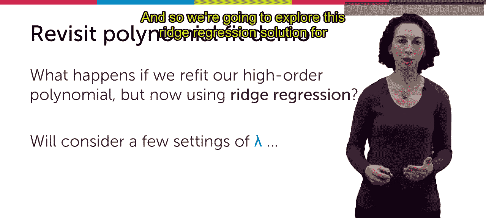

# 华盛顿大学《机器学习（回归，第2课⧸共4课）｜Machine Learning》中英字幕 p68 68_岭回归如何平衡偏差和方差.zh_en -BV11b421H7XL_p68-

。

Okay， let's talk about this in the context of the bias variance tradeoff and what we saw is when we had very large lambda。

 we had a solution with very high bias but low variance。

 and one way to see this is that is thinking about when we're cranking lambda all the way up to infinity in that limit we get coefficients shrunk to be zero and clearly that's a model with high bias but low variance。

 it's completely low variance it doesn't change no matter what data you give me。On the other hand。

 when we had very small lambda， we have a model that has low bias but high variance and to see this。

 think about setting lambda to zero， in which case we get out just our old solution。

 our old least squares are minimizing residual sum squares fit and there we see that for high complexity models。

 clearly you're going to have low bias but high variance。

So what we see is this lambda tuning parameter controls our model complexity and controls this bias variance trade off。

Okay， so let's return to our polynomial regression demo。

 but now using Rige regression and see if we can ameliorate the issues of overfitting as we vary the choice of Lambda。

 and so we're going to explore this Rige regression solution for a couple different choices of this lambda tuning parameter。

