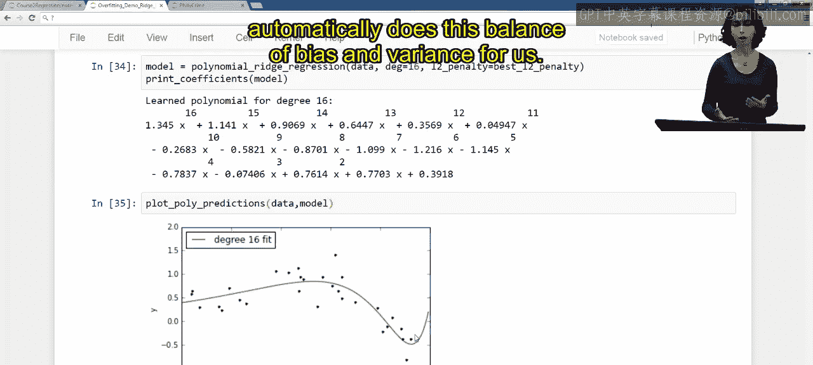

# 华盛顿大学《机器学习（回归，第2课⧸共4课）｜Machine Learning》中英字幕 p69 69_岭回归演示.zh_en -BV11b421H7XL_p69-

。

So here we are back at our polynomial regression demo and remember when we're just doing least squares estimation。

Let's just quickly scroll through this remember we had this data generated from a s function and when we went to fit a degree2 polynomial。

 things looked pretty reasonable。G4 started looking a bit wiggglier， larger estimated coefficients。

 and a degree 16 looked really wiggly and had these massive， massive coefficients。Okay。

 but now let's get to our Rige regression where we're just going to take our polynomial regression function and modify it and using graphLb create it's really simple to do the ridge regression modification because as we mentioned before。

 there's this L2 penalty input to dot linear regression and before when we're doing just least squares。

 we set that L2 penalty equal to zero and this is this lambda value that we're talking about in trading off between fit and model complexity。

 so here though we're going to actually specify a value for this penalty。

And that's the only modification that we have to make in order to implement Rige regression using GraphLb C。

 but again， in the assignments for this course， you're going to explore implementing these methods yourself。

Okay， so let's go and define this polynomial ridge regression function and then we're just going to go through and explore performing a fit of this really high order polynomial。

 this 16th order polynomial that had that very wgggly fit crazy coefficients associated with it。

 but now looking at solving the ridge regression objective for different values of lambmbda。

 so to start with let's consider a really really small lambda value。

 so a very small penalty on the two norm of the coefficients。

And what we'd expect is that the estimated fit would look very similar to the standard least squares case。

And if we look at the plot， this figure looks very。

 very similar if I scroll up quickly to the fit we had doing just standardly squares。

 so that checks out to what we know should happen， and likewise the coefficients are still these really。

 really massive numbers。Okay， but what if we increase the strength of our penalty。

 so let's consider a very large L2 penalty here we're considering a value of 100。

 whereas in the case above we were considering a value 1 e to the minus 25， so really really tiny。

Okay。Well， in this case。We end up with much smaller coefficients， actually， they look really。

 really small， so let's look at what the fit looks like。And we see a really。

 really smooth curve and very flat actually probably way too simple of a description for what's really going on in the data。

 it doesn't seem to capture this trend of the data the values increasing and then decreasing it just gets a constant fit followed by a decrease。

 so this seems to be underfi and so as we expect。What we have is that when lambmbda is really。

 really small， we get something similar to our least square solution， and when lambda becomes really。

 really large， we start approaching all the coefficients going to zero。Okay。

 so now what we're going to do is look at the fit as a function of a series of different lambda values going from our 1 e to the minus 25 all the way up to the value of 100。

 but looking at some other intermediate values as well to look at what the fit and coefficients look like as we increase lambmbda so we're starting with these crazy。

 crazy large values。By the time we're at 1 e to the minus 10 for lambda。

The values have decreased by two orders of magnitude， so we have times 10 to the fourth now。

 then we keep increasing lambda  one e to the minus6。

 and we get values on the order of hundreds for our coefficients。In terms of reason of these values。

 I'd say that these start looking a little bit more realistic and then we keep going and you see that the value of the coefficients keep decreasing and when we get to this value of lambda that's 100。

 we get these really small coefficients。But now let's look at what the fits are for these。

different lambda values and here's the plot that we've been showing before for this really small lambda。

 increasing the lambda bit， smoother fit still pretty wiggly and crazy especially on these boundary points。

Increase lambda more things start looking better when we get to one e to the minus3。

 this looks pretty good， you know， especially here it's hard to tell whether the function should be going up or down I want to emphasize that app boundaries where you have few observations it's very hard to control the fit so we believe much more the fit in intermediate regions of our X range where we have observations。

Okay， but then we get to this really large lambda and we see that clearly we're oversming across the data。

So a natural question is out of all these possible lambmbda values we might consider and all the associated fits。

 which is the one that we should use for forming our predictions well it' would be really nice if there is some automatic procedure for selecting this lambmbda value instead of me having to go through。

 specify a large set of lambdas look at the coefficients。

 look at the fit and somehow make some judgment call about which one I want to use。Well。

 the good news is that there is a way to automatically choose lambmbda and this is something that we're going to discuss later in this module so one method that we're going to talk about is something called leave one out cross validation and what leave one out cross validation does is it approximates so minimizing this leave one out cross validation error that we're going to talk about approximates minimizing the average mean squared error in our predictions so。

What we're going to do here is we're going to define this leave one out cross validation function and then apply it to our data and。

This leave one out cross validation function， you're not going to understand what's going on here yet。

 but you will， by the end of this module， you'll be able to implement this method yourself。

But what it's doing is it's looking at prediction error of different lambda values and then choosing one to minimize。

 but of course we're not looking at that on the training error or on the sorry on the training set or the test set or using a validation set。

 but in a very specific way。Okay。Now that we've applied this。

 leave one out function to our data in some set of specified penalty values。

We can look at what the plot of this leave one out cross validation error looks like as a function of our considered lambmbda values and in this case we actually see a curve that's pretty flat in a bunch of regions and what this means is that our fits are not so sensitive to this choice of lambda in these regions but there is some minimum and we can figure out what that minimum is。

Here so here we're just selecting the lambda that has the lowest crossvalidation error and then we're going to fit our polynomial ridge regression model using that specific lambda value and we're printing our coefficients and what you see we have very reasonable numbers。

 things on the order of 1。2。5 and let's look at the associated fit and things look really nice in this case。

 so there's a really nice trend in throughout most of the range of x the only place things look a little bit crazy is out here at the boundary but again at this boundary region we actually don't have any data to really pin down this function so considering it's a 16 order polynomial we're shrinking coefficients but we don't really have much information about what the function should do out here。

But what we've seen is that this leave one out cross validation technique really nicely selects a lambda value that provides a good fit and automatically does this balance of bias invariance for us。

