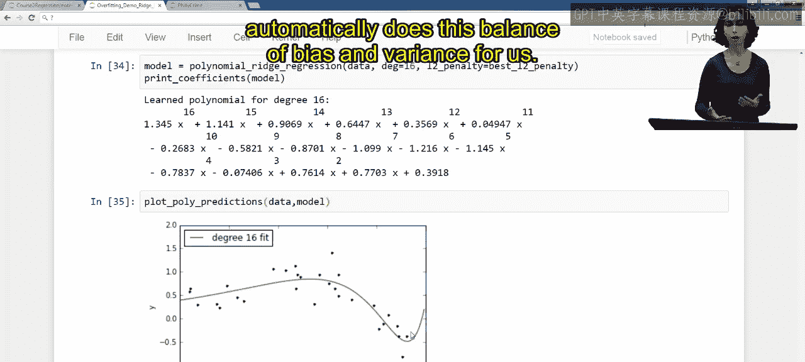

# 机器学习：第2课：岭回归演示 🧪


在本节课中，我们将学习岭回归（Ridge Regression）的核心概念，并通过一个多项式回归的演示，直观地理解如何通过调整正则化参数（λ）来平衡模型的拟合程度与复杂度。我们将看到，当λ值过小时，模型会过拟合；当λ值过大时，模型会欠拟合；而通过交叉验证技术，我们可以自动选择一个合适的λ值，以获得最佳的预测性能。

---

## 回顾最小二乘法

上一节我们介绍了多项式回归。现在，让我们快速回顾一下使用普通最小二乘法（OLS）进行拟合的情况。

我们有一组由S形函数生成的数据。当我们用2阶多项式拟合时，结果看起来相当合理。使用4阶多项式时，拟合曲线开始变得有些波动，估计的系数值也变大了。而当我们使用16阶多项式时，拟合曲线变得非常曲折，并且产生了巨大的系数值。


## 引入岭回归

本节中，我们来看看如何将普通多项式回归修改为岭回归。使用GraphLab Create库实现这一点非常简单，因为`linear_regression`函数自带一个L2惩罚项（正则化项）的参数。

在之前进行最小二乘估计时，我们将这个L2惩罚参数设置为零。这个参数正是我们之前讨论的，用于权衡拟合优度与模型复杂度的λ值。现在，为了实现岭回归，我们只需要为这个惩罚参数指定一个非零值。

以下是实现多项式岭回归函数的核心代码修改部分：

```python
# 最小二乘法（λ=0）
model_ols = graphlab.linear_regression.create(features, target, l2_penalty=0)

# 岭回归（λ>0）
model_ridge = graphlab.linear_regression.create(features, target, l2_penalty=lambda_value)
```

在本课程的作业中，你将有机会自己动手实现这些方法。

## 探索不同λ值的影响

接下来，我们将用这个16阶多项式模型进行岭回归拟合，并观察不同λ值对结果的影响。

### 极小的λ值（λ = 1e-25）

首先，我们考虑一个非常小的λ值，即对系数向量的L2范数施加的惩罚非常轻微。

我们预计此时的拟合结果会与标准最小二乘法的情况非常相似。查看绘图结果证实了这一点：拟合曲线与之前OLS的拟合曲线几乎完全相同，系数也仍然是那些巨大的数值。这与我们的预期相符。

### 极大的λ值（λ = 100）

接着，我们考虑一个非常大的L2惩罚，这里设置λ为100。

在这种情况下，我们得到的系数变得非常小。拟合曲线变得非常平滑，甚至近乎一条直线，这显然过于简单，无法捕捉数据中先上升后下降的趋势，出现了欠拟合。

这验证了我们的理论：当λ极小时，解接近最小二乘解；当λ极大时，所有系数都趋向于零。

### 中间范围的λ值

现在，我们系统地观察λ值从1e-25逐步增加到100的过程中，拟合效果和系数的变化。

以下是不同λ值对应的系数大小和拟合曲线的变化趋势：

*   **λ = 1e-25**： 系数极大，曲线极度曲折（过拟合）。
*   **λ = 1e-10**： 系数值下降了约两个数量级，但仍很大。
*   **λ = 1e-6**： 系数值降至百位量级，开始看起来更合理一些。
*   **λ = 1e-3**： 拟合曲线看起来相当不错，尤其在数据密集的中间区域。
*   **λ = 100**： 系数极小，曲线过于平滑（欠拟合）。

在边界区域，由于观测数据稀少，很难控制拟合行为，因此我们更应相信在X值范围内有大量观测数据的中间区域的拟合结果。

一个很自然的问题是：在这么多可能的λ值和对应的拟合模型中，我们应该选择哪一个来做出预测？

## 自动选择λ：留一法交叉验证

手动遍历大量λ值并凭经验判断显然效率低下。好消息是，存在自动选择λ值的方法，我们将在本模块后续内容中详细讨论。

其中一种方法叫做**留一法交叉验证**。这种方法通过近似最小化预测的平均均方误差，来为我们选择最优的λ值。

我们定义一个留一法交叉验证函数并将其应用于数据。目前你无需理解其具体实现，在本模块结束时，你将能够自己实现这个方法。它的核心思想是评估不同λ值下的预测误差，并选择误差最小的那个λ，而且它评估误差的方式非常特殊，既不是用训练集，也不是用简单的测试集或验证集。

应用该函数后，我们可以绘制出交叉验证误差随λ值变化的曲线。在本例中，曲线在某些区域相当平坦，这意味着在这些区域内拟合结果对λ的选择不敏感。但曲线存在一个明确的最低点，我们可以找到它。

以下是选择过程的核心步骤：

1.  计算一系列λ值对应的留一法交叉验证误差。
2.  选择误差最小的λ值。
3.  使用该λ值重新拟合岭回归模型。

```python
# 伪代码：选择最佳lambda
best_lambda = lambda_values[argmin(cross_validation_errors)]
model_best = graphlab.linear_regression.create(features, target, l2_penalty=best_lambda)
```

使用最佳λ值拟合后，我们得到了数量级非常合理（如1， 2， 5）的系数。其对应的拟合曲线在整个X范围的大部分区域内都呈现出良好的趋势。只有在边界处，由于缺乏数据约束，曲线表现仍有些不确定，但考虑到我们使用的是16阶多项式且系数已被收缩，这在意料之中。



## 总结


本节课中，我们一起学习了岭回归的实战应用。我们通过演示看到：
*   **λ的作用**： λ控制着正则化的强度，过小导致过拟合，过大导致欠拟合。
*   **自动调参**： 留一法交叉验证是一种有效的自动选择最优λ值的方法，它帮助我们在偏差与方差之间取得平衡，从而获得泛化能力更佳的模型。
*   **实践结果**： 通过交叉验证选出的λ，我们成功用一个高阶多项式模型得到了平滑、合理且预测性能良好的拟合结果，避免了过拟合的陷阱。