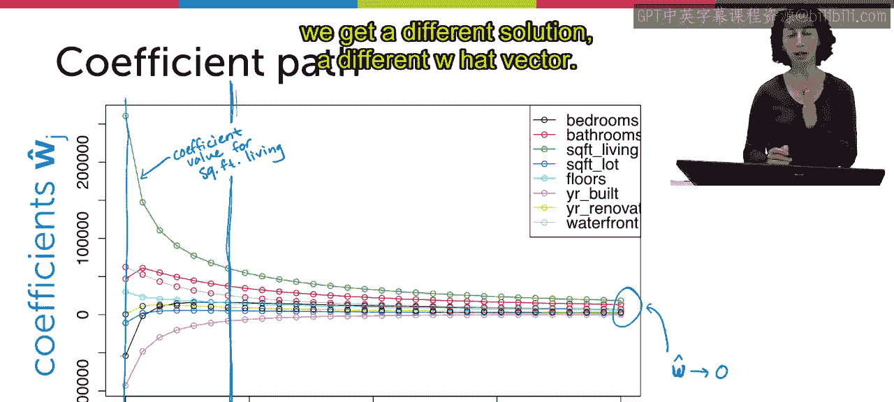

# 华盛顿大学《机器学习（回归，第2课⧸共4课）｜Machine Learning》中英字幕 p70 70_岭回归系数路径.zh_en -BV11b421H7XL_p70-

。

Well， we've motivated analytically how the coefficients that we get when solving this Rige regression problem are going to change for different settings of lambmbda。

 specifically we saw that when lambmbda was zero， we get our least square solution when lambda goes to infinity。

 we get very， very small coefficients approaching zero and in between we get some other set of coefficients。

 and then we explore this experimentally in this polynomial regression demo。

 but one thing that's interesting to draw is what's called the coefficient path for Rige regression。

 which shows as you very lambda。All the way from zero up towards infinity。

How do the coefficients change so how does my solution change as a function of Lambda and what we're doing in this plot here is we're drawing this for our housing example where we have eight different features。

 number of bedrooms， bathroom， square feet of the living space number of square feet of the lot size。

 number of floors the year the house was built， the year the house was renovated and whether or not the property is waterfront。

And for each one of these different inputs to our model or different and these we're just going to use as different features we're drawing what the coefficients so this would be。

Coeicient。Value。4。Square feet living。For some specific choice of Lambda and how that coefficient varies as I increase Lambda。

 and I'm showing this for each one of the eight different coefficients。

And I just want to briefly mention that in this figure。

 we've rescaled the feature so that they all have unit norms， so each one of these different inputs。

 that's why all of these coefficients are roughly on the same scale。

 they're roughly the same order of magnitude。U。Okay。

 and so what we see in this plot is as lambda goes towards zero or when it's specifically at zero。

 our solution here。The value of each of these coefficients。

 so each of these circles touching this line， this is going to be my W hat least square solution。

And as I increase lambda。Out towards infinity。I see that my solution。W hat。Approaches zero。

 this vector of coefficients is going to zero and we haven't made lambmbda large enough in this plot to see them actually really。

 really， really， really close to zero， but you see the trend happening here。

And then there's some sweet spot in this model sorry， not in this model in this plot。

 which we're going to talk about later in this module。Oops， I shouldn't。

Draw actually hitting some of these circles at one of these considered points。

So this is going to represent。this is going to represent some lambmbda star。

Whi will be the value of lambmbda that we want to use when we're selecting our specific regularized model to use for forming predictions。

 and we're going to discuss how we choose which lambda to use later in the module。

 but for now the main point of this plot is to realize that for every value of lambda。

 every slice of this plot， we get a different solution， a different W hat vector。

