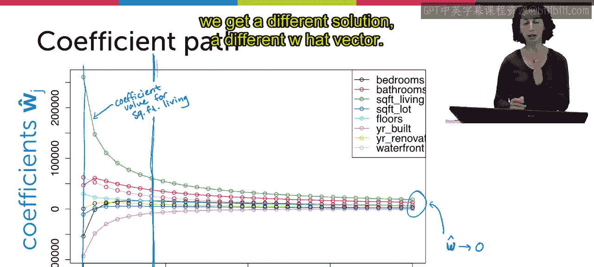

# 机器学习：第2课：岭回归系数路径 📈

在本节课中，我们将学习岭回归中一个重要的可视化工具——**系数路径**。我们将看到，随着正则化参数 λ 的变化，模型系数是如何连续变化的，并理解这背后的含义。

上一节我们介绍了岭回归如何通过惩罚项来约束模型系数的大小。本节中，我们来看看当 λ 从 0 变化到无穷大时，这些系数具体是如何演变的。

## 系数路径的概念

系数路径图描绘了当 λ 从 0 逐渐增加到无穷大时，岭回归模型中每一个系数值的变化轨迹。

具体来说，我们之前分析过：
*   当 **λ = 0** 时，我们得到普通最小二乘解。
*   当 **λ → ∞** 时，所有系数会趋近于 0。
*   在两者之间，我们会得到一系列不同的系数解。

## 房价预测案例的可视化

我们通过一个房价预测的例子来实验性地探索这一点。该模型使用了八个特征：
*   卧室数量
*   浴室数量
*   居住面积（平方英尺）
*   地块面积（平方英尺）
*   楼层数
*   建造年份
*   翻新年份
*   是否临水

为了绘制系数路径，我们首先对特征进行了**归一化处理**，使每个特征都具有单位范数。这样，所有系数的大小就大致处于同一数量级，便于在图中进行比较。

以下是绘制系数路径的步骤说明：

1.  **初始化**：从 λ = 0 开始，计算对应的最小二乘解，得到每个特征的初始系数值。
2.  **迭代增加 λ**：逐步增大 λ 的值。
3.  **求解新系数**：对于每一个新的 λ 值，重新求解岭回归优化问题，得到一组新的系数。
4.  **绘制路径**：将每个特征对应的系数值，按照 λ 增大的顺序连接起来，形成一条条曲线。

在生成的系数路径图中，我们可以看到：
*   最左侧（λ = 0）的每个点，代表最小二乘解 `W_hat_least_squares`。
*   随着 λ 向右（增大）移动，所有系数曲线都逐渐向 0 趋近。
*   图中存在一个特定的 λ* 值（对应某个垂直切片），它可能代表模型在偏差与方差之间取得最佳平衡的点，我们将在后续课程中讨论如何选择这个最优的 λ。

## 核心要点总结

本节课中，我们一起学习了岭回归的系数路径。
*   系数路径图直观展示了正则化强度 λ 如何影响每个特征的权重。
*   当 λ 为 0 时，模型退化为无正则化的线性回归。
*   当 λ 增大时，所有系数都被“压缩”并向 0 收缩。
*   理解系数路径有助于我们把握模型复杂度与正则化之间的关系，并为后续选择最优的 λ 值奠定基础。